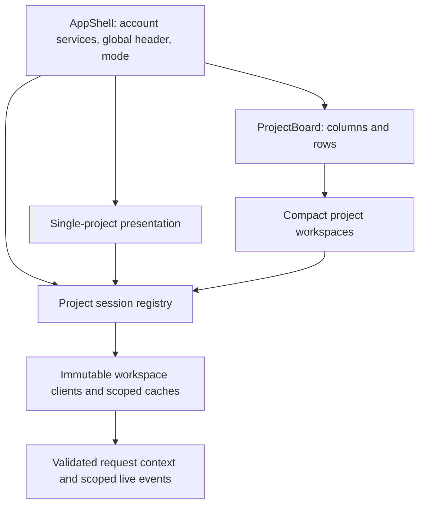

## Context

The user requested an optional multi-project desktop mode alongside the existing single-project mode. A project panel should reuse the mobile workspace structure, choose its tools independently, and share the page background and global controls. Maintainability, efficient operation, design before implementation, and a staged plan are explicit priorities.

The current client and server assume one selected root per account. `src/App.tsx` combines account services, project state, layout, and tools. `src/api/client.ts` keeps a mutable default project, and `src/utils/contentCache.ts` selects its workspace through a module variable. Several UI components inspect the browser viewport or query the whole document. On the server, `runAccountWorkspace` selects the account's active root; workspace switching persists that choice and broadcasts it to the account. Rendering multiple copies of the existing workspace would therefore not provide independent project contexts.

Worktree support also distinguishes a logical `projectPath` from the actual working root. Shared editor, agent, and terminal tabs belong to the former; file operations and caches must use the latter. A design that carries only one of these paths loses existing behavior after a worktree handoff.

## Proposed decision

Use one React application with an app shell, explicit project sessions, and reusable workspace presentation. Introduce request scope before exposing multiple live panels. Keep changes incremental and preserve the existing single-project behavior at every intermediate stage.

### Ownership boundaries

| Owner | Responsibility |
| --- | --- |
| App shell | Authentication, runtime/transport, theme, locale, account settings, project catalog, global resources, notifications, Mewpet, mode, and active project-panel identity. |
| Project session | Server-confirmed logical project and working root, request generation, tab and tree controllers, draft/save lifecycle, and subscriptions to that project's data. Sessions outlive presentation changes. |
| Workspace view | The visible tool, navigation stack, local focus, scroll, and DOM references. View identity is separate from project identity. |
| Compact workspace | The shared mobile-style header/content/Dock composition. It consumes a session and explicit presentation settings; it does not initialize another application. |
| Project board | Stable panel IDs, column/row arrangement, resize/reorder interactions, and device-local restoration. It does not read or save project files. |

A registry owns one session per open logical project in the first version. Keep controllers cohesive and expose focused interfaces rather than a single context containing every changing field. A change in one project's transcript should not rerender all other project workspaces.

### Identity and requests

Use an immutable scope concept containing the instance/account identity, logical project path, and actual workspace path. Keep UI panel IDs and request generations separate from this identity. Browser identity fields are cache boundaries, never server authorization claims; the server derives the account from authentication.

`createWorkspaceClient(scope)` binds HTTP requests, WebSocket handshakes, and DOM resource URLs to the same scope. Existing transports remain shared beneath that client. A captured request never consults the subsequently focused panel. Account-level APIs use an account client and do not inherit an arbitrary project's root.

Reuse server `AsyncLocalStorage` through one validated scope resolver. Explicit scopes take precedence over the legacy account-selected root. Reject invalid explicit scopes rather than falling back. Preserve registered-project rules for members, owner/manager folder access, feature/file permissions, protected paths, and worktree membership validation. Preserve the distinction between logical project and worktree in snapshots and later requests.

Opening or changing a panel resolves a destination and its snapshot in the same validated request context, without persisting the account's single-project selection. The snapshot's project existence and identity must come from that context. Keep the existing selection API and its broadcast semantics for compatible single-project clients during migration. Explicit panels ignore account selection changes while continuing to consume relevant account tab, catalog, permission, and theme signals. Specify the exact HTTP, socket, and resource encoding in the first implementation stage after the transport inventory; it must work through Mewlink without relying on custom headers for browser resource loads.

Preserve existing mutation preconditions, including file/task owner and workspace checks, Git owner/root headers, and upload roots. Reject contradictory scope values. Audit endpoints that independently rebind a root, such as command buttons, rather than letting a nested resolver silently override the initiating scope.

Pin live sources and mutation jobs to their captured root, while rechecking current authentication and authorization. Review both connection setup and subsequent authorization in `server/reqAuth.ts` and `server/live-sources.ts`. Root-relative event keys, including DB events currently keyed by API project name and database ID, must include actual root identity where that data is project-owned. Preserve intentionally global memo/chat services.

### State, presentation, and input

The current [account-tab contract](../development/account-tabs.md) remains authoritative for persisted tab metadata. Share cache infrastructure and its limits, but require explicit identities on cache operations. Global mutable root setters may survive only as a temporary single-project compatibility adapter; multi-project sessions must not use them.

Give workspaces an explicit presentation value, such as `docked` or `compact`. Derive compact layout from its host container, with scoped CSS or container queries where useful. Preserve actual pointer, keyboard, and touch capabilities separately: a narrow desktop panel is not a phone. Do not patch `matchMedia`, simulate a mobile user agent, or globally override viewport CSS.

Use one keyboard dispatcher with an active panel target and existing modal/remote-input priority. Scope DOM searches to the owning workspace. Namespace DOM IDs and drag payloads with view identity. A project-local overlay carries its owner and restore-focus target; global settings and account dialogs remain at the app level. Reuse overlay primitives rather than adding a second dismissal system.

Keep sessions and the selected workspace's live editor identity stable during mode changes. Reparenting or remounting an editor can lose undo, selection, or IME state even when its text was saved; validate those details before moving the mode control into normal use. Hidden views can release heavy rendering and live reads when their state has a safe owner, while drafts, save queues, and running sessions remain recoverable.

### Board geometry and storage

Use a focused column/row layout model with stable panel IDs, column widths, and row weights. It supports a narrow first panel, unused background, multiple rows, movement, and resize boundaries. Keep this model separate from tool `DockKind` and existing single-project `DockState`. Extract a shared pure geometry helper only when both consumers need the same behavior; do not introduce a general window-management framework.

Add a versioned multi-project browser record scoped to account and instance, separate from single-project desktop geometry and physical-mobile restoration. Store panel descriptors, geometry, active panel, and per-view tool selection. Keep document contents and tab ledgers in their existing owners. Normalize invalid IDs, impossible dimensions, and unknown versions conservatively; distinguish a missing record from an intentionally empty board.

This proposal extends [ADR 0134](0134-account-desktop-layout.md) with a separate optional mode. Its existing desktop geometry contract remains the single-project contract. It preserves [ADR 0133](0133-realtime-account-tabs.md). No current decision is superseded by this proposed, unimplemented design.

### Efficiency and lifecycle

Run account services once. Reuse the existing transport and root-keyed subscription/cache infrastructure; coalesce identical reads and release listeners when their last consumer leaves. Preserve one browser-session identity in active-session accounting while representing the projects it displays. Native Browser and login keep their [single account session and active viewer](../development/browser-desktop.md#permissions-profiles-and-lifecycle); project Docks invoke the shared viewer rather than creating competing attachments. Localhost app tabs retain their separate viewer/proxy contract.

Load tool code on demand. Pause hidden view rendering and reads under existing visibility rules, without stopping agents or terminals. Isolate loading failures with project-level error boundaries. Avoid per-panel copies of resource polling, authentication, theme synchronization, notification collectors, Mewpet, or storage maintenance.

Measure one, three, and ten panels before calling the implementation efficient. Record mounted heavy tools, retained listeners/subscriptions, request counts, memory, and responsiveness on a documented fixture. Shared service counts and teardown correctness are testable requirements; numerical latency and memory budgets need a measured baseline.

## Alternatives

| Alternative | Assessment |
| --- | --- |
| Render several current `EditorApp` instances | Small initial markup change, but mutable root state, global events, shortcuts, portals, and server selection remain shared. Reject as the production architecture. |
| Embed the full app in one iframe per project | Isolates browser globals and reuses viewport CSS, but still needs server request scoping. Duplicates app services and requires another lifecycle, focus, modal, fullscreen, background, and Mewlink bridge contract. Existing framing protections must not be relaxed just for this shortcut. Keep as a considered alternative. |
| Rewrite all layout and state code at once | Removes old assumptions in one change but makes compatibility failures hard to localize. Reject in favor of small verified extractions. |
| Scoped sessions and shared compact presentation | Requires more initial separation, but fixes the underlying multi-project boundary, reuses mobile tools, and centralizes global work. Recommended target. |

## Consequences and status

The foundational work crosses client APIs, caches, server request scope, live updates, input routing, and UI composition. It cannot be delivered safely as only a layout toggle. Each stage must remain compatible with the existing application; multi-project mode stays unexposed until the independence tests pass.

This ADR records the recommended design, not implementation or verification. The [feature](../features/appearance-accounts-operations/multi-project-mode.md) owns behavior and design defaults. The [work plan](../work/multi-project-mode.md) owns staging, exit criteria, and actual evidence. Change this status when the scope contract and implementation are established.
