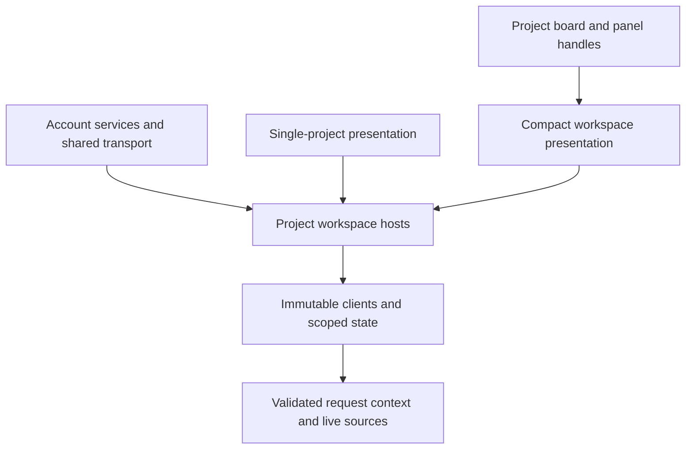

## Context

The user requested an optional multi-project desktop mode alongside the existing single-project mode. A project panel reuses the mobile workspace structure, selects its tools independently, and shares the page background and global controls. Maintainability, efficient operation, design before implementation, and a staged plan are explicit priorities. The later interaction decision uses a dedicated handle to move a project panel, preserving the project name as its selection action.

Before this change, client APIs and server defaults assumed one selected root per account. `src/App.tsx` combined account services, project state, layout, and tools. `src/api/client.ts` kept a mutable default project, and `src/utils/contentCache.ts` selected its workspace through a module variable. Several UI components inspected the browser viewport or queried the whole document. Server workspace switching persisted account selection and broadcast it to that account. Repeating the unmodified workspace component could therefore route one project's requests or callbacks through another project's selection.

Worktree support distinguishes a logical `projectPath` from the actual working root. Shared editor, agent, and terminal tabs belong to the former; file operations and caches use the latter. Carrying only one path loses that distinction after a worktree handoff.

## Decision

Use one React application with shared account services, explicit workspace clients and state ownership, and reusable workspace presentation. Preserve legacy single-project APIs through an adapter while migrating concurrent views to captured scopes. Keep the changes incremental so request isolation can be checked before relying on the board UI.

### Ownership boundaries

| Owner | Responsibility |
| --- | --- |
| Account/application shell | Authentication, runtime/transport, theme, locale, account settings, project catalog, global resources, notification collection, Mewpet, and shared native Browser. |
| Project workspace | Confirmed logical project and actual working root, request generations, tab/tree controllers, drafts and saves, and subscriptions to that project's data. |
| Workspace view | Visible tool, navigation stack, local focus, scroll, DOM root, and explicit compact presentation. View identity remains separate from project identity. |
| Project board | Stable panel IDs, columns/rows, handles, resizing, active-panel targeting, and device-local restoration. File I/O stays with the workspace. |

The [scoped workspace contract](../development/workspace-sessions.md) owns the implemented request encoding, validation, client/cache boundaries, live/event behavior, compact presentation interface, and current database restriction. Keep those details in that canonical source. The [feature](../features/appearance-accounts-operations/multi-project-mode.md) owns panel behavior and defaults; the [workspace layout contract](../development/ui-workspace-layout.md) owns geometry and restoration.

### Implementation choices

`createWorkspaceClient(scope)` captures actual and logical paths for HTTP, resource URLs, and sockets. Existing transports remain shared beneath those clients. The server resolves explicit scopes through one validated `AsyncLocalStorage` boundary and retains its authorization rules. Explicit destination preparation returns a snapshot without changing account selection; legacy selection keeps its existing persistence and signals.

Scoped cache operations share bounded infrastructure. Document mutation coordinators and task-document handlers retain workspace ownership. File collaboration and live resource delivery retain captured roots, while account tab metadata remains under [ADR 0133](0133-realtime-account-tabs.md). Global mutable root setters survive only in the compatibility adapter.

Use `WorkspaceViewProvider` and scoped compact CSS to reuse the mobile composition. Keep pointer, keyboard, touch, and viewport capabilities separate from presentation. Scope DOM searches and input targets to the owning view. Project-local overlays retain their owner, and account services stay above views. A project panel's dedicated handle owns movement; the feature contract defines project-name selection and close behavior.

Store board descriptors and geometry separately from the existing single-project desktop and physical-mobile records. This extends [ADR 0134](0134-account-desktop-layout.md) with an optional mode. It preserves that decision's single-project desktop geometry and the existing account tab ledgers; neither decision is superseded.

### Compatibility and incomplete boundaries

Explicit Postgres access is currently blocked because the shared pool/catalog has not completed its root-isolation migration. Root-keyed DB events do not establish catalog isolation. The [current Postgres restriction](../development/workspace-sessions.md#current-postgres-restriction) specifies HTTP, socket, Markdown-save, and generic filesystem behavior. The legacy database path remains available under its existing contract.

Keep editor and session ownership stable through presentation changes. Integration checks must establish undo, selection, IME, draft, and live-session retention; accepting this architecture does not claim that every lifecycle path is already verified. The shared native Browser retains its [single account session and active viewer](../development/browser-desktop.md#permissions-profiles-and-lifecycle). Localhost app viewers retain their separate proxy contract.

### Follow-up on linked row-page saves

The initial guard also rejected body edits to linked Markdown pages. The accepted follow-up permits body saves through the scoped file path and preserves the frontmatter on disk. A body edit needs only the workspace's file, and the save baseline protects against overwriting a concurrent body edit or a different binding.

Enabling Postgres synchronization for these requests would require authoritative root ownership. The current catalog identifies pages by project name and relative path, and a copied page can carry the same DB and row IDs into another root. Keeping the entire page read-only would also block edits that need only the scoped filesystem. Property editing and database access therefore continue through the single-project workflow. [Multi-project body save contract](../development/database-row-pages.md#multi-project-body-saves)

## Alternatives

| Alternative | Assessment |
| --- | --- |
| Repeat the unmodified `EditorApp` in each panel | Small markup change, but mutable defaults, global events, shortcuts, portals, and account selection still overlap. Reject without extracting or gating account owners and binding each workspace's dependencies. |
| Embed the full app in one iframe per project | Isolates browser globals and viewport CSS, but still needs server scope. Duplicates account services and adds lifecycle, focus, modal, fullscreen, background, and Mewlink bridge contracts. Reject for this implementation; preserve existing framing protections. |
| Rewrite all layout and state code at once | Makes compatibility failures difficult to localize. Reject in favor of verified scope boundaries and incremental composition changes. |
| Scoped workspaces with shared compact presentation | Requires initial separation across APIs and state, but fixes request ownership, reuses mobile tools, and gives account work one owner. Accept. |

## Consequences and status

The decision is accepted. Request resolution, immutable clients, scoped cache/queue/event handling, collaboration identity, presentation boundaries, and App integration are implemented in source. The [work record](../work/multi-project-mode.md) records local mode-transition, singleton lifecycle, save/draft, compatibility, and synthetic multi-panel checks. Those checks do not establish production provider/editor performance, physical-device IME behavior, or operational application. An older server that does not advertise the required workspace-scope version retains the existing single screen; browser assets alone cannot enable unsafe concurrent requests.

Measure one, three, and ten panels before claiming efficient scaling. Record heavy tools, listeners/subscriptions, requests, memory, and responsiveness against a documented fixture. Prefer shared services, coalesced reads, lazy tool loading, and listener teardown over per-panel copies. Hidden rendering may pause under existing visibility rules while recoverable drafts and running execution sessions retain their owners.

The architecture is accepted. Full database access in explicit scopes requires a verified replacement for the current catalog boundary. The staged progress, checks, failures, and remaining gates are in the [work record](../work/multi-project-mode.md).
