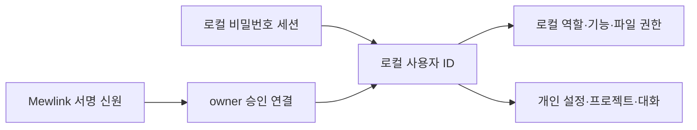

[Installation and execution](../../../docs/guides/getting-started-ko.md)

## Structure

- `server/serve.ts` — production server (5000, single port)
- `server/cli-host.ts` — IPC for the prebuilt CLI's first owner, current working directory, readiness, and Mewlink public address. [CLI Distribution Contract](cli-distribution.md)
- `server/instance-lock.ts` — ownership of `DATA_DIR/server.lock` by the source production server and CLI host, and prevention of duplicate execution. Only locks for dead PIDs are reclaimed; data contents are not reset.
- `server/platform/` — process, IPC, and state paths called by shared functionality, with POSIX and Windows implementations. Linux memory controls and macOS metrics are also owned by their respective OS folders. Terminal backend, CLI, and distribution boundaries follow the [Windows Native Contract](windows-native.md).
- `server/plugin.ts` — API and WebSocket connections for the Vite development server (4999)
- `server/dataDir.ts` — shared I/O for `DATA_DIR` state files (below)
- `server/auth.ts`, `server/authRoutes.ts` — authentication (users, sessions, and login routes)
- `shared/mewlink-identity.ts` — central issuer, immutable identity verification, and shared types. `server/mewlink-identities.ts`·`mewlink-auth-routes.ts` — local approval, account linking, external login, and owner management.
- `server/remote-authentication.ts` — password session or approved identity selected for a P2P connection. Transport leases and permissions are checked by `remote-access-agent.ts` and the dispatcher.
- `server/reqAuth.ts` — per-request authentication resolution (`req.auth`) and role/feature gating middleware
- `server/user-ui-routes.ts` — account UI routes for themes, My Projects, agent tabs/session claims, and workspace layout. `server/api.ts` mounts them after its existing account-workspace, body, cache, file-permission, and Git-context middleware and supplies the shared error handler.
- `server/access-policy.ts`·`access-routes.ts`·`access-socket.ts` — [Per-Account Feature and File Permissions](access-control.md), management APIs, and connection revalidation. `guestAccess.ts` is compatibility code for the existing storage format.
- `server/usersCli.ts` — approval list CLI
- `server/docsRepo.ts` — docs folder import/export; `server/fsBrowse.ts` — folder listing outside the workspace
- `server/project-registry.ts` — instance-wide project catalog, per-account shortcuts, legacy list migration, and managed project creation
- Mew's own documentation follows this repository's [Documentation Rules](../README.md). Documentation policies for other projects linked to Documents are owned by those projects and do not automatically require MOC registration.

`vite.config.ts` loads `server/plugin.ts` only from the development server's `configureServer` hook. It passes a module URL to dynamic import so the Vite configuration bundler does not preload server dependencies, keeping native `node-pty` unnecessary for loading configuration during browser builds. Running the development or production server still requires a native PTY installed for the platform. `server/vite-config.test.ts` loads the configuration without building the app or running the server to check this dependency boundary.

## Initial Browser Startup

[Browser startup and deferred loading](browser-startup.md) owns route selection, authentication/storage gates, workspace UI snapshots, editor/tool preparation, chunk boundaries, and verification.

### Application routes and missing pages

See the [route and missing-page contract](browser-startup.md#application-routes-and-missing-pages).

### Workspace initialization

See the [workspace initialization contract](browser-startup.md#workspace-initialization).

## Server State Files (`.data/`)

The storage root for the files below is `DATA_DIR` in `server/dataDir.ts`, while `.data/` is the path used by older installations. If `MEW_DATA_DIR` is explicitly set, that location is used; otherwise, an existing `.data/` in the app folder is preserved first. New installations use `~/.local/share/mew` on Linux and macOS (respecting `XDG_DATA_HOME`), and `%LOCALAPPDATA%\mew\data` on Windows. Follow [Configuration Files and Precedence](../../../docs/configuration/environment.md#server-settings).

In `users.json` v2, `accounts` owns profiles and roles, `passwordCredentials` owns passwords and password-change requirements, `mewlinkIdentities` owns approved external identity links, and `mewlinkRequests` owns request and decision state. Approval and user creation are saved in one atomic operation. v1 is migrated on the first account save, preserving existing email-based user IDs, permissions, and personal data keys. New external-only users use immutable internal IDs. `email` in the existing API is a compatibility name for the user ID and does not mean a contact email address. `sessions.json` stores only existing local password sessions; external identities are verified on live connections.



Users, sessions, per-account feature/file permissions, project layouts, terminal buttons, hidden lists, and scheduled tasks are stored here. The project catalog and My Projects use `projects.yaml`; other structured settings use JSON. Atomic state I/O is shared through `server/dataDir.ts`. Conversation transcripts use the SQLite store in `server/agentTranscript.ts` and follow the [Conversation Storage Contract](conversation-storage.md). Connection history is persisted in `presence/history.sqlite` in `server/presence-history.ts` and follows the [Collaboration Storage Contract](collaboration.md#connection-history-daily-queries-and-excel):

- **Writes use only a temporary file + rename**. Writing directly with `writeFileSync` briefly makes the file 0 bytes, and another process reading it at that moment mistakes it for an empty value.
- **Do not return an empty value on read failure.** If the file is missing, return `null`; if it is corrupted, leave a copy (`*.corrupt-*`) and throw. Treating an unreadable file as `{}` and overwriting it would erase all remaining settings — project icons were actually reset through this path.
- The location can be changed with `MEW_DATA_DIR`. `npm test` sets it to a temporary path so **tests do not touch actual production data** (tests create and delete projects while also modifying icons and layouts).

## Project-owned document metadata

`server/document-metadata.ts` resolves comments, Markdown table widths, and shared frontmatter options to `.mew/comments.json`, `.mew/table-layout.json`, and `.mew/frontmatter-options.json` under the actual project root. The special `docs` API scope is a Documents view of the active root, not a separate project. It uses the active root's `.mew`, never `<Documents>/.mew`. Named child projects retain their own `.mew` files.

Comments and table layouts use project-relative file keys. With Documents set to `.mew/docs`, `docs:a.md` uses the `.mew/docs/a.md` key, matching the same file opened through Files (`.workspace`). Changing the Documents location keeps metadata for different physical files separate. Frontmatter option lists and colors are shared by field name across Documents and Files in the same project.

On access through Documents, each known legacy file in `<Documents>/.mew` is migrated independently. Prefix legacy comment/layout keys with the configured Documents path. Merge comment threads and replies by ID, retaining canonical values for matching IDs; retain canonical widths on collisions. Union option lists and merge colors, retaining canonical colors on collisions. Atomically publish the merged destination before removing that legacy file. Remove the old directory only when empty; retain unrelated files. Invalid JSON, unsupported versions, symlink paths, and publication failures stop migration without deleting the original. Migration is synchronous within the request-local root and requires no recursive scan. See [ADR 0109](../decisions/0109-project-owned-document-metadata.md) and the [implementation record](../work/project-owned-document-metadata.md).

## Project Icon Canonical Source

Each root's `.mew/project-icon.json` stores one icon value in the form `{ "icon": "i:folder" }`. Existing `svg:`·`svgt:` and emoji notation remain supported, and shared SVG validation applies to reads and writes. `null` is an explicit reset and does not restore an old value. File explorer lists, nested trees, and root tabs read the same file through `server/projectIcons.ts`. The tree structure cache also rereads icons from project files when responding so it does not retain stale values. Symlinks for the file or `.mew` are rejected, and corrupted files are not overwritten.

Existing values in `DATA_DIR/project-icons.json` for projects directly under the current root are migrated to project files on first lookup, then the old keys are removed. Existing account tab icons are migrated as initial values only when neither project file nor file explorer values exist. Old file explorer values are not applied to projects with the same name under other roots. Projects that cannot be queried display the default folder icon. Reads and migration occur at display time, so closed projects are not traversed recursively.

The signed-in-only `POST /api/project-icons/read` reads current icons for a list of absolute paths, and `PUT /api/project-icons` saves `{ path, icon }` to the project. Members are restricted to registered project roots; guests cannot use these APIs. The existing `/api/project-icon` also updates the same file. Account root tab storage no longer includes icon contents. Follow [ADR 0177](../history/decisions/0177-mew-project-owned-icons.md).

## Shared project registry and My Projects

`server/project-registry.ts` owns `DATA_DIR/projects.yaml`. The instance catalog contains all registered folders; My Projects contains each account's ordered shortcuts. Registration grants discoverability to every signed-in non-guest account, while normal file and feature rules still govern project contents and tools. Managed project files live separately at `~/.mew/projects/<name>`, independent of `MEW_DATA_DIR`.

```yaml
version: 1
projects:
  - path: /home/example/.mew/projects/Notebook
    name: Notebook
    managed: true
  - path: /work/existing-app
    name: existing-app
    managed: false
myProjects:
  example-account:
    paths:
      - /home/example/.mew/projects/Notebook
    icons: {}
```

`projects` is global; optional `discovered: true` identifies a nested project first found by catalog discovery. API rows add `parentPath` for the nearest registered ancestor; this relationship is computed from paths rather than stored as another ledger. `myProjects` keys are normalized local account IDs, and each value retains the compatible `StoredRootProjects` shape (`paths`, legacy `icons`, and optional `groups`). Icons displayed in the UI are still read from each project's `.mew/project-icon.json`; no group UI is restored. Removing a shortcut never removes the global entry, another account's shortcuts, or files. Missing directories remain listed so an unavailable mount or migrated entry is not silently discarded.

My Projects is a subset of the catalog. Reading a personal list removes paths absent from `projects`, while retaining registered folders that are temporarily unavailable. The compatible personal-list write still registers supplied paths for legacy browser recovery.

`src/hooks/use-root-project-tabs.ts` restores My Projects from the signed-in account's server response. Its initial list is empty, and a `null` response means no personal shortcuts, regardless of role, file permissions, the active project, or cached browser paths. Browser paths are never imported into an account's list. Saves and browser-cache updates wait for a successful read; a failed read leaves saved shortcuts untouched. Existing server lists retain their ordering. Opening an All Projects entry changes only the active project; adding its personal shortcut remains explicit.

Catalog listing imports existing real, non-hidden direct folders from the managed root without pinning them, then discovers nested projects beneath registered roots. A real `.mew` directory or a `.git` directory/file marks a nested project. Discovery registers it with `discovered: true`, without adding personal shortcuts. It skips symlinks, hidden directories, `node_modules`, `vendor`, `dist`, `build`, and server metadata; each root scan stops at depth 20 or 10,000 directories. In-progress managed creation is excluded from catalog import and discovery. Unavailable entries remain registered.

When YAML is missing, its first read migrates all accounts' `rootProjects` from `user-ui-state.json`. Only when an account has no `rootProjects` value does migration use its saved `activeProjectPath` or `activeWorkspace`. Existing ordering and compatibility metadata are preserved, duplicates share one catalog entry, and the old JSON stays intact as historical migration data. A fresh installation does not register the server startup directory. YAML writes use atomic replacement; malformed existing YAML raises a data error and is not replaced by an empty catalog.

| API | Contract |
| --- | --- |
| `GET /api/project-registry` | Returns `{ projects: [{ path, name, managed, mine, icon, parentPath?, discovered? }] }` for a signed-in account. |
| `POST /api/project-registry` with `{ name, git? }` | Creates a managed directory, registers it, and adds it to the caller's My Projects; Git defaults to enabled. Returns `{ project, state }`. |
| `POST /api/project-registry` with `{ path }` | Validates and canonicalizes an existing directory, registers it without moving it, and adds it to the caller's My Projects. Returns `{ project, state }`. |
| `POST /api/project-registry` with `{ mode: "clone", url }` | Clones a public GitHub/GitLab HTTPS repository or an account-authorized private GitHub repository into the managed root, registers it, and pins it for the caller. Returns `{ project, state }`. |
| `GET /api/project-registry/repositories` | Returns the caller’s `{ connected, repositories: [{ name, fullName, url, private }] }` GitHub repository list, including permitted organization/private repositories across all pages. Disconnected accounts receive `false` and an empty list; responses are no-store. |
| `PUT /api/project-registry/mine` with `{ path, added }` | Adds or removes only the caller's shortcut and returns `{ state }`. |
| `GET/PUT /api/user-ui/root-projects` | Compatible personal-list API backed by YAML instead of the old JSON field. |

Managed names are validated as one safe directory component: no traversal, separators, leading dot, control characters, reserved filename characters/names, or trailing dot/space. Existing directories are rejected with 409 instead of reused or overwritten. Every newly created empty project gets an empty `.mew/docs/` directory, which existing Documents detection selects by default. Keeping that location inside `.mew/` avoids creating a separate root `docs/` on first access. Git-enabled projects additionally get `.git/` and `.gitignore` excluding `.mew/temp/`. Linking requires an existing canonical directory and deduplicates symbolic-link aliases. Both flows preserve server-data path restrictions. If an explicitly configured data root is an ancestor of `~/.mew/projects`, general file operations allow the managed-project subtree while continuing to block instance metadata and symbolic-link escapes. Arbitrary server folder creation and Git operations retain their existing role and feature checks.

Managed cloning derives the destination name from the repository basename, rejects an existing destination with 409, and cleans up partial files on failure before registration. It preserves the repository’s files instead of adding initialization files. [Git connections](git-connections.md#managed-project-cloning-and-repository-listing) owns provider, credential, and transport restrictions; [ADR 0124](../decisions/0124-managed-clone-and-project-discovery.md) records the choice.

The project sidebar uses `ProjectAddInline` for clone, name-only creation, and linking, and `ProjectCatalogPanel` for the collapsed All Projects hierarchy. `LinkProjectDialog` retains explicit server-folder browsing. The secondary agent-assisted action opens `ProjectCreationAgentDialog`, which hosts the normal `AgentPanel` for discovery and documentation after managed creation. [The project feature](../features/projects-files-search/opening-projects-tabs-and-groups.md), [agent sessions](agent-sessions.md#agent-assisted-project-creation), and [ADR 0118](../decisions/0118-shared-project-registry.md) own their behavior and rationale.

## Per-Account Active Project

Under [ADR 0200](../history/decisions/0200-mew-account-active-workspace.md), the last active project is owned by the per-account `activeWorkspace` in `user-ui-state.json`. `server/account-workspace.ts` reads the authenticated account's root and fixes it in the `AsyncLocalStorage` context of `paths.ts` for the request's lifetime. Path functions such as `workspacePaths` and `projectRoot` read this context, while CLI and server initialization without an account use the existing server default root. A saved active root is used only while its directory exists. If it is absent or deleted, the request layer chooses the first existing My Projects directory and persists it as active. If none exists, it uses the server startup root only as an internal request fallback. Workspace metadata reports `hasProject: true` for a signed-in account only when its saved active root matches the request root; otherwise it reports `false`, and the UI shows project onboarding instead of files and tools. Missing catalog entries and shortcuts remain stored. A fresh account is not enrolled in the startup project.

`POST /api/workspace` accepts registered project roots for all signed-in accounts. `/api/fs/open-project` links, pins, and opens an existing folder for the caller. Members cannot use an unregistered arbitrary path through `/api/workspace`; owners and managers retain their broader existing switching behavior. `/api/subprojects/open` and worktree operations keep their existing manager/owner checks. Opening an existing subproject also registers and pins it for the caller. Opening an existing All Projects catalog row changes the active root without implicitly pinning it; the explicit Add to My Projects action controls that shortcut. All root changes save only the requesting account's root. `workspace` presence notifications are sent only to the same authenticated account. They do not change the server default root, `MEW_WORKSPACE` settings, other accounts' watchers, or collaborative editing rooms. Existing agent working paths remain fixed, while the default path for new terminals follows the requesting account's root. Documents folder settings remain owned by the project configuration file.

File catalogs, search state, and tree watchers are separated by actual project path, and search SQLite handles by per-root DB path. Project WebSocket connections use the account root at connection time, and collaborative editing rooms include the root in their internal server keys. The wire-level `프로젝트:상대경로` and server-wide shared memo room are retained. Accounts viewing the same actual root share collaborative editing, while files with the same name under different roots remain separate.

## Mewpet global skins

`DATA_DIR/mewpet/skins/<스킨 폴더>/skin.json` and PNG·WebP files are the project-independent skin canonical source. `server/mewpet-skins.ts` reads `public/mewcat/*/skin.json` from the global folder and app source at runtime, prioritizing the global version for matching IDs. Image replacements and new folders appear in list queries without a build or restart. `/api/mewpet/skins` is outside the active project and Documents file ACLs, and only the owner may write to it. API saves write all images for the new version before atomically replacing the manifest, while retaining the previous version. Detailed schema and browser migration follow the [Mewpet Feature Contract](../features/appearance-accounts-operations/mewpet-mascot-notifications-and-breaks.md#registering-skins-from-files).
