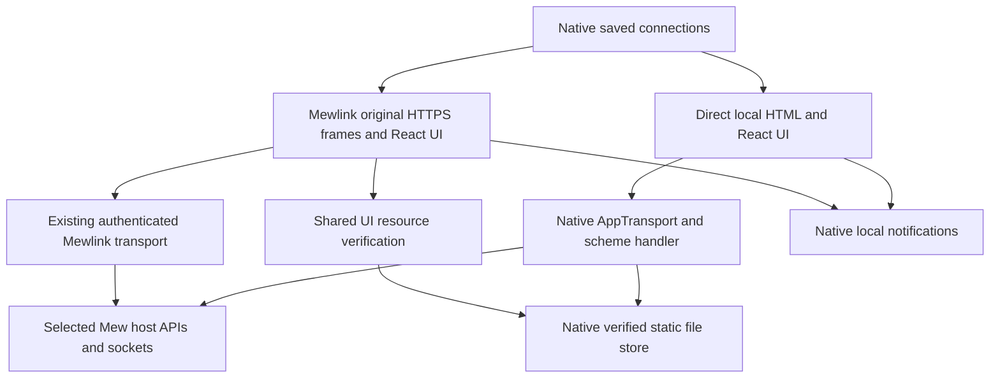

# iOS client implementation contract

Audience: engineers and coding agents implementing or reviewing the iOS client. This document owns native/web interfaces and storage behavior. [ADR 0162](../decisions/0162-ios-hybrid-client.md) owns the technology choice; the [feature contract](../features/appearance-accounts-operations/ios-client.md) owns user-visible acceptance, and the [operating guide](../operations/ios-client.md) owns building and device checks.

## Goals and boundaries

Reuse the existing Mew React application in a dedicated iOS client. Remember user-selected direct and Mewlink connections. Keep static UI code in native storage so browser cache entry, byte, and retention limits do not dictate its lifetime. Retain current server authentication, permissions, transport authorization, and code verification.

This does not move agent runtimes, a shell, Git, or workspace files onto the iPhone. The selected host must remain running and reachable. Cached UI code does not grant offline data access. WebKit still renders and edits the UI, so native storage does not itself fix text-selection, IME, or editor-engine issues.

## Components and dependency direction

| Owner | Responsibility | Must not own |
| --- | --- | --- |
| `apps/ios` | Connection chooser, endpoint validation, WKWebView lifecycle, native storage, upstream networking, OS notifications | React domain behavior or Mew authorization policy |
| `src/runtime/native-bridge.ts` | Narrow typed native capability, base64 encoding, digest and deadline helpers | Server credentials or destination selection |
| Native direct runtime | AppTransport fetch/socket adaptation, custom resource URLs, authentication/storage scope | Replacing browser globals or changing ordinary browser requests |
| `src/utils/native-ui-cache.ts` | Native file-store adaptation for Mewlink UI resources | Relaxing current-host ETag verification or caching work data |
| `src/utils/native-notifications.ts` | Existing notification delivery mapped to native permission/show/close | Generating server events while the app is stopped |
| Existing server and central | Existing APIs, local account authorization, Mewlink proofs/leases and P2P transport | Trusting a native bridge as permission |

The native app loads the same host-produced UI version rather than maintaining an independent React fork. Fresh HTML selects the current asset paths. Browser entrypoints require no native capability and retain their original paths.

## Direct connection flow

1. Validate and normalize a user-entered endpoint. Reject credentials, query/fragment, unsupported schemes, and ambiguous paths. HTTPS is preferred. Explicit private-network HTTP is a separate user choice; certificate failures are never bypassed.
2. Bind a native networking context to that saved connection. A page request cannot change its upstream authority. Authentication cookies stay in the platform cookie store, not preference metadata. The current native URLSession uses the standard shared cookie store: normal cookie host/domain/path rules apply, including sharing between two labels for the same host and lack of a cookie port boundary. Saved connection labels are not separate authentication profiles.
3. Fetch current entry HTML over that context. Do not persist or substitute HTML on error. Load it as local HTML with `mew-app://workspace/` as the base; relative module imports and styles resolve through the native scheme handler.
4. Before the React application mounts, select the native runtime only when the expected native direct capability and local scheme are both present. Establish account/endpoint storage scope before mounting workspace effects. Prefer the verified local `accountId` over email, retaining email fallback for older hosts. Direct authentication does not currently return the Mewlink instance identity, so the normalized endpoint is the direct-mode scope. Recreating an account with a new ID creates a new storage namespace even if its email is unchanged.
5. Map `/api` requests through the native HTTP bridge. Map ordinary static resources and native DOM resources through the custom scheme handler. Map sockets to native WebSocket tasks. Resolve public/share URLs against the real configured endpoint.
6. For cacheable UI files, revalidate with the selected host. Return verified retained bytes only after current host confirmation. Other files and API responses travel live and are never written into the UI cache.
7. On account or connection change, dispose network tasks and old UI before mounting the next identity. A fresh UI context avoids carrying React/module state across identities.

Direct mode changes the document origin. Audit new code for direct `location.origin`, `location.host`, API URL construction, worker construction, and public links. Prefer existing AppRuntime resource and transport helpers. This route does not require service workers on arbitrary tunnel or Tailscale hosts.

## Mewlink connection flow

Use the selected public device URL in the existing origin/frame chain. Keep `link.mew.run` and `app.mew.run` as declared app-bound domains. New and loaded saved Mewlink addresses normalize the previous `mew.run` and `mew.saens.kr` hosts to `link.mew.run`, preserving connection IDs and labels; changed lists are persisted. Main-frame navigation and native-bridge access require the canonical origin and the selected device path. App-origin child frames retain their existing launch-path restriction. See [ADR 0167](../decisions/0167-homepage-and-mewlink-subdomain.md). The existing [remote access contract](remote-access.md) and [recovery contract](remote-access-recovery.md) continue to own proof verification, local login, trusted devices, lease renewal, reconnect, and identity changes.

`remote-resources.ts` calls `fetchRemoteUiResource` in the launcher document, where a native message bridge can be available. If that capability exists, `native-ui-cache.ts` handles eligible files; otherwise the existing browser CacheStorage implementation is unchanged. The resource service worker itself never calls native handlers.

Native Mewlink cache lookup uses the current verified instance as the logical scope. Native storage adds the selected endpoint namespace. Migrated endpoints therefore use a new namespace and revalidate/download static resources again; previous central and local browser authentication may require sign-in. This does not rewrite host registrations, proof issuers, or local identity links. Rehash every loaded body and compare both its recorded hexadecimal SHA-256 and the host's strong SHA-256 ETag. Send the current host a conditional request. Only a matching live 304 response permits reuse. Use current response security headers. A mismatch causes an unconditional live read; offline, denied, revoked, or failed requests never fall back to cached code.

The initial HTML still travels live. The native path currently uses per-file revalidation rather than the browser path's small index inventory batch. This trades small round trips for native storage without changing the wire protocol or central authority.

## Native bridge protocol

The app injects a frozen `window.mewNative` version 1 capability before application scripts. Every native message independently validates the current saved connection, frame URL/security origin, operation, path, sizes, and input shape. A page-side capability check is not authorization.

The Swift handler accepts versioned operation messages and responds with `{ok:true,value:...}` or `{ok:false,error:...}`. The injected JavaScript wrapper resolves/rejects method promises. Callers use bounded waits and a live network fallback where safe.

| Capability | Arguments/result |
| --- | --- |
| `connection` | Immutable selected `kind`, endpoint, and scope; contains no credentials |
| `cache.get` | `{scope,path}` → native asset or `null` |
| `cache.put` | `{scope,path,bodyBase64,mimeType,sha256,etag,storedAt}` → success |
| `cache.remove` | `{scope,path}` → success |
| `notifications.permission` / `request` | Returns `default`, `granted`, or `denied`; request occurs only after a user action |
| `notifications.show` / `close` | `{id,title,body?}` / `{id}`; title and identity lengths bounded |
| Native direct HTTP | Same-host API path, method, headers and optional base64 body; response status, header pairs and base64 body; cancellation uses request identity |
| Native direct sockets | Versioned open/send/close commands and owned socket events; exact fields are defined by the typed direct runtime interface |

Native asset `sha256` is lowercase hexadecimal over decoded bytes. Mewlink ETags are quoted `sha256-<base64url>` values, optionally with the existing gzip variant suffix. Base64 holds binary bytes only, never arbitrary JSON string conversion. Native returns decoded bodies; content-encoding/content-length are reconstructed or removed as appropriate.

Direct HTTP currently buffers each request and response, with a 32 MiB decoded body cap, 16 concurrent API requests, and a 30-second JavaScript deadline for ordinary requests. The exact `POST /api/speech/transcribe` operation has a 310-second JavaScript deadline and native URLSession request timeout to accommodate the [speech engine's bounded inference/model download](speech-input.md). Other URLSession requests retain their existing 60-second timeout. Cancellation still uses the request identity, and no write is automatically replayed. It does not expose incremental fetch streaming or unlimited media transfers. Sockets have separate message, pending-byte and connection bounds. These restrictions need device/performance acceptance and a future streaming protocol before claiming full parity for large or long-running transfers.

Do not grant the bridge to arbitrary external navigation, raw file HTML, user shares, or unrelated child frames. Open external browsing through the operating system. Never pass central management cookies, proof keys, or native authentication material into the installed UI.

## Native storage

Store static bodies and bounded metadata under the app's Application Support directory, outside WebKit's CacheStorage quota. Use opaque endpoint/scope/path-derived names, atomic writes, digest validation, and serialized LRU maintenance. Retain at most 16 MiB decoded per resource and 512 MiB total UI assets. Storage errors are cache misses, not authentication errors.

Only the existing static-code path allowlist is eligible: JS/MJS/CSS/fonts/Wasm in `/assets/`, and CSS/font files in `/fonts/`. Reject traversal, hidden path segments, foreign authorities, URL queries, and invalid MIME/path combinations. Do not cache HTML, images, account state, API responses, credentials, documents, or transcripts in this store. Direct weak ETags identify the live host representation; local bytes still need their own SHA-256 integrity check. Mewlink additionally requires its existing strong content ETag.

This native policy does not inherit browser CacheStorage's 32 MiB/64-entry/7-day policy. It is still bounded by device free space, app removal/offloading behavior, deliberate cache deletion, and future app migrations. Do not promise that arbitrary downloaded content is permanent.

## Notifications

The existing Mew event selection remains authoritative. When a native capability exists, map permission and delivery to UserNotifications rather than the browser notification worker or Mewlink parent. Maintain ownership of at most 30 active notice IDs per delivery instance, close on disposal, and route native tap events only to a live owner. Account/connection changes discard old ownership.

These are local notifications generated while Mew code is receiving events. Receiving agent completion/approval after suspension or termination requires server-side event ownership, per-account device registration, delivery credentials, APNs sending/revocation, privacy decisions, and notification-tap restoration. That is a separate implementation stage; a local permission grant does not establish remote push support.

## Failure and lifecycle rules

- Keep a connection chooser reachable when entry loading, TLS, authentication, or Mewlink bootstrap fails. Retry creates a new bounded load; it does not weaken checks.
- Handle native content-process termination with a visible recoverable state. Do not silently lose unsent work through repeated forced reloads.
- Cancel fetch and socket work when its WebView or selected connection is disposed. Late callbacks cannot target the next connection.
- Cache bridge failure falls back to the existing live resource path. Native direct transport failure is surfaced because that connection has no alternative API authority.
- Do not replay writes or socket input after connection failure. Existing Mewlink recovery remains unchanged.
- No saved code is an offline replacement for a revoked/denied current host.

## Verification boundaries

Node regressions cover native cache integrity, live authorization, denied/offline behavior, ineligible paths, native limits, notification ownership, and direct bridge HTTP/socket behavior. Existing remote-resource and browser-notification regressions verify absent-capability behavior. Run `npm run build`, applicable type checks/lint, and `npm run check:docs` after implementation.

The speech deadline has TypeScript clock-controlled transport checks and a Swift XCTest assertion. The Swift check was added but not executed in the Linux speech implementation environment because `xcodebuild` was unavailable. Applying that native timeout change requires a separate native build and app update; host browser assets alone cannot change URLSession behavior. See the [speech work record](../work/speech-input.md) for actual local checks and the remaining physical-device gate.

Xcode compilation and XCTest require macOS/Xcode. Physical iPhone acceptance must separately check local custom-scheme module/CSS loading, PDF/editor workers, direct cookies/login/logout, uploads and downloads, long-lived sockets, Mewlink service-worker/frame behavior, OS keyboard/selection, process termination, app switching, native storage reuse and updates, notification permission/taps, and TLS failures. Passing Node tests does not establish any of these device results. Record actual outcomes in the [work record](../work/ios-client.md).

`NativeHTTPTransportTests` includes a platform integration test for app-bound local HTML, custom-scheme ES modules, dynamic imports, a module worker, and the actual frame security origin used by the bridge. This is an executable acceptance gate, not a completed result in a Linux checkout. The macOS CI workflow is described in the operating guide.
