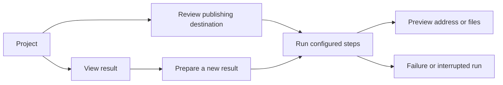

## Goal and readers

People using Mew should be able to answer two questions without learning deployment commands: "How do I see what I made?" and "How do I make it available to others?" This document guides implementation and review. The [action contract](../features/terminals-agents-automation/project-build-deploy-actions.md) continues to own individual build/deploy commands and file downloads.

## User experience

Open results and publishing from the project command menu, alongside Build and Deploy. Lead with the latest useful result and two purposes: prepare a result to inspect, and publish it. A successful result offers its real preview address or downloadable files. A website with only static output files offers downloads and setup guidance; it must not pretend that an HTML download is a running preview.

When several variants exist, show a named choice using the shared selection control. Show execution steps only when they correspond to configured work. Preserve debug/release labels where they help choose an installable app or release. Keep commands, step editing, and provider fields in settings. The existing Build and Deploy dialogs remain available as advanced controls.

Before publishing, show the selected destination and branch and ask the user to start that concrete operation. Carry the reviewed plan revision and reject execution if its resolved commands or targets changed. Explain that remote workflows use the repository version already available to the provider; local edits are not automatically committed, pushed, or uploaded. A local deployment command may also change a remote service, so its execution computer must not be described as its publishing destination. A connection or missing configuration leads to setup; it never blocks opening or editing the project. Errors retain the last known result and offer a useful retry or agent setup action. Do not claim a provider request succeeded until the provider's recorded execution reports success, and do not claim a site is reachable merely because a URL is configured.

## Pipeline configuration and execution

Store editable pipeline definitions in `.mew/project-pipelines.json`, separate from individual actions. Each definition has a stable ID, a name, a `preview` or `publish` purpose, and ordered steps. A step refers to an existing action or an account-owned external connection. No credential belongs in this file.

When no pipeline file exists, offer read-only defaults from actual configured or discovered actions: a build can prepare a result, and an explicit build/deploy pair can publish. Each supported external connection can provide a remote publishing workflow whose build runs at the provider. Persisted empty configuration remains empty. Invalid configuration produces a recoverable warning and is not overwritten by discovery.

Resolve and validate every step before starting. Freeze action commands and external targets for the run. Reserve the canonical project root so a second pipeline or manual action cannot modify the same outputs during the pipeline. Run sequentially, stop at the first failed or uncertain step, and mark later steps skipped. A retry is a new explicit run; no status read or reconnect repeats deployment.

Record the initiator, timestamps, pipeline/configuration snapshots, actual action or remote run IDs, bounded logs, and source commit and dirty status when Git is available. Source metadata describes the working folder; this first implementation does not check out an isolated immutable commit. Local execution retains the existing trusted owner/manager terminal boundary and host OS permissions.

Store bounded execution history atomically in private installation data, bound to canonical project root and directory identity. Filter account-visible records by account and account creation identity. Persist the initial record before dispatching work. Preserve completed file/ZIP authorization metadata so results can be inspected after a restart, subject to the existing fresh-file checks. Mark unfinished local orchestration interrupted after restart, retain known external execution IDs for refresh, and never automatically replay work. A record of completion is distinct from an immutable copy of the output files.

Recheck the initiator's current account identity, role, password restriction, and terminal permission before later steps can start. Local commands have a 30-minute deadline; terminate only their owned process group and wait for closure before releasing the reservation. Persist known process IDs and reject new work after restart while a recorded group is still alive. Do not kill processes automatically at startup. A crash between OS spawn and PID persistence remains an uncertain-execution window; this first implementation cannot eliminate that window or provide isolated crash-proof workers.

## External connections

Use a provider adapter with explicit capabilities and typed inputs/results. Keep the common screen independent of vendor API details. The first adapters target GitHub Actions workflows, Git-connected Cloudflare Pages deployments, and Google Cloud Build triggers. They start an explicit remote execution and follow the exact ID returned by the provider. Do not associate a deployment with whichever run happens to be newest.

Connections belong to a Mew account and canonical project root. Store tokens encrypted in private installation data, with ownership bound into authenticated encryption, and return summaries only. A shared pipeline referencing another account's connection requires that account's own setup; it must not borrow credentials. Account deletion or merge revokes stored connections. Logs and errors must not echo tokens or raw authorization responses. Connecting or saving does not dispatch work.

Provider failures require distinctions between rejected requests, known failed executions, transient status errors, and an uncertain dispatch. An uncertain dispatch must not be automatically retried. Polling and requests need deadlines and size bounds. A status refresh may query a known execution but cannot create one. Recover a missing orchestration link by the exact persisted request ID, never by guessing the newest deployment. A confirmed remote result can be opened even when the overall interrupted pipeline did not finish; later skipped steps remain skipped. The remote execution can outlive Mew; local orchestration cannot promise to continue while the host is asleep or off.

| Adapter | Execution and results | Initial boundary |
| --- | --- | --- |
| GitHub Actions | Explicit workflow dispatch, run status, provider run link | Requires a configured dispatchable workflow and Actions permission; a successful workflow is not itself proof of a published website |
| Cloudflare Pages | Create a Git-connected branch deployment, inspect stages and deployment URL | Direct-upload assets and Workers deployments require different adapters |
| Google Cloud Build | Run an existing regional trigger, inspect build status and console link | Requires appropriate IAM and a usable token; service deployment and readiness depend on the configured build |

MCP remains useful for agent investigation and setup. A generic MCP connection does not guarantee deployment, logs, or status support. A future MCP adapter must declare and verify the actual tools and response schema; it cannot infer success from conversational text.

## Implementation sequence and boundaries

The first implementation combines the outcome screen, editable sequential action/provider pipelines, durable history, explicit publishing review, and the three adapters above. Test with fixture projects, fake runners, and mocked provider responses before changing implementation; no real deployment is part of repository verification.

Later work can add provider OAuth onboarding and resource pickers, webhook or Git-push triggers, scheduled pipeline queues, parallel dependencies, cancellation, isolated/ephemeral runners, remote artifact import, background push, and a separately isolated static web preview. These are distinct capabilities, not implied by the first screen. Existing MCP/Git logins do not automatically grant the necessary provider permissions.

The first connection settings can require an administrator or agent to identify a remote target and credential. Once configured, ordinary use should require only viewing a result or selecting Publish. Provider account enrollment, billing choices, DNS ownership, and app-store review remain explicit user tasks where needed.

## Acceptance

- A first-time user can find results and publishing without opening a command editor.
- Missing build, destination, authentication, or preview information offers recovery while preserving project access.
- Saving, reading, closing, or reopening never starts a build or deployment.
- Tests verify configuration preservation, sequential execution, first-failure skipping, root/account isolation, concurrent-start rejection, frozen targets, durable recovery, and no automatic replay.
- Provider tests verify exact execution IDs, authenticated requests, response bounds, uncertain dispatch, safe URLs, and token-free public state.
- Browser tests cover mobile/desktop, light/dark, publishing review, actual run progress, downloads, and error recovery.
- Required build, relevant tests, lint, metadata, and links are checked locally. Operational deployment requires Deploy on or an explicit user request, with destination, credential, and result verification under the [execution rules](getting-started.md#execution-and-verification).

## Sources

The adapters follow [GitHub workflow dispatch](https://docs.github.com/en/rest/actions/workflows#create-a-workflow-dispatch-event), [workflow runs](https://docs.github.com/en/rest/actions/workflow-runs), [Cloudflare Pages deployments](https://developers.cloudflare.com/api/resources/pages/subresources/projects/subresources/deployments/), and [Cloud Build triggers](https://docs.cloud.google.com/build/docs/api/reference/rest/v1/projects.locations.triggers/run). The [Cloud Build resource](https://docs.cloud.google.com/build/docs/api/reference/rest/v1/projects.builds) notes that individual step status is updated at build completion rather than continuously; the UI must not invent live sub-step progress.
