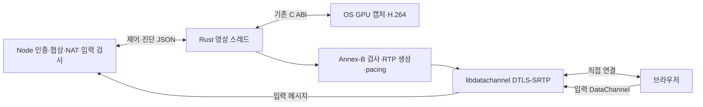

## 실행 경로

기본값은 `MEW_DESKTOP_ENGINE=rust`다. `native-host.mjs`가 Koffi를 통해 같은 프로세스에 Rust cdylib를 로드한다. `rust/src/engine.rs`의 전용 스레드가 GPU 장치를 만들고 같은 스레드에서 캡처 시작·출력 읽기·인코더 제어·정리를 호출한다. Windows COM과 GPU 표면 수명을 다른 스레드로 넘기지 않는다. Windows GPU ABI 5, Mac/Linux ABI 2와 기존 하드웨어 인코더를 재사용하며 OS 캡처 자체를 Rust로 재작성하지 않는다.



`rust-engine.mjs`는 기존 worker의 `postMessage`·`message`·종료 인터페이스를 제공한다. 4ms 간격으로 제어 이벤트만 가져오며 GPU 출력과 RTP 패킷은 이 경계를 넘지 않는다. Rust는 활성 상태에서 인코더 출력 확인과 pacing을 수행하고, 유휴 상태에서는 제어 명령만 기다린다. 원래 1/2ms GPU polling은 유지하므로 모든 캡처가 OS 이벤트로 깨어나는 구현은 아니다.

Node는 SDP 모드 선택·STUN 재시도·임시 NAT 매핑·RTT 적응 정책·클립보드와 입력 권한 검사를 유지한다. `rust-direct.mjs`는 기존 `video-settings.mjs`·`video-adaptation.mjs`와 공통 재시도 수명을 사용한다. 입력 메시지는 기존 JS 수신기에서 세션·잠금·빈도·키 상태를 확인한 뒤 OS에 주입한다. Windows 독립 커서는 `cursor-worker.mjs`에서 조회하므로 영상 backpressure가 커서를 멈추지 않는다. Mac TCC 앱 식별자와 Node 실행 파일은 유지하며 Rust를 별도 실행 파일로 시작하지 않는다.

## 큐와 전송

GPU 출력 버퍼는 최대 4MiB다. Rust가 Annex-B NAL과 SPS/PPS의 협상 프로필·레벨을 검사한 뒤 최대 두 압축 프레임을 큐에 둔다. RTP는 재사용하는 1192바이트 버퍼에서 single NAL/FU-A로 생성하며 JS 객체·패킷별 타이머를 만들지 않는다. 실제 소켓·암호화·NACK 재전송은 libdatachannel이 처리한다. Rust는 단조 시계와 RTP 시계를 대응시킨 compound RTCP SR·SDES를 보낸다.

프레임 순서·IDR 복구·burst·수명 한도와 품질 회복은 [공통 전송 계약](remote-desktop.md#전송과-지연)을 따른다. IDR 전송 중에는 다음 GPU 출력을 읽지 않고 추가 키프레임 요청 플래그를 완료·폐기까지 보존한다. 인코더 bitrate와 pacer bitrate를 함께 바꾸며 Windows 설정 실패를 상위로 전달한다. `queueMs`는 GPU 출력을 Rust가 읽은 시점부터 잰다. Node 시계와 Rust 시계를 직접 빼지 않는다.

## 승인과 정리

- 제어 명령·이벤트 큐는 각각 256개로 제한한다. 큐가 넘치면 엔진을 종료하며 무한히 대기하거나 제어 메시지를 조용히 누락하지 않는다.
- `stop`·peer 교체·종료 요청은 FFI 진입 시 원자적 generation을 바꾼다. 이전 generation의 대기 중 시작 명령과 영상 송신은 거부한다.
- Node가 현재 세션의 승인 lease를 갱신한다. Rust는 자체 단조 시계로 마지막 갱신부터 8초를 검사하므로 Node가 멈춰도 캡처를 계속 허용하지 않는다. 8초 한도는 OS 드라이버 호출이 멈추지 않는다는 보장은 아니다.
- GPU 정지·인코더 정리·peer 삭제가 끝나야 `stopped`를 보낸다. POSIX 정지 확인에 실패하면 호스트를 재사용하지 않는다. 기존 supervisor의 시간 제한과 강제 종료 경계는 유지한다.
- 드라이버에서 멈춘 Rust 스레드를 Node 이벤트 루프에서 무기한 join하지 않는다. 종료를 확인한 핸들만 해제하고, 확인 실패는 상주 호스트 폐기로 처리한다.
- 세션·협상 ID가 다른 입력·통계·콜백은 새 연결에 적용하지 않는다. 영상·입력 내용·SDP·ICE 자격증명을 파일에 기록하지 않는다.

## 설치와 비교

모든 OS에서 Rust stable·CMake·libclang·C++ 컴파일러·Perl이 필요하며 Windows는 MSVC Rust toolchain·Visual Studio C++ Build Tools·Windows SDK를 사용한다. WSL 원격 데스크톱은 Windows 도구가 필요하다. 기존 OS별 GPU·로그인·권한 조건도 그대로 적용한다. 도구는 설치기의 PATH에서 찾아야 한다.

`install-rust-engine.mjs`는 `Cargo.lock`에 고정한 소스를 `rust/vendor/`에 보존하고 해당 소스에서 `--release --locked --offline`으로 컴파일한다. MPL 라이브러리와 OpenSSL 등 고지·대응 소스를 제거하지 않는다. [배포 계약](remote-desktop-distribution.md)이 라이선스와 Windows OpenSSL 경로 보정의 범위를 소유한다. 설치기와 준비 해시는 중첩 Rust 소스·잠금 파일·빌드 스크립트를 포함한다.

완성한 파일을 임시 경로에서 최종 경로로 옮기고 Mac은 로컬 서명한다. 설치 검증은 엔진 ABI 1만 호출하며 캡처·입력·GUI를 시작하지 않는다. GPU 모듈·Rust 모듈·ABI 검사까지 성공해야 `.mew-ready`를 기록한다. 파일이 빠지거나 소스가 달라지면 다시 준비한다. 생성 바이너리·vendor·target 폴더는 Git에 넣지 않는다.

`MEW_DESKTOP_ENGINE=legacy`는 기존 JS GPU worker·프레임 IPC·JS pacing 경로를 선택한다. 비교·복구용이며 자동 실패 폴백은 하지 않는다. 같은 화면·품질·회선에서 비교하고 엔진 선택을 바꾸면 상주 호스트도 다시 시작해야 한다. Windows/WSL은 선택값을 인증된 부트스트랩에 전달해 로그인 세션에서도 유지한다. 앱 빌드·설치본 갱신·운영 재시작은 사용자가 수행한다.

## 검증 범위

Rust 단위 검사는 Annex-B 경계·FU-A 재구성·sequence wrap·유한 burst·IDR backpressure·참조 복구·프로필 거부·승인 generation과 lease 만료를 검사한다. `cargo clippy --all-targets -- -D warnings`로 Rust 경고도 검사한다. 기존 JS 전송·권한·OS 수명 회귀 검사는 별도로 유지한다.

`server/remote-desktop-rust.test.ts`의 opt-in 검사는 별도 임시 GPU ABI 라이브러리에서 미리 생성한 FHD H.264 합성 영상을 반환한다. 실제 libdatachannel·Chromium으로 수신하고 Node 이벤트 루프가 400ms 멈춘 동안에도 최소 8프레임을 디코드하는지, 정지 확인 뒤 같은 엔진 재접속과 lease 갱신 중단 8초 뒤 독립 종료가 되는지 검사한다. 이어서 별도 Xvfb·D-Bus에서 기존 상주 호스트 통합 검사를 실행해 합성 화면의 XTest 입력·권한 회수 시 키 해제·OS 잠금·같은 프로세스 재접속·연결 알림도 확인한다. 테스트의 FFmpeg·소프트웨어 인코더는 합성 fixture 생성에만 사용하며 운영 경로에 포함하지 않는다. Chromium fixture의 수신 SDP는 지원하는 Baseline level 4.2로 설정한다.

2026-10-24 Linux에서 위 Rust 단위·Clippy와 합성 브라우저 검사를 통과했다. 이는 JS 이벤트 루프와 영상 송신의 분리 근거이며 실제 GPU 성능·화질 우위·입력 후 표시 지연의 개선 수치가 아니다. Windows/MSVC·Mac의 새 Rust 라이브러리 실제 빌드·서명·실행, 실제 Linux GPU·Wayland portal, 외부망·고주사율 비교는 미검증이다.

격리 검사는 저장소 루트에서 아래처럼 실행한다. 운영 설치 폴더를 지정하지 않는다.

```bash
cargo test --manifest-path native/remote-desktop/rust/Cargo.toml --locked
cargo clippy --manifest-path native/remote-desktop/rust/Cargo.toml --locked --all-targets -- -D warnings
MEW_DESKTOP_TEST_RUST_LIBRARY="$PWD/native/remote-desktop/rust/target/debug/deps/libmew_desktop_engine.so" \
  node --test server/remote-desktop-rust.test.ts
```
