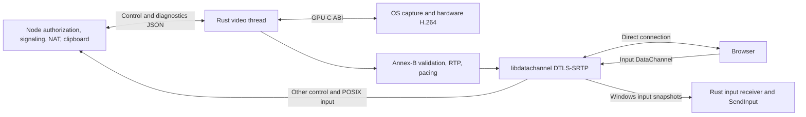

## Execution Path

The default is `MEW_DESKTOP_ENGINE=rust`. `native-host.mjs` loads the Rust cdylib into the same process through Koffi. A dedicated thread in `rust/src/engine.rs` creates the GPU device and calls capture startup, output reading, encoder control, and cleanup on that same thread. Windows COM and GPU surface lifetimes are not transferred to other threads. It reuses Windows GPU ABI 5, Mac/Linux ABI 2, and existing hardware encoders; OS capture itself is not rewritten in Rust.



`rust-engine.mjs` preserves the worker's `postMessage`, `message`, and shutdown interfaces. Its 4ms poll retrieves control and diagnostics; GPU output, RTP packets, and Windows input snapshots stay in native code. Windows GPU libraries can expose the optional `mew_gpu_wait(handle, timeoutMs)` symbol without changing ABI 5. Rust waits at most 1ms between control/pacer checks and reads GPU output immediately on wake. Libraries without this symbol retain the existing 1/2ms output polling. The optional wait does not make driver calls bounded.

Node retains SDP mode selection, STUN retries, temporary NAT mappings, RTT adaptation, clipboard operations, and session approval. `rust-direct.mjs` reuses `video-settings.mjs`, `video-adaptation.mjs`, and the shared retry lifecycle. Windows sends input snapshots directly from libdatachannel callbacks to Rust's receiver and Win32 input adapter. Mac/Linux retain the existing Node receiver and OS adapters. The separate `cursor-worker.mjs` still queries the Windows cursor; its sequence acknowledgement reads the Rust receiver's current snapshot sequence through FFI. The Mac TCC app identifier and Node executable remain unchanged.

## Queues and transport

GPU output is limited to 4MiB. Rust validates Annex-B NALs and the negotiated SPS/PPS profile and level, then queues at most two compressed frames. Single-NAL/FU-A RTP uses a reusable 1192-byte buffer. libdatachannel owns sockets, SRTP encryption, and NACK retransmission. Compound RTCP SR/SDES maps the monotonic and RTP clocks.

The offer advertises extension ID 1 for `http://www.webrtc.org/experiments/rtp-hdrext/playout-delay`. Rust emits its RFC 8285 one-byte header only when the receiving video answer accepts that ID and direction. Each packet carries 12-bit minimum and maximum delays of zero; payload capacity shrinks by 8 bytes to preserve the 1192-byte bound. Missing/rejected extensions leave ordinary RTP unchanged. This is a [best-effort request to render promptly](https://webrtc.googlesource.com/src/+/refs/heads/main/docs/native-code/rtp-hdrext/playout-delay/README.md), not a zero-latency guarantee.

The normal pacer retains a 1.15 × bitrate budget and 5ms burst cap, with a two-packet minimum. An uncongested delta frame can complete in one tick when its full wire cost fits two nominal frame budgets, clamped to 2480–131072 bytes. This consumes credit below zero; later frames repay that debt through elapsed-time credit. Debt, larger delta frames, IDRs, and the first second after a bitrate reduction or queue/send failure use normal pacing. Burst allowance never replenishes at frame boundaries. Frame lifetimes and IDR recovery retain the [shared transport contract](remote-desktop.md#transport-and-latency).

While sending an IDR, Rust does not read another GPU frame and preserves additional keyframe requests until completion or discard. Encoder and pacer bitrate change together; Windows setting failures propagate upstream. `queueMs` starts when Rust reads GPU output. Node and Rust clock values are never subtracted.

## Windows input safety

`input.rs` preserves the existing cumulative motion counters, reliable transition epochs, sequence ordering, pending lossy motion, absolute touch coordinates, 4096-unit motion clamps, and held key/button tracking. It rejects malformed snapshots, caps lossy motion at 300 messages per second, and terminates input after more than 256 reliable input/paste messages per second. The selected screen's actual desktop bounds determine absolute coordinates. Win32 scan-code and extended-key behavior use the existing browser-code mapping passed by Node.

Each injected action rechecks the atomic session generation, the 8-second Node lease, and the Windows input desktop name (`Default`). Stop, peer replacement, and shutdown revoke and release held inputs synchronously at FFI entry. Callback errors and channel closure also release held state. An independent native watchdog checks locks, leases, and the 1500ms input heartbeat every 50ms, so Node or video-thread stalls do not alone keep keys held. Release is best effort when Windows rejects input; administrator/UAC and locked desktops remain unsupported.

Clipboard reads/writes, connection notices, feedback, and paste requests still reach Node. Paste releases native held state and sends its modifier/key chord back through the authorized Rust receiver. Node's Windows receiver proxy exposes release, chord, and sequence operations; ordinary snapshots do not pass through its event loop. Session/negotiation-scoped control commands and monotonic lease expiration continue to apply.

## Authorization and cleanup

- The control command and event queues are each limited to 256 entries. Queue overflow shuts down the engine; it does not wait indefinitely or silently drop control messages.
- `stop`, peer replacement, and shutdown requests change the atomic generation on FFI entry. Pending start commands and video transmissions from previous generations are rejected.
- Node renews the current session's authorization lease. Rust checks the 8-second interval since the last renewal using its own monotonic clock, so capture does not remain authorized if Node stalls. The 8-second limit does not guarantee that OS driver calls will not stall.
- `stopped` is sent only after GPU shutdown, encoder cleanup, and peer deletion finish. If POSIX stop confirmation fails, the host is not reused. The existing supervisor's timeout and forced termination boundaries remain.
- The Node event loop does not indefinitely join a Rust thread stalled in a driver. Only handles whose termination has been confirmed are released; failed confirmation is handled by discarding the resident host.
- Input, statistics, and callbacks with different session or negotiation IDs are not applied to a new connection. Video, input content, SDP, and ICE credentials are not written to files.

## Installation and comparison

Windows/WSL installs a verified prebuilt helper package containing the GPU DLL, Rust DLL, native npm dependencies, and preserved corresponding sources. The host needs no Rust, CMake, LLVM, Perl, C++ Build Tools, or Windows SDK. The [Windows setup contract](remote-desktop-windows-setup.md) owns content-hash release selection, bundled offline packages, file verification, staged replacement, and readiness. A package for the exact source identity must be available; a missing or incompatible package stops setup rather than compiling on the host. Windows package publication and a clean-host connection remain release gates.

Rust stable, CMake, libclang, a C++ compiler, and Perl are build dependencies. Windows release maintainers additionally prepare the MSVC Rust toolchain, Visual Studio C++ Build Tools, and Windows SDK before running `build-windows-package.mjs`; this builder does not install them. Mac/Linux retain the current source-build installation path and their existing GPU, login, and permission requirements.

`install-rust-engine.mjs` preserves the sources pinned in `Cargo.lock` in `rust/vendor/` and compiles them with `--release --locked --offline`. On Windows this runs only during package production. Notices and corresponding sources for MPL libraries, OpenSSL, and other components remain alongside the resulting library. The [distribution contract](remote-desktop-distribution.md) owns licensing and the Windows OpenSSL path correction. Source identity includes all shared helper files, nested Rust sources, lockfiles, and build scripts.

Source-build failures identify the command and phase, such as `cargo vendor` or `cargo build`, and retain the OS launch error, exit code, or termination signal. The terminal retains compiler output, temporary output is removed on failure, and the helper stays unready. Windows end-user errors instead identify package download, source/file verification, or native ABI checks. Failures never select the legacy engine automatically.

Installation verification checks the required native bindings and engine ABI 1 without starting capture, input, or a GUI. Windows validates the staged package before replacing installed components; Mac/Linux move completed build outputs to their final paths and sign them locally on Mac. Record `.mew-ready` only after the GPU module, Rust module, and ABI checks succeed. Prepare again if required files are missing or the source changes. Generated binaries, vendor trees, target folders, and package archives remain outside Git.

`MEW_DESKTOP_ENGINE=legacy` selects the existing JS GPU worker, frame IPC, and JS pacing path. It is for comparison and recovery; failures do not trigger automatic fallback. Compare using the same screen, quality, and network connection, and restart the resident host when changing the engine selection. Windows/WSL passes the selection to the authenticated bootstrap so it persists in the login session. The user performs app builds, installed copy updates, and production restarts.

## Verification Scope

Rust unit tests check Annex-B/FU-A payload reconstruction, sequence wrap, negotiated playout extension rejection/encoding, packet bounds, bounded delta debt, congestion/IDR pacing, and profile rejection. Input regressions cover lossy/reliable ordering, touch coordinates, paste chords, message rates, malformed/partially failed injection, generation/lock/lease/heartbeat release, the independent watchdog, and the Windows INPUT layout. Windows adapter code is type-checked by Linux unit builds without executing Win32 calls. `cargo clippy --all-targets -- -D warnings` also checks Rust warnings. Existing JS transport, permission, and OS lifecycle regression tests are maintained separately.

The opt-in test in `server/remote-desktop-rust.test.ts` returns pregenerated FHD H.264 synthetic video from a separate temporary GPU ABI library. It receives video through actual libdatachannel and Chromium and checks that at least 8 frames are decoded while the Node event loop stalls for 400ms, that the same engine can reconnect after stop confirmation, and that it shuts down independently 8 seconds after lease renewal stops. It then runs the existing resident host integration tests in separate Xvfb and D-Bus environments to also verify XTest input on the synthetic screen, key release on permission revocation, OS locking, reconnection in the same process, and connection notifications. The test's FFmpeg and software encoder are used only to generate synthetic fixtures and are not included in the production path. The Chromium fixture's receiving SDP is set to the supported Baseline level 4.2.

On 2026-10-24, the original Rust unit tests, Clippy, and synthetic browser tests above passed on Linux. On 2026-11-04, the expanded Rust unit tests and Clippy passed locally; the JS Rust signaling/install tests passed with their optional browser/GPU fixture skipped. This provides evidence that video transmission is separated from the JS event loop; it does not measure actual GPU performance, superior image quality, or improvements in input-to-display latency. Actual builds, signing, and execution of the new Rust library on Windows/MSVC and Mac, actual Linux GPUs and Wayland portals, and comparisons over external networks and at high refresh rates are unverified.

Run isolated tests from the repository root as shown below. Do not specify the production installation directory.

```bash
cargo test --manifest-path native/remote-desktop/rust/Cargo.toml --locked
cargo clippy --manifest-path native/remote-desktop/rust/Cargo.toml --locked --all-targets -- -D warnings
MEW_DESKTOP_TEST_RUST_LIBRARY="$PWD/native/remote-desktop/rust/target/debug/deps/libmew_desktop_engine.so" \
  node --test server/remote-desktop-rust.test.ts
```
