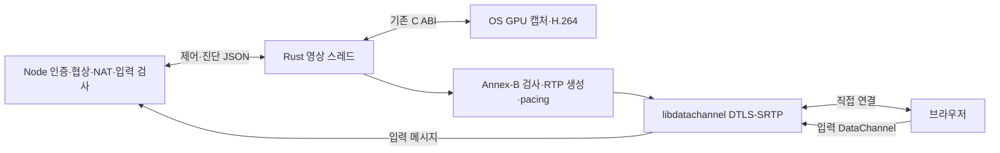

## Execution Path

The default is `MEW_DESKTOP_ENGINE=rust`. `native-host.mjs` loads the Rust cdylib into the same process through Koffi. A dedicated thread in `rust/src/engine.rs` creates the GPU device and calls capture startup, output reading, encoder control, and cleanup on that same thread. Windows COM and GPU surface lifetimes are not transferred to other threads. It reuses Windows GPU ABI 5, Mac/Linux ABI 2, and existing hardware encoders; OS capture itself is not rewritten in Rust.



`rust-engine.mjs` provides the existing worker's `postMessage`, `message`, and shutdown interfaces. It retrieves only control events at 4ms intervals; GPU output and RTP packets do not cross this boundary. While active, Rust checks encoder output and performs pacing; while idle, it waits only for control commands. The original 1/2ms GPU polling remains, so this implementation does not wake all capture through OS events.

Node retains SDP mode selection, STUN retries, temporary NAT mappings, RTT adaptation policies, and clipboard and input permission checks. `rust-direct.mjs` uses the existing `video-settings.mjs` and `video-adaptation.mjs` and the shared retry lifecycle. The existing JS receiver checks session, lock, rate, and key state before injecting input messages into the OS. The independent Windows cursor is queried in `cursor-worker.mjs`, so video backpressure does not stop the cursor. The Mac TCC app identifier and Node executable remain unchanged; Rust is not started as a separate executable.

## Queues and transport

The GPU output buffer is limited to 4MiB. Rust checks Annex-B NALs and the negotiated SPS/PPS profile and level, then queues at most two compressed frames. RTP is generated as single NAL/FU-A in a reusable 1192-byte buffer, without creating JS objects or per-packet timers. libdatachannel handles the actual sockets, encryption, and NACK retransmissions. Rust sends compound RTCP SR and SDES with a mapping between the monotonic clock and RTP clock.

Frame order, IDR recovery, burst and lifetime limits, and quality recovery follow the [shared transport contract](remote-desktop.md#transport-and-latency). During IDR transmission, it does not read the next GPU output and preserves the additional keyframe request flag until completion or discard. It changes the encoder bitrate and pacer bitrate together and propagates Windows configuration failures upstream. `queueMs` is measured from when Rust reads the GPU output. Node and Rust clock values are not directly subtracted.

## Authorization and cleanup

- The control command and event queues are each limited to 256 entries. Queue overflow shuts down the engine; it does not wait indefinitely or silently drop control messages.
- `stop`, peer replacement, and shutdown requests change the atomic generation on FFI entry. Pending start commands and video transmissions from previous generations are rejected.
- Node renews the current session's authorization lease. Rust checks the 8-second interval since the last renewal using its own monotonic clock, so capture does not remain authorized if Node stalls. The 8-second limit does not guarantee that OS driver calls will not stall.
- `stopped` is sent only after GPU shutdown, encoder cleanup, and peer deletion finish. If POSIX stop confirmation fails, the host is not reused. The existing supervisor's timeout and forced termination boundaries remain.
- The Node event loop does not indefinitely join a Rust thread stalled in a driver. Only handles whose termination has been confirmed are released; failed confirmation is handled by discarding the resident host.
- Input, statistics, and callbacks with different session or negotiation IDs are not applied to a new connection. Video, input content, SDP, and ICE credentials are not written to files.

## Installation and comparison

All OSes require Rust stable, CMake, libclang, a C++ compiler, and Perl; Windows uses the MSVC Rust toolchain, Visual Studio C++ Build Tools, and Windows SDK. WSL remote desktop requires Windows tools. Existing OS-specific GPU, login, and permission requirements also apply unchanged. Tools must be discoverable in the installer's PATH.

`install-rust-engine.mjs` preserves the sources pinned in `Cargo.lock` in `rust/vendor/` and compiles them with `--release --locked --offline`. Notices and corresponding sources for MPL libraries, OpenSSL, and other components are not removed. The [distribution contract](remote-desktop-distribution.md) owns the scope of licensing and Windows OpenSSL path corrections. The installer and preparation hashes include nested Rust sources, lockfiles, and build scripts.

Move completed files from the temporary path to the final path, and sign them locally on Mac. Installation verification invokes only engine ABI 1 and does not start capture, input, or the GUI. Record `.mew-ready` only after the GPU module, Rust module, and ABI checks all succeed. Prepare again if files are missing or the source changes. Do not add generated binaries or vendor or target folders to Git.

`MEW_DESKTOP_ENGINE=legacy` selects the existing JS GPU worker, frame IPC, and JS pacing path. It is for comparison and recovery; failures do not trigger automatic fallback. Compare using the same screen, quality, and network connection, and restart the resident host when changing the engine selection. Windows/WSL passes the selection to the authenticated bootstrap so it persists in the login session. The user performs app builds, installed copy updates, and production restarts.

## Verification Scope

Rust unit tests check Annex-B boundaries, FU-A reconstruction, sequence wrap, finite bursts, IDR backpressure, reference recovery, profile rejection, authorization generations, and lease expiration. `cargo clippy --all-targets -- -D warnings` also checks Rust warnings. Existing JS transport, permission, and OS lifecycle regression tests are maintained separately.

The opt-in test in `server/remote-desktop-rust.test.ts` returns pregenerated FHD H.264 synthetic video from a separate temporary GPU ABI library. It receives video through actual libdatachannel and Chromium and checks that at least 8 frames are decoded while the Node event loop stalls for 400ms, that the same engine can reconnect after stop confirmation, and that it shuts down independently 8 seconds after lease renewal stops. It then runs the existing resident host integration tests in separate Xvfb and D-Bus environments to also verify XTest input on the synthetic screen, key release on permission revocation, OS locking, reconnection in the same process, and connection notifications. The test's FFmpeg and software encoder are used only to generate synthetic fixtures and are not included in the production path. The Chromium fixture's receiving SDP is set to the supported Baseline level 4.2.

On 2026-10-24, the Rust unit tests, Clippy, and synthetic browser tests above passed on Linux. This provides evidence that video transmission is separated from the JS event loop; it does not measure actual GPU performance, superior image quality, or improvements in input-to-display latency. Actual builds, signing, and execution of the new Rust library on Windows/MSVC and Mac, actual Linux GPUs and Wayland portals, and comparisons over external networks and at high refresh rates are unverified.

Run isolated tests from the repository root as shown below. Do not specify the production installation directory.

```bash
cargo test --manifest-path native/remote-desktop/rust/Cargo.toml --locked
cargo clippy --manifest-path native/remote-desktop/rust/Cargo.toml --locked --all-targets -- -D warnings
MEW_DESKTOP_TEST_RUST_LIBRARY="$PWD/native/remote-desktop/rust/target/debug/deps/libmew_desktop_engine.so" \
  node --test server/remote-desktop-rust.test.ts
```
