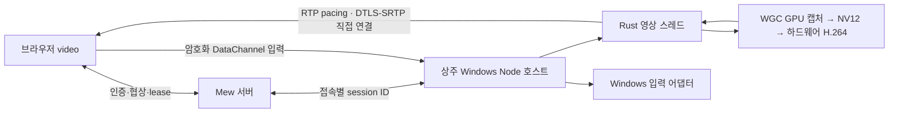

[Installation and usage](../../../docs/guides/remote-desktop.md) · [Distribution licenses](remote-desktop-distribution.md) · [ADR 0185](../history/decisions/0185-mew-desktop-resident-direct-host.md) · [ADR 0189](../history/decisions/0189-mew-desktop-external-direct-connectivity.md) · [ADR 0144](../history/decisions/0144-mew-desktop-local-cursor.md)

## Boundaries and lifecycle

Under [ADR 0185](../history/decisions/0185-mew-desktop-resident-direct-host.md), video/input use direct WebRTC only. Mew's authenticated WebSocket carries negotiation, authorization, lifecycle, and cursor metadata; TURN and WebSocket video relay are rejected. Previous Electron/server transport implementation and checks remain in the [historical record](../history/remote-desktop-electron-transport.md).

`server/desktop-resident-host.ts` prelaunches the login host at server startup on supported OSes when installation is ready. Preparation retains only the D3D device and screen list. Capture, encoders, GPU polling, sleep prevention, and timer-resolution requests exist only in active sessions. Closing/changing the shared screen creates a new session in the same host process, without a permanent Windows service or login autostart. Mac/Linux also use resident Node/native hardware H.264 under the [POSIX contract](remote-desktop-posix.md). Each Windows connection refreshes screens/physical coordinates and immediately selects the default/preferred screen, avoiding a browser selection round trip.

Windows uses a temporary least-privilege InteractiveToken task under the same user SID and an authenticated named pipe. Entry is `native-host.mjs`, executed by installed `runtime/node.exe`. The pipe's per-run 256-bit token permits the current user SID, denies Network SID, and checks the client login session. Authentication removes the token from the environment; it is never stored on disk. If the parent disappears, the login supervisor terminates it through the retained process handle. Privileges do not extend through WSLg, session 0, the lock screen, or UAC.

Internal messages carry a random 128-bit connection session ID; stale responses, input, and worker callbacks cannot reach a new session. Control transfers only after native `stopped` confirmation. After 3.5 seconds without confirmation, the host is discarded and relaunch waits 11.25 seconds to cover the parent's 8-second and virtual monitor's 10-second leases. Authentication, Origin, exclusive control, and revocation checks remain. Active input times out after 1.5 seconds and parent authorization after 8 seconds; capture authorization is independently checked by the worker, and input requires the Default desktop.

Windows physical/virtual outputs use WGC GPU surfaces. The [virtual display contract](remote-desktop-virtual-display.md) owns the in-house monitor, permissions, signing, installation, and unverified scope. GPU warmup works without a monitor; input preparation waits for actual virtual-output coordinates. Connection completion requires both input channels and the first video decode.

Executable discovery reuses in-progress requests and successful results for 30 seconds, never installation versions, permissions, or authorization. Read-only firewall diagnostics do not block startup; a blocked `runtime/node.exe` plus no explicit inbound allow rule produces guidance. Installation UAC and temporary active-connection NAT preparation follow the [external connectivity contract](remote-desktop-connectivity.md). `ready` means installation readiness, not successful login/direct connectivity. Video, clipboard, keystrokes, SDP, and ICE credentials are never written to files.

The default Rust engine runs within Node, with GPU ABI calls, Annex-B checks, RTP, pacing, and WebRTC transmission on a dedicated thread. Compressed frames/RTP bypass JS worker IPC. Node retains authentication, SDP, NAT preparation, congestion policy, and OS input checks. See the [Rust engine contract](remote-desktop-rust.md) for installation, lifecycle, and checks.

## Host connection notifications

After first video decode and both input DataChannels are ready, the browser sends `viewer-ready` once on reliable `control`. The host rechecks both channels and displays **mew remote desktop connected** once per current connection. Warmup, negotiation-only/no-video connections, and stale session responses cannot notify. A new session from reconnect or screen switching may notify again.

Windows builds `notification-windows.cpp` into the GPU DLL. A short-lived native thread, separate from capture/input, calls `Shell_NotifyIconW`; shutdown or at most 30 seconds cleans its icon, hidden window, and thread. It creates neither notification polling nor another executable. `NIF_REALTIME` avoids delayed-notification queues; notifications are silent and follow OS settings ([Microsoft API](https://learn.microsoft.com/en-us/windows/win32/api/shellapi/ns-shellapi-notifyicondataw)). Mac uses UserNotifications, Linux D-Bus Notifications. API/service/permission failures do not fail video/input; actual display depends on OS settings and service availability.

## Automatic preparation and internal tmux

`./mew setup` loads settings, then runs `native/remote-desktop/install.mjs` and `permissions.mjs` after app `npm ci`, before build/startup. This installer owns OS detection, Windows-from-WSL installation, `MEW_DESKTOP_HELPER_DIR`, dependency reuse, and checks. Installation/permission failures warn and let Mew setup continue; SIGINT/SIGTERM abort it. `./mew desktop-setup` uses the same settings/preparation, preserves failure codes, and neither builds nor starts/stops Mew. Output stays in the invoking terminal, outside internal tmux status. It activates no capture, input, login autostart, or resident helper. After `./mew update`, components still update on the next viewer connection.

Setup integration checks use Bash syntax validation and simulated installer/permission success, failure, and interruption. Agent validation does not run actual setup, downloads, builds, or server startup.

For owners/managers, preparation availability in `/api/remote-desktop/status` makes `desktop-preparation.ts` call `POST /api/remote-desktop/install` once, then poll with `GET`. Failure does not auto-retry; completion rechecks status before opening WS. Poll intervals grow 250 → 500 → 1000 → maximum 1500ms, balancing quick code updates against long downloads. Preparation allows 20 minutes; video timeout starts afterward. Closing cancels only requests/polling. `server/remote-desktop-install.ts` owns fixed session `mewcmd-desktop-install`; HTTP cannot supply commands, directories, or sessions.

Installation uses the server's Node and app-root `native/remote-desktop/install.mjs`, independent of project cwd. A POSIX shell records exit status regardless of fish/zsh, inheriting server PATH, WSL_INTEROP, and MEW_DESKTOP_HELPER_DIR. Concurrent requests share the running installation; only retrying a completed task replaces the previous terminal.

The tmux manager's `startCommand` launches installation as a new session's first process. It avoids interactive `send-keys` and shell-initialization input loss/delay. Completion leaves `/bin/sh -i` open for output. Session startup failure records exit 125 rather than permanent running state; normal-terminal `runCommand` is unchanged.

`MEW_DATA_DIR/desktop-install/` stores only the start marker/exit code; npm output stays in tmux without another log. The exit code distinguishes success/failure even if the session survives. A vanished session without a result means interrupted. Restart rereads both state and terminal.

`SessionTerminalPopup` uses a separate portal above fullscreen. While open, it makes the remote screen inert; terminal Esc cannot close that screen. **View setup details** opens it from setup/errors, and closing it does not stop installation. Setup completion connects automatically; status polling runs only while setup/details are active.

PowerShell installs the Windows copy from WSL, changing to the Windows destination before npm to avoid UNC cwd errors. Host/installer use dedicated helper Node/npm. If missing, `windows-runtime.ps1` verifies official Node 24.21.0 x64/arm64 ZIPs against pinned SHA-256 and extracts them to helper `runtime/`. Download, checksum, and execution were verified in a real-machine temporary folder. Global installs, PATH, registry, and interop remain unchanged. Every OS installer shares `MEW_DESKTOP_HELPER_DIR` with the runtime.

Installer and connection setup share `native/remote-desktop/wsl-powershell.mjs`. Without Windows PATH entries, it resolves the drive from `/proc/mounts` and the absolute `Windows/System32/WindowsPowerShell/v1.0/powershell.exe`, handling custom mounts/escaped spaces and checking `/mnt/c`. Missing executables produce drive-mount guidance; non-executable files produce interop guidance. Discovery neither runs installation nor automatically retries it after failure.

After PowerShell discovery, read-only checks inspect `/proc/sys/fs/binfmt_misc/status` and `WSLInterop`. Missing registration can make a POSIX shell parse an exe as `MZ`/syntax errors, so execution stops with interop guidance: run `wsl --shutdown` in Windows PowerShell, then restart WSL and Mew, noting that all running WSL distributions stop. Disabled registration gets enablement guidance instead. The app changes no registrations, sockets, or system settings. Valid registration alone does not ensure execution; the current session socket may also be required.

Windows/WSL runs `[1/3] npm ci` → `[2/3] node-datachannel·Koffi binding import 검증` → `[3/3] C++ GPU DLL 컴파일`, then `install-rust-engine.mjs` preserves locked sources, builds release Rust, and checks ABI. Dedicated Windows Node, C++ Build Tools, Windows SDK, and Rust build tools are required. Missing DLL/ABI mismatch blocks connection. Browser setup first terminates the resident host and awaits login-supervisor cleanup. Direct `desktop-setup` can fail while that host holds the DLL: stop the server first or use viewer setup.

Mac/Linux installs supported dedicated Node and its notices, checks bindings, and marks success only after GPU/Rust compilation and local Mac app signing. Download/build failures leave no success marker. Installation checks neither capture the screen nor launch a GUI.

The readiness API does not recommend reinstalling for discovery, interop, or file-permission errors. `.mew-ready` records `helper-version.mjs` shared files/content hashes; missing executables/marker or changed source trigger automatic setup. `.mew-dependencies` fingerprints lockfile/OS/architecture, so code-only changes skip npm reinstall. Success requires OS runtime and native-module checks; a missing GPU or OS-specific Rust library reruns setup. Running-server connection code needs restart; new installations reread installer scripts.

## Transport and latency

Windows follows `rust-direct.mjs` → Rust `engine.rs` → `gpu-windows.dll` → Rust `rtp.rs`/`rtc.rs`, retaining GPU ABI 5 and POSIX ABI 2. WGC D3D11 textures are downscaled/converted to NV12 by GPU VideoProcessor and passed as DXGI surfaces to same-adapter Media Foundation hardware H.264 MFT. No raw-screen readback to CPU, Electron renderer, or canvas occurs. 3 NV12 surfaces, VideoProcessor views, and output buffers are reused only after encoder release via `IMFTrackedSample` ([Microsoft contract](https://learn.microsoft.com/en-us/windows/win32/api/mfidl/nn-mfidl-imftrackedsample)). GPU/color-conversion/encoder copies remain; this is not fully zero-copy.

Windows ABI 5 requires `S_OK` for initial CBR/bitrate and distinguishes unsupported optional low-latency/VBV/B-frame/GOP properties. Failure on a supported property or read-only `S_FALSE` is not success. Applied properties form a bitmask. Dynamic bitrate failures surface as worker errors; the initial setting is not repeated. Bitrate changes recalculate applicable VBV and clear its applied flag on failure. [SetValue return values](https://learn.microsoft.com/en-us/windows/win32/api/strmif/nf-strmif-icodecapi-setvalue) · [H.264 buffer size in bytes](https://learn.microsoft.com/en-us/windows/win32/codecapi/avenccommonbuffersize-property).

`video-settings.mjs` accepts:

| Setting | Values and limits |
| --- | --- |
| Resolution | 720p, 1080p, 1440p, 2160p; encoder maximum 3840×2160 |
| Target FPS | 30, 60, 120, 144, 165, 240; encoder maximum 240 FPS |
| Quality | Balanced/High; default 1080p, 60 FPS, Balanced (6 Mbps) |
| Transport priority | `quality`/`speed`; default speed, but older high-quality settings and requests without priority restore quality |
| Bitrate | Resolution bases 3.5, 6, 12, 24 Mbps × `sqrt(FPS/60)`; High doubles the result, capped at 50 Mbps |
| Codec | High H.264 offered first; browser-accepted Baseline supported |
| Encoder | B-frames 0, low latency, CBR; approximately two frames of VBV only where supported |

These settings do not guarantee measured quality or latency.

Capture/encoding start after the browser answer and stay within its payload, profile, level, max-fs/max-mbps, macroblock throughput, and FPS limits ([RFC 6184](https://www.rfc-editor.org/rfc/rfc6184.html)). For default-level 3.1 answers, `MediaCapabilities.decodingInfo(type='webrtc')` probes the accepted profile: only `supported` and `smooth` together raise the receive level. Failure, unsupported results, or more than 500ms retain the original answer ([W3C contract](https://www.w3.org/TR/media-capabilities/)). Level 6+ requests also offer level 5.2; current libwebrtc stops at 5.2, so FHD 240 may fall to FHD 165, QHD 165 to QHD 144, and 4K 144 to 4K 60 ([libwebrtc parser](https://webrtc.googlesource.com/src/+/refs/heads/main/api/video_codecs/h264_profile_level_id.cc)). Native rejection tries lower FPS/resolution within negotiation. SPS exceeding the selected profile/level stops transmission before sending. CPU encoding is never a fallback.

`timeBeginPeriod(1)` applies only during active sessions and pairs with `timeEndPeriod` using the same value ([Microsoft timer contract](https://learn.microsoft.com/en-us/windows/win32/api/timeapi/nf-timeapi-timebeginperiod)). Active polling is 1 ms at ≥120 FPS, otherwise 2 ms, and stops idle. Each MFT input-acceptance event is one credit. Frame clocks absorb small scheduler delays and reset after long pauses without catch-up bursts. Missing hardware encoding or DXGI failures from rotation/lock/device changes end the session with guidance. Source screen, encoder, decoder, and display constrain actual FPS; static screens emit no new frames. The virtual driver remains 1920×1080 at 60 Hz. HDR, native rotation, and physical 4K/high-refresh performance are unverified.

The Rust engine reads compressed GPU access units up to 4 MiB and holds at most two frames: transmitting and waiting. IDR transmission blocks reading another frame. Reference order is preserved, SPS/PPS accompany IDRs, and reusable buffers produce single-NAL/FU-A RTP up to 1192 bytes. Budget is 1.15 × encoder bitrate minus 48 bytes UDP/IP/SRTP overhead per packet. Burst allowance is max(two maximum-size packets, 5 ms budget), without frame-boundary replenishment. Rust emits compound RTCP SR/SDES; native libdatachannel handles NACK retransmission, ICE, and DTLS-SRTP.

Regular-frame limits are `max(24ms, 2/FPS)` for speed and `max(100ms, 2/FPS)` for quality; IDRs allow 500 ms. Time starts at GPU output, includes waiting/transmission, and does not reset at turn changes. A broken reference chain clears waiting frames and requests IDR. Congestion slows encoder and pacer while retaining requested resolution/quality. These limits do not bound total input-to-display latency or all OS queues.

`MEW_DESKTOP_ENGINE=legacy` selects `gpu-worker.mjs`/`gpu-posix-worker.mjs` → `video-pump.mjs` → `video-pacer.mjs` for comparison/recovery. Only legacy transfers compressed frames and ACKs by session/negotiation/frame ID; same-thread Rust needs no per-frame JS ACK. [ADR 0059](../decisions/0059-remote-desktop-rust-engine.md) changes implementation placement while retaining [ADR 0024](../decisions/0024-remote-desktop-fhd-pipeline.md) frame limits and quality recovery.

Browser feedback, approximately every 200 ms, reports receive/decode deltas, loss, average jitter-buffer residence, RTT, and optional average decode time. Loss >2%, buffer growth, rising RTT, or internal backlog triggers 20% reductions at least 200 ms apart. RTT handling distinguishes the first baseline+25 ms sample from later samples >5 ms above the rising period's peak, avoiding repeated cuts for stable high RTT/fluctuation. A stable 2-second period of normal receive/decode, no loss/buffer growth, and no recent backlog relearns baseline RTT. This route-change/congestion heuristic is not full bandwidth estimation.

Buffer growth is measured above observed minimum residence: >40 ms for speed, >80 ms for quality. Baseline updates require video progress without loss or rising RTT. Without receive/decode deltas, initial decode confirmation plus positive interval buffer residence is alternative evidence; idle 0 ms and explicit decode stalls never seed baseline. After 1.5 seconds without reduction, confirmed video progress/stable RTT allow `dR/dt = 0.25R + 0.05M` recovery (`M`: selected mode maximum bitrate; time in seconds). Each sample contributes ≤500 ms, bitrate caps at `M`, and idle samples cannot recover quality. Mode reset clears baselines/clocks. Initially high buffers can become baseline, so low absolute latency is not guaranteed.

Both priorities apply the same encoder/pacer bitrate, from 350 kbps to the mode's initial bitrate. Quality allows longer regular-frame transmission and greater receive-buffer growth, without guaranteeing indefinite clarity or stable FPS. Very low throughput/high loss requires IDR recovery after finite frame limits. PLI/FIR and post-reception decode stalls request keyframes; static/no-frame screens do not request periodic IDRs. HEVC, AV1, dynamic encoder FPS, and event-based wakeups are excluded. Decode-cost receiver overload control and full GCC remain unverified.

While transmitting a large IDR, Rust defers additional encoder IDR requests from receive stats or PLI/FIR until completion/discard; legacy suppresses duplicate receive-stat requests. Stats-based decode-stall recovery resumes afterward. Recovery flags survive deferral but never apply to ended sessions, preventing redundant keyframes while one is still transmitting.

Windows cursor polling is independent of video: target-FPS timing, minimum 8 ms interval, maximum 120 Hz, even with two queued video frames. Unchanged metadata is omitted; termination clears the timer.

### Stage-by-stage diagnostics and FHD verification

Optional `connectDesktop()` `diagnostics` supplies `sender`/`receiver` aggregates independently of on-screen stats, without new default-UI messages or log storage. Current-peer/negotiation `getStats()` arrives about every 200 ms; results after termination are discarded.

Sender `video-status` reports queue length; interval maximum frame size, transmission time, poll cost, and production backpressure; handoff FPS; and compressed Mbps.

| Field | Meaning |
| --- | --- |
| `queueMs` | Maximum interval waiting/transmission residence after Rust reads GPU output; legacy also includes worker IPC |
| `captureMs` (Windows) | WGC QPC capture timestamp → input processing |
| `encodeMs` (Windows) | Input processing → output drain, including GPU conversion, encoder internals, and poll wait; not pure GPU encode time |
| `encoderOptions` (Windows) | Applied property bits: low latency 1, CBR 2, bitrate 4, VBV 8, B-frame 0 setting 16, GOP 32 |
| `encoderBitrate` (Windows) | Readable bitrate property, distinct from actual compressed output rate |

Unsupported readbacks are omitted.

Receiver aggregates contain resolution, cumulative decoded/discarded frames, decode time, buffer time/emitted frames, freezes, and sample time. Cumulative values become interval deltas. Out-of-range mode/diagnostic numbers are rejected/omitted; unsupported values never become 0. Durations stay within their clock: Windows QPC, Rust monotonic queue time, or legacy same-Node performance origin. Host/browser timestamps are not directly subtracted.

The primary FHD comparison conditions are an actual 1920×1080 source, a request for FHD at 60FPS and high quality (12Mbps), and the same display scaling and network. Comparisons are made without lowering resolution or recompressing frame data. In the 2026-10-20 fake-clock check, with 25KB AUs, an 8ms synthetic encoder, and 2ms polling, throughput over 2 seconds was 105 frames serially → 117 frames overlapped, with 0 dropped in both cases. In the 4-second case with RTT changing from 10→40ms and normal reception, it recovers to 12Mbps instead of the previous collapse from 12Mbps→350kbps. With normal feedback at 200ms intervals after 30 congestion events, recovery to FHD 12Mbps takes 55.6→8.2 seconds. These are not measurements of FPS or input-to-display latency on an actual GPU and network or against StarDesk.

In the 2026-10-16 deterministic feedback reproduction, loss of 0, RTT of 10 ms, receive-buffer time of 45 ms, and continuous decoding were reported every 200 ms. The previous controller slowed from 6 Mbps to 350 kbps in 2.4 seconds; after the fix, it maintained 6 Mbps under the same conditions. Unit checks verify alternating fixed 45/80 ms and idle samples, prevention of baseline contamination by decode-stall or loss samples, reductions for buffer growth relative to baseline, loss, and rising RTT, and mode resets. These results do not measure improvements in quality, FPS, or input-to-display latency on actual devices, or performance against StarDesk.

In a deterministic transmission reproduction on the same day with a 100 KB IDR and 4 ms callback intervals, completion time fell from 332 to 120 ms in 6 Mbps mode, and from 168 to 60 ms at 12 Mbps. These values compare only pacing policies using a fake clock; they are not actual network throughput or input-to-display latency. Actual timer delay distributions, GPU encoding, external networks, and receiving decoder performance must be measured separately.

The browser uses `<video>` and supported `jitterBufferTarget=0`, but chooses its own minimum buffer. Connection failure or no decoding within 20 seconds of offer shows guidance; the former 1.2-second server-transport fallback is removed. Separate cursor PNG/position metadata retains local cursor/input seq correction. Motion uses unordered retransmit-0 DataChannel; buttons, keys, paste, and recovery feedback use reliable DataChannel.

Default ICE uses public Google/Cloudflare STUN with bounded retries replacing the native agent. Delayed connections request short-lived PCP/NAT-PMP/UPnP mappings from the OS default gateway. Installation prepares Windows-approved UDP app rules without overriding blocks. See [external direct connectivity](remote-desktop-connectivity.md) for lifetimes/checks. HTTPS tunnels carry auth/negotiation only; tunnel success does not prove external video connectivity.

## Viewer settings and coordinates

Settings use `SelectField` for resolution, FPS, quality, and transport priority. Changes release inputs, clean the connection, and reconnect the same screen in a new session. Scoped `mew-desktop-video` stores requests; invalid/read-failed storage uses defaults. UI distinguishes requested and negotiated modes and shows received resolution, decoded FPS, applied target FPS, RTT, Mbps, H.264 profile, and queue time. Updates run about every 1 second, independently of 200 ms feedback. RTT measures ICE round trips, not input-to-display latency; received FPS is not displayed FPS ([WebRTC statistics](https://www.w3.org/TR/webrtc-stats/)).

The fullscreen toolbar displays combined received/sent session bytes as `누적 12.3 MB`, with separate directions in its accessible name/title. Existing stats refresh it about every 1 second. Setup shows `0 B`; termination/errors retain the last total. Reconnect, screen change, or viewer reopening starts at 0, while negotiation retries, rotation, and fullscreen retain session totals.

`desktop-network.ts` sums per-ID [candidate-pair byte deltas](https://www.w3.org/TR/webrtc-stats/#dom-rtcicecandidatepairstats-bytesreceived), counting video/DataChannel once rather than adding RTP/DataChannel stats again. Disappeared paths retain prior totals; new peers start separate counters. Auth WebSocket strings add UTF-8 lengths. Setup HTTP and other Mew features are excluded, as are unreported headers/padding/ICE checks and WS/TLS/IP headers. Totals can differ from OS/carrier accounting; termination uses the last WebRTC sample.

Per-connection deltas are also reflected in [cumulative network usage in the app header](network-usage.md). The header retains values from multiple remote sessions after disconnection and includes installation/setup HTTP in the remote desktop category. The shared tracker does not count the authentication WebSocket twice.

Input-device controls are detected independently:

- **Mouse/trackpad:** initial/`change` values of `(any-hover: hover) and (any-pointer: fine)` or remote-screen `pointerType=mouse` hide virtual mouse, view/zoom controls, and handles. `pen` is not mouse. Controls return when the media condition stops matching, or on touch while it is false.
- **Keyboard:** the first trusted, non-composing supported-`code` keydown on the remote screen/viewer root hides the entire hotkey bar. Settings, paste, joystick, and synthetic events do not establish keyboard presence. Detection lasts through viewer reconnect, rotation, and layout reset.

Browsers offer no generic keyboard attach/detach API, so connection alone cannot trigger detection and disconnection cannot restore controls automatically. Virtual keyboards/accessibility devices can also emit `code`; it does not prove physical hardware ([MDN code](https://developer.mozilla.org/en-US/docs/Web/API/KeyboardEvent/code), [any-pointer](https://developer.mozilla.org/en-US/docs/Web/CSS/Reference/At-rules/@media/any-pointer)). Hidden controls unmount from touch/Tab navigation and clean up active joystick input.

The toolbar matches panel headers: `surface-deep`, `edge` bottom border, 36 px height, 24 px close button, 28 px other tools, and 12 px title/tool text. At ≤600 px width it becomes two 36 px rows plus separate safe-area space. The internal desktop dock shares header height.

Screen, video, and hotkey-modifier selectors use `SelectField`, portaled into the rotating panel. Menus use transformed-container local coordinates and track size/transform changes in normal/fullscreen views. Esc closes list then settings while retaining the screen; Back closes list, settings, then screen. Modifier selection sends no remote keys. Screen selection reconnects with that screen ID.

The default viewer keeps the task dock: fixed mobile bottom bar or movable translucent desktop capsule ([dock contract](ui-contracts.md#dock-and-top-menu)). App preserves dock state/order/touch-name toasts while portaling through `dockHostRef`, outside inert background. Mobile video/joystick reserve 48 px plus safe area; actual fullscreen hides the dock host/removes spacing and restores both on exit. Mobile-keyboard dock hiding remains. Switching dock panels closes the viewer, connection, and pressed inputs before navigation; the same desktop button does not reconnect. Background-editor and installation-terminal modal/inert boundaries remain. Do not restore default-viewer dock hiding without a user request.

- Fullscreen follows `document.documentElement.requestFullscreen()` and `fullscreenchange`, targeting the full document because the installation terminal uses a body portal. Unmount exits only viewer-owned fullscreen; rejection/unsupported cases show status ([Fullscreen API](https://developer.mozilla.org/en-US/docs/Web/API/Element/requestFullscreen)).
- `.desktop-panel` rotates video, local cursor, mouse, hotkeys, toolbar, settings, and dock in 90-degree steps. At 90/270 degrees, layout dimensions swap and container queries relayout UI. Contain/zoom/pan are computed before rotation. `desktopLocalPoint`/`rotateDelta` inverse-transform clicks, touches, joystick, and handles; cursor/knob inherit rotation. Rotation releases inputs/touches and resets zoom, pan, and controls. Global video `max-width` is removed. Direct-video `loadedmetadata`/`resize` synchronize positive dimensions, including same-track resolution changes.
- `DesktopStick` sensitivity defaults to 3, ranges 0.5–6 in 0.1 steps, and multiplies speed-based `desktopStick` movement. At 200 CSS px/s and 3×, 1 CSS px yields 6 remote px. Arrow keys move 3 × existing 16px without acceleration. Wheel/pan/zoom are unaffected. `mew.desktop.sensitivity` accepts only numeric localStorage values and clamps them; unavailable storage limits settings to this window.
- `DesktopFloating` shares pointer capture, arrows, cancellation, and resize constraints for mouse/hotkeys. Positions last for the viewer and reset together in settings. On short landscape screens, the hotkey list scrolls while its handle remains visible.
- The hotkey bar is 56 px wide with 2 px outer margin, 24 px items, and 9 px text. Collapse reduces width to 32 px with expand button/handle only; hidden items cannot receive focus/touch. State survives viewer rotation, position resets, and reconnection. Expand reapplies bounds for the new size.
- Connected hotkeys release existing inputs, press the combination in order, release in reverse, and send final release. Ctrl/Cmd selection is viewer-local; OS-reserved/unsupported combinations follow native adapter handling.
- Settings focus the sensitivity input. Tool-focused Esc closes auxiliaries, then fullscreen; repeats do not close the viewer. Mobile Back closes auxiliaries, fullscreen, then viewer. Close ends immediately. Auxiliary/fullscreen-only Back returns false from `closeOnBack` to re-register the guard. Ordinary remote keyboard input requires screen focus.

## Input and permissions

Mouse geometry is fixed proportionally, including after panel rotation:

| Region | Size |
| --- | --- |
| Whole mouse | 132px × 184.8px |
| Top left/wheel/right | Width ratio 2:1:2; height 2/5 of total width = 52.8px |
| Left/right click | 52.8×52.8px each |
| Wheel | 26.4×52.8px |
| Lower cursor pad | 132×132px |
| Movement handle | Same width as mouse, 44px tall; 8px below right pan/zoom container |

CSS Grid aligns both columns so right container + gap + handle matches mouse height. Connection guidance stays above floating controls, keeping reconnect/install reachable regardless of placement or size.

Under [ADR 0145](../history/decisions/0145-mew-desktop-mouse-controls.md), top left/wheel/right controls and the full-width cursor pad form the mouse; pan/zoom uses an adjacent column and the existing handle moves the group. Left/right joysticks press before first movement at 3px and release on up/cancel/blur. Cursor-pad taps/holds never press buttons. Only wheel enters middle-button dragging after a 320ms hold. Arrow dragging releases when all arrows lift, on blur, or when disabled.

[ADR 0154](../history/decisions/0154-mew-desktop-touchpad-motion.md) cursor/button dragging uses deltas from the previous input with 2px base gain × velocity acceleration × sensitivity. Crossing 3px includes the initial distance and retains fine movement/reversals. The visual handle's 8px radius does not bound touchpad travel; each touch resets its reference.

Under [ADR 0169](../history/decisions/0169-mew-desktop-view-velocity-controls.md), wheel/pan/zoom are velocity joysticks. After initial 3px movement, displacement uses `.desktop-stick-ring` center, not the touch origin. A 3px dead zone and 32px maximum radius give t = clamp(distance outside dead zone / 29px, 0–1). The t / (1 + t) curve multiplies wheel 900px/s, pan 600 CSS px/s, and logarithmic zoom 1.5/s: actual maxima are 450px/s, 300 CSS px/s, and 0.75/s, half the former linear maxima. Visual handle movement stays linear. Wheel/zoom use vertical input, pan radially normalized axes. rAF/input time integration continues while held, capped at 50ms per step. Center return, up/cancel/blur, disable, or unmount stops it. Wheel-hold middle dragging retains touchpad behavior; normal scrolling cannot switch mid-gesture. Arrow repeats are unchanged.

The mouse, view control column, movement handle, and left hotkey bar use a background that mixes 78% theme surface with transparency and a 4px backdrop blur. Container opacity is not applied, keeping text, icons, and focus indicators sharp.

Velocity acceleration is `min(16, hypot(Δx, Δy) / Δt / 0.2)` (Δt in ms), using event `timeStamp` and supported `getCoalescedEvents()` to exclude React delays. Positive fractional intervals stay exact; equal/backward timestamps use 1ms, and invalid input is ignored. The 16× cap has no low-speed floor. Constant-speed distance is invariant to sample subdivision. Cursor/button dragging emits no rAF movement after the finger stops; each touch resets time/position. Acceleration includes wheel middle-drag, not ordinary scroll/pan/zoom, physical absolute mouse, or key repeats. Within the cap, 100px/50ms travels exactly 10× 100px/500ms; screen-edge clamping takes precedence.

Windows converts `MapVirtualKeyW(vk, MAPVK_VK_TO_VSC_EX)` into `SendInput` `wScan` with `KEYEVENTF_SCANCODE`; E0 uses `KEYEVENTF_EXTENDEDKEY` on press/release. Numpad Enter differs from Enter through E0 1C. E1/Pause, Hangul/English, Hanja, and unmappable keys retain virtual-key input. This addresses game issues from `wScan=0` ([KEYBDINPUT](https://learn.microsoft.com/en-us/windows/win32/api/winuser/ns-winuser-keybdinput), [MapVirtualKeyW](https://learn.microsoft.com/en-us/windows/win32/api/winuser/nf-winuser-mapvirtualkeyw)). FFI-double `remote-desktop-native.test.ts` checks WASD/Q/E/F/G/Space, modifiers, extended keys, numpad, and fallback packet bytes; it proves neither Roblox success nor compatibility with all games.

The v1 snapshots in `desktop-input.ts` and native `protocol.mjs` contain cumulative movement and wheel counters, the full button bitset (left=1, middle=2, right=4), a key list, and an optional normalized absolute position. Fractional movement is accumulated before transmission as integers to preserve fine input.

- `motion`: unordered, maxRetransmits=0. If the send queue exceeds 2KB, transmission is skipped and the next cumulative snapshot recovers the distance.
- Normal pointer movement, dragging, and wheel input follow the selected target FPS; after mode negotiation, they are coalesced with the applied FPS (30–240) as the cap. No catch-up burst is sent even if rAF is delayed. The first rAF approximately 70ms after the last movement/wheel input recovers losses with a reliable snapshot. Button and key transitions do not wait for a frame.
- `control`: ordered/reliable. The epoch increments on button/key transitions and every 250ms heartbeat. The connection closes if the queue exceeds 64KB. Idle heartbeats that have received only cursor feedback, keyboard input, and releases do not send absolute coordinates. Actual clicks, wheel input, movement, and recovery of the final lost movement include coordinates.
- seq discards stale packets. Only the latest motion packet from a future epoch is retained and applied after the corresponding reliable transition. Fast movement packets cannot overtake click down/up events and eliminate the click itself.
- The final lost movement is first restored with the existing button state, then the new button transition is applied. down/up/wheel all calculate the UI event coordinates first, clamping the release position to the edge if it is outside the screen. Wheel input includes the same coordinates and is processed after the receiver applies the position.
- Inputs are released on blur, pointercancel, lost capture, or close. Entering the background also stops video. If the native input heartbeat stops for 1.5 seconds, inputs are released and the session terminates.
- The server checks authentication and WS liveness every 3 seconds. Account, role, or session invalidation closes the connection. The helper app exits if the parent lease is absent for 8 seconds or stdin closes. When there is no session, only the resident pool sends idle leases. If graceful shutdown is delayed, only children it launched are terminated, and new control is not granted until native cleanup is confirmed or the existing lease expires.
- Input is limited separately to 300 unreliable motion messages and 256 reliable control messages per second so high-refresh-rate movement does not exhaust the receive budget for keys and buttons. Excess motion is recovered through the next cumulative snapshot; excess reliable input closes the connection. Limits also apply to negotiation messages at 128 per 3 seconds, incoming WS messages at 128KB, and pending Wayland inputs at 32. WebSocket input and frame ACKs are not accepted. When a session ends, the DataChannel and input receiver are released, and a new session starts with fresh seq/epoch state.

The physical desktop is not isolated by Mew account. Only one control connection is allowed per server process. If multiple servers run as the same OS user, locks are not shared across servers, so operate only one server for remote control. The canonical source for permissions is [security.md](../../../docs/operations/security.md).

## On-screen keyboard

`DesktopScreenKeyboard` opens through an explicit toggle in the viewer tools and offers `full` and `game` modes. The full keyboard displays a standard English keyboard plus Hangul/English and Hanja keys, totaling 106 keys, and tapping Ctrl/Shift/Alt/Meta latches or releases them. Game mode starts with a 3-column layout of Q/W/E, A/S/D, and F/G/Space and sends presses/releases per pointer. Game modifiers also remain active only while held, like regular keys. If multiple pointers press the same key, it is released only when the last pointer is lifted.

Game key editing selects keys from `KEY_CODES` through the shared `SelectField` and supports changing each slot, adding, deleting, and restoring defaults. It allows 1–24 keys, excluding duplicates and unknown keys. The mode, key code array, and keyboard-only view preference are saved under `mew-desktop-screen-keyboard` in account/instance-scoped browser storage. Corrupted stored values revert to the default full keyboard/game layout; if storage is unavailable, the settings work within the current viewer. The open state is not persisted.

The full keyboard uses space below the video and offsets the bottom position of the virtual mouse/view controls by the keyboard height. In narrow or short panels, the keyboard scrolls internally. The game pad appears over the video and moves to the upper left on narrow portrait screens to separate it from the virtual mouse at the lower right. It follows panel rotation and releases pressed keys when rotated. Opening settings, input, help, or installation windows removes the keyboard and releases its keys.

`키보드만 보기` hides the video area and virtual mouse while connected, allowing both keyboard modes to use the panel's remaining space. The video element, received stream, and input connection remain active, and transmission continues. The hidden video area is also excluded from focus and accessibility navigation. Turning off the toggle, closing the keyboard, or opening another tool restores the screen; disconnecting shows the connection guidance again. If an older stored value lacks `keyboardOnly`, it defaults to `false`. Switching views also releases pressed on-screen keys.

On-screen keys are registered with `DesktopInput.key` under the `screen` owner, while existing physical input uses `physical`. The union of both owners is included in the existing snapshot of up to 16 keys, preserving a key held by one owner when the other releases it. On-screen-owned keys are released on keyboard close, mode/layout changes, touch cancellation, disabled state, rotation, fullscreen transitions, window blur, focus moving to another tool, or unmount. Focus movement between the remote screen and the on-screen keyboard/virtual mouse, and release of screen pointer capture, use `releasePhysical()` to clear only physical keys and mouse buttons, preserving game keys held by another finger. A full `input.release()` clears both owners and also resets on-screen pointer/modifier indicators through the `onRelease` subscription. The transmission format and native input limits remain unchanged.

Verification: `desktop-screen-keyboard.test.ts` and `desktop-input.test.ts` check stored-value normalization, shared key ownership, multitouch state, modifiers, and releases. `server/desktop-screen-keyboard-ui.test.ts` verifies both themes on PC/mobile, actual multitouch holds/cancellations, editing/reopening/refreshing, and releases on connection changes, rotation, fullscreen transitions, blur, and close. `server/remote-desktop-ui.test.ts` delivers on-screen keys to the existing synthetic WebRTC host. Input compatibility with actual games and physical OS security keys are not guaranteed.

## Keyboard Lock and clipboard

When the connected remote screen or viewer root has focus, the shared window capture listener in `registerKeyboardCapture` prevents default behavior and propagation for all keys and forwards supported `KeyboardEvent.code` values remotely. This listener registers before the App's tab close, creation, number selection, left/right navigation, and overlays, so Ctrl/Cmd+W, N, Shift+N, T, numbers, Tab, Escape, and F6 are also remote keys. keydown and keyup have the same owner, while local input in tools, settings, input, help, and the installation terminal is preserved. Pressed keys are released when screen focus is lost, the window blurs, or the viewer closes.

`keys.mjs` includes the numpad (including Enter and arithmetic operators), Insert, PrintScreen, ScrollLock, Pause, ContextMenu, F13–F24, international layouts, Hangul/English, Hanja, and mappable media/browser keys. Mac keys without a supported native key code are explicitly marked `null` so they do not become KeyA at 0. Delivery is not guaranteed for keys the client OS does not send to the browser or that do not exist on the host OS/layout. Repeated keydown events are converted into two reliable snapshots that release and press the same key, preserving repeats even on receivers that apply only state differences. If the remote screen is entered with a key held and the first received event is a repeat, the pressed state is sent first. If the screen is entered with modifiers already held, event flags are used to send the missing modifiers first.

When the remote screen has focus in JavaScript fullscreen, `navigator.keyboard.lock()` requests a lock on all keys the browser permits in supported browsers. The higher-priority request in `keyboard-lock.ts` replaces the app's reserved-key lock, and the app lock in the same fullscreen session is restored after focus loss, an auxiliary window, or disconnection. The lock is released on fullscreen exit, window blur, or screen hiding, and its lifetime is checked so a delayed approval response cannot release a new owner's lock. If the API is unsupported, fullscreen is inactive, secure context requirements are unmet, or permission is denied, only events delivered by the browser can be blocked. Denial is shown as guidance, and the connection remains active. Complete blocking is not guaranteed for security keys such as Ctrl+Alt+Delete, platform-dependent Windows key/Alt+Tab behavior, or Chrome's long-press Esc escape. No helper app is installed on the client for Keyboard Lock ([Keyboard Lock](https://developer.chrome.com/docs/capabilities/web-apis/keyboard-lock)).

Text clipboard requests and responses use only the reliable WebRTC control channel. Positive request IDs in `clipboard-read` are matched against `clipboard` responses, with a 3-second timeout and limits of 2 pending browser requests and 1 in-progress host request. The current session and logged-in desktop control permission are checked before and after reading, and responses after termination are discarded. Limits of 4096 UTF-16 code units and 16KB per response message apply; NUL, non-text, and oversized input are handled as errors or empty text. Clipboard contents are not stored, logged, or sent over the authentication WS.

After Ctrl/Cmd+C or X is sent remotely from the remote screen, clipboard text is fetched 200ms later and written to the browser clipboard. Ctrl/Cmd+V reads the browser clipboard, sets the remote clipboard through the existing paste path, and then performs the OS-specific paste. Paste combinations with additional Shift/Alt are forwarded remotely as keys. After success, keys still held are restored in the browser snapshot, and native `keyChord` also restores the latest key state as of clipboard write completion. If reading or sharing fails, remote Ctrl/Cmd+V is sent within the same focus to paste from the existing remote clipboard. If focus or the session changes during the asynchronous read, sharing and fallback are discarded. Change monitoring, continuous polling, and image/file clipboards are not provided. Users can explicitly retry with **Get Remote Clipboard** and **Paste My Clipboard** in the input window, and existing text input remains available. Guidance appears if automatic operation fails because of browser secure context, clipboard permission, or user activation restrictions ([Clipboard API](https://developer.mozilla.org/en-US/docs/Web/API/Clipboard_API)).

Windows reads CF_UNICODETEXT memory within the limit, always releases locks/clipboard handles, and does not free OS-owned memory. Mac reads NSPasteboard strings into a bounded UTF-8 buffer. Linux runs `wl-paste` or `xclip` without a shell, with limits of 2 seconds and 16KB of output.

## OS adapters

All supported operating systems share `native-host.mjs`, `native-direct.mjs`, and resident host lifecycle management. Video uses a direct WebRTC connection with hardware H.264, with no fallback to Electron, VP8, or server video relay.

| Host | Capture/encoding | Input |
| --- | --- | --- |
| Windows/WSL | D3D11·Media Foundation | SendInput |
| macOS 13+, x64/arm64 | ScreenCaptureKit/VideoToolbox | CoreGraphics/Accessibility permission |
| Linux X11, x64/arm64 | GStreamer X11 capture/VA-API/NVENC | XTest |
| Linux Wayland, x64/arm64 | ScreenCast portal/PipeWire/VA-API/NVENC | Same RemoteDesktop portal session |

Installation requirements, OS approval, lock and capture shutdown confirmation, and the scope of actual verification follow the [POSIX native contract](remote-desktop-posix.md). The screen is not captured or encoded while idle. Insufficient hardware or permissions cause an explicit failure.

## macOS capture and installation contract

### Mac terminal permission preparation

Permissions are checked from the same executable in its own `MewDesktop.app`, and only missing Accessibility and Screen Recording permissions are requested. Existing Electron permissions do not substitute for approval of the new app. Follow [permission preparation details](remote-desktop-posix.md#installation-and-permissions).

### Capture module

The ScreenCaptureKit NV12 surface in `gpu-macos.m` is passed to the VideoToolbox hardware encoder. Uncompressed screen data is not read into JS. Follow [GPU path and limitations](remote-desktop-posix.md#video-path).

## Verification

The 2026-10-07 video optimization passed 153 of 159 targeted regression checks and skipped 6 opt-in checks. Verification also covered 2 isolated Chromium viewers, PC/mobile video settings, a 144FPS target and 240→165FPS fallback negotiation on native Linux Xvfb, and an isolated UDP NAT connection on native Linux. TypeScript, lint (existing warnings), description, and diff checks passed. Static UI detection flags only one existing hidden cursor image that sets `src` dynamically. Linux production/test modules were compiled separately with a temporary SDK, and Windows sources were syntax-checked with the installed Windows SDK. Execution of the new Windows GPU module could not be verified because WSL interop was disabled. Successful negotiation of a high-refresh-rate target does not establish physical GPU processing/display at that FPS or measured input-to-display latency at high quality. This change did not include Mac execution, an app build, an installed-copy update, or a production server restart.

Resident host checks verify warmup without capture, reuse after confirmed shutdown, isolation of responses from stale sessions, and prevention of control reuse after shutdown failure. WebSocket checks verify authentication revocation, exclusive control, and relay rejection. Synthetic browser checks verify the first video and input readiness over actual WebRTC, plus one notification signal per connection.

Native Linux X11 capture, direct H.264 transmission, XTest input, authentication revocation, and reconnection within the same process are checked in isolated Xvfb. The software encoder used in these checks exists only in a separate test build and is not evidence of production hardware performance. Wayland checks actual Unix FD passing and portal lifetimes on isolated D-Bus. Actual Mac/Linux GPU and Wayland compositor operation is unverified. Follow the [specific verification scope](remote-desktop-posix.md#verification).

Previous Windows verification and Mac/Linux Electron verification are preserved in the [previous transport record](../history/remote-desktop-electron-transport.md) and [previous POSIX record](../history/remote-desktop-posix-electron.md).

The opt-in Windows pipe check uses a separate temporary native host to verify authenticated input/output, the login session, and parent-exit handling for a child whose JS has stalled. It does not overwrite the launcher or entry point of the existing installation.

Actual Windows hardware verification runs as an opt-in in `server/remote-desktop-gpu-windows.test.ts`. It requires a separate helper copy that does not overwrite the installation, a compiled DLL, and Windows npm dependencies. Set `MEW_DESKTOP_TEST_WINDOWS_HELPER` (an absolute Windows path) and `MEW_DESKTOP_TEST_WINDOWS_NODE` (the absolute path to Windows Node to run from WSL). The optional `MEW_DESKTOP_TEST_WINDOWS_CHROME` is the Windows Chrome executable path, and the test copy requires Playwright. The actual screen is received only in memory; no screenshots, clipboard changes, or pointer/key input are sent, and a successful connection may display a host connection notification. Time to first display is measured across two sessions on the same host. This value is the time to first screen in that test environment, not a guarantee for internet, mobile phone, or click-to-photon performance.

The user performs production server builds/restarts and actual helper installation. Historical verification figures and measured server transmission results follow the [previous record](../history/remote-desktop-electron-transport.md). Optional WSL firewall diagnostics distinguish an explicit inbound block on the Windows Node executable from the absence of an allow rule and include this distinction in failure guidance. If the query fails, the guidance is omitted and host startup is not blocked. The absence of a rule alone is not treated as proof that packets are actually blocked. The installer's OS approval procedure follows the [external direct connection contract](remote-desktop-connectivity.md).
