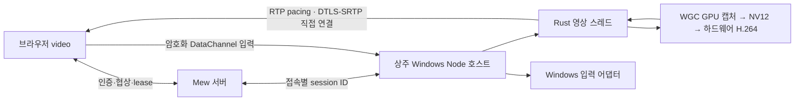

[Installation and usage](../../../docs/guides/remote-desktop.md) · [Distribution licenses](remote-desktop-distribution.md) · [ADR 0185](../history/decisions/0185-mew-desktop-resident-direct-host.md) · [ADR 0189](../history/decisions/0189-mew-desktop-external-direct-connectivity.md) · [ADR 0144](../history/decisions/0144-mew-desktop-local-cursor.md)

## Boundaries and lifecycle

Under [ADR 0185](../history/decisions/0185-mew-desktop-resident-direct-host.md), video and input use only direct WebRTC connections. Mew's authenticated WebSocket carries only negotiation, connection authorization, lifecycle, and cursor metadata. TURN and WebSocket video relaying are rejected. Implementation and validation of the previous Electron and server transport are preserved in the [historical record](../history/remote-desktop-electron-transport.md).

`server/desktop-resident-host.ts` prelaunches the login host at server startup on supported OSes if the installation is ready. During preparation, it retains only the D3D device and screen list. Capture, encoders, GPU polling, sleep prevention requests, and timer resolution requests exist only during active sessions. Closing or changing the shared screen creates a new session while reusing the host process. It does not install a permanent Windows service or login autostart. Mac/Linux also use resident Node and native hardware H.264. It follows the [detailed POSIX contract](remote-desktop-posix.md). Windows screen lists and physical coordinates are queried again on each connection, and the server immediately selects the default/preferred screen to skip the browser selection round trip.

Windows execution retains a temporary least-privilege InteractiveToken task under the same user SID and an authenticated named pipe. The fixed entry point is `native-host.mjs`, and the executable is the installed `runtime/node.exe`. The pipe uses a per-run 256-bit token, allows the current user SID, denies the Network SID, and checks the actual client's login session. The token is removed from the environment after authentication and is not stored on disk. If the parent disappears, the login supervisor terminates it using the retained process handle. It does not expand privileges through WSLg, session 0, the lock screen, or UAC.

Each connection attaches a random 128-bit session ID to internal messages. Responses, input, and worker callbacks from previous sessions are not forwarded to the new session. Control is handed over after native `stopped` confirmation is received. If confirmation does not arrive within 3.5 seconds, the host is discarded and the next host launch is delayed for 11.25 seconds to account for the parent's 8-second lease and the virtual monitor's 10-second lease. Mew's authentication, Origin, single control connection, and permission revocation checks remain. Active input has a 1.5-second timeout and parent authorization has a 8-second timeout; the worker also independently checks capture authorization. It also checks for the Default desktop before injecting input.

Capture of Windows physical and virtual outputs uses WGC GPU surfaces. The [virtual display contract](remote-desktop-virtual-display.md) owns the scope of the in-house virtual monitor, permissions, signing, installation, and unverified items. The GPU device is warmed up even without a monitor, and input is prepared after the virtual output's actual coordinates are established. Connection completion is displayed only after both input channels and the first video decode are confirmed.

Executable path discovery reuses only in-progress requests and successful results for 30 seconds. Installation versions, permissions, and connection authorization are not cached. Firewall diagnostics are read-only queries that do not block host startup. If blocked `runtime/node.exe` and the absence of an explicit inbound allow rule are detected, recovery guidance is provided. Windows UAC approval during installation and temporary NAT preparation for active connections follow the [external direct connectivity contract](remote-desktop-connectivity.md). `ready` indicates installation readiness and does not guarantee successful login or direct network connectivity. Video, clipboard contents, keystrokes, SDP, and ICE credentials are not written to files.

The default video path is a Rust engine loaded into the same Node process. GPU ABI calls, Annex-B checks, RTP generation, pacing, and WebRTC transmission run on a dedicated Rust thread; compressed frames and RTP packets do not pass through JS worker IPC. Node retains authentication, SDP negotiation, NAT preparation, congestion policies, and OS input checks. Installation, lifecycle, and validation details follow the [Rust engine contract](remote-desktop-rust.md).

## Host connection notifications

After the browser confirms both the first video decode and readiness of both input DataChannels, it sends the fixed `viewer-ready` message once over the reliable `control` channel. The host also checks that both channels are ready and displays the **mew remote desktop connected** notification once for the current connection only. It does not display it for warmup, connections that only complete negotiation, connections without video, or late responses from previous sessions. Reconnecting or changing the shared screen to create a new session permits a new notification.

Windows compiles `notification-windows.cpp` into the GPU DLL. It calls `Shell_NotifyIconW` on a short-lived native thread separate from the capture and input threads, then cleans up the temporary icon, hidden window, and thread on a shutdown signal or after at most 30 seconds. It does not create pending-notification polling or a separate executable process. It uses `NIF_REALTIME` to avoid waiting for delayed notifications, produces no sound, and follows OS notification settings ([Microsoft API](https://learn.microsoft.com/en-us/windows/win32/api/shellapi/ns-shellapi-notifyicondataw)). Mac uses UserNotifications; Linux uses D-Bus Notifications. Notification service, permission, and API errors do not fail the video or input connection. Whether a notification is displayed depends on OS settings and notification service availability.

## Automatic preparation and internal tmux

`./mew setup` loads settings and runs the existing `native/remote-desktop/install.mjs` and `permissions.mjs` in order after the app's `npm ci` finishes, before the build and server startup. The same installer owns OS detection, Windows installation from WSL, `MEW_DESKTOP_HELPER_DIR`, dependency reuse, and installation verification. Installation or permission preparation failures produce warnings and allow Mew installation to continue, while SIGINT/SIGTERM abort it. `./mew desktop-setup` runs only the same settings and preparation path, preserves failure codes, and does not build or start/stop the Mew server. Output remains in the invoking terminal and is not recorded as internal tmux installation status. It does not activate capture, input, login autostart, or a resident helper. Component updates after `./mew update` continue to run on the next viewer connection as before.

The setup integration is verified with Bash syntax checks and tests that simulate installation and permission execution to check continuation after success, failure, and interruption. Actual setup, downloads, builds, and server startup are not run during agent validation.

When `/api/remote-desktop/status` responds that preparation is available, `desktop-preparation.ts` calls `POST /api/remote-desktop/install` once and waits with `GET` until completion. Only managers and owners can use it. It does not automatically retry on failure and rechecks status after preparation before opening the WS. Installation completion queries increase their interval from 250 → 500 → 1000 → a maximum of 1500ms to detect short code updates quickly while limiting request frequency during long downloads. Preparation waits up to 20 minutes; the video connection timeout starts after preparation finishes. Closing the viewer cancels only requests and polling. `server/remote-desktop-install.ts` owns the fixed `mewcmd-desktop-install` session; HTTP input cannot specify commands, folders, or sessions.

Uses the server's Node executable and `native/remote-desktop/install.mjs` in the mew app root. It is independent of the project cwd and runs through a POSIX shell to record the exit code regardless of the user's fish/zsh configuration. It passes the current server's PATH, WSL_INTEROP, and MEW_DESKTOP_HELPER_DIR. Concurrent start requests are coalesced, and an installation in progress is reused. The previous terminal is replaced only when retrying a completed task.

The installation task starts as the first process in a new session through the tmux manager's `startCommand`. It does not enter commands into an interactive shell with `send-keys`, avoiding lost or delayed input during shell initialization. After completion, it leaves `/bin/sh -i` running to preserve output. If session startup itself fails, it records exit code 125 so the task does not remain permanently marked as running. Existing `runCommand` behavior for regular terminals is preserved.

Only the start marker and exit code are stored in `MEW_DATA_DIR/desktop-install/`. npm output remains in tmux and is not copied to a separate log. The exit code distinguishes installation success from failure even if the session remains; if the session disappears without a result, the task is marked as interrupted. State and the terminal are read again after a server restart.

The UI uses the existing `SessionTerminalPopup` in a separate portal on a layer above fullscreen. While it is open, the remote screen is made inert, and Esc in the terminal does not close the remote screen. Open it with **View setup details** on the setup or error screen; closing it does not terminate installation. It connects automatically when setup is complete. Status is polled only while the details or setup screen is active.

The WSL installer installs the Windows copy through PowerShell. It changes to the Windows destination folder before running npm to avoid WSL UNC working-directory issues. The native host and installer use the helper's dedicated Node/npm. If absent, `windows-runtime.ps1` verifies the official Node 24.21.0 x64/arm64 ZIP against a pinned SHA-256 checksum and extracts it into the helper's `runtime/`. Downloading, checksum verification, and execution of the dedicated runtime were verified on a real machine in a temporary folder. Global installations, PATH, the registry, and interop itself are not changed. All OS installers use `MEW_DESKTOP_HELPER_DIR` consistently with the runtime.

The installer and connection setup use the same PowerShell discovery in `native/remote-desktop/wsl-powershell.mjs`. Even if PATH contains no Windows paths, it finds the Windows drive root in `/proc/mounts` and uses an executable absolute path to `Windows/System32/WindowsPowerShell/v1.0/powershell.exe`. It handles custom mount locations and escaped spaces, and also checks the default `/mnt/c`. Errors where the executable cannot be found show drive-mount guidance; errors where the file is found but cannot be executed show WSL interop guidance. It does not run the installation command for discovery or automatically rerun it after failure.

After finding the PowerShell path, it checks the enabled state of `/proc/sys/fs/binfmt_misc/status` and the `WSLInterop` registration without modifying them. If the registration is missing, a Windows exe may be interpreted by a POSIX shell and cause `MZ` or syntax errors, so it stops before execution and displays WSL interop recovery guidance. For a missing registration, it instructs the user to run `wsl --shutdown` in Windows PowerShell and then restart WSL and mew, also noting that this command shuts down all running WSL distributions. A disabled state instead shows guidance for enabling interop settings and registration. The app does not automatically change registrations, sockets, or system settings. Even with a valid registration, execution may fail because of additional requirements such as the current session's socket.

Windows/WSL installation proceeds through `[1/3] npm ci` → `[2/3] node-datachannel·Koffi binding import 검증` → `[3/3] C++ GPU DLL 컴파일`. Then `install-rust-engine.mjs` preserves locked dependency sources, compiles Rust in release mode, and checks the ABI. Dedicated Windows Node, C++ Build Tools, Windows SDK, and the Rust engine's build tools are required. Connections do not start if the DLL is missing or the ABI differs. The browser's automatic setup path first terminates the resident host, waits for login supervisor cleanup, and then installs. Running `desktop-setup` directly may fail if the current host is using the DLL, so stop the server before setup or use the viewer's automatic setup.

Mac/Linux installs a dedicated copy of the currently supported Node version and Node notices, and checks native bindings. Setup is recorded as complete only after the custom GPU module and Rust engine compile successfully and the Mac app is locally signed. Download or compilation failures do not leave a success marker, and installation verification does not capture the screen or launch a GUI.

The readiness API does not recommend reinstalling for path discovery/interop errors or file access permission errors. It records the shared file list and content hashes from `helper-version.mjs` in `.mew-ready`, and runs automatic setup if an executable is missing, the marker is absent, or the source version has changed. `.mew-dependencies` is a fingerprint of the lockfile, OS, and architecture; npm reinstallation is skipped if only code has changed. The success marker is written only after OS runtime verification and native module preparation. Setup runs again if the GPU library or OS-specific Rust library is missing. Changes to connection code loaded in the running server take effect after a server restart; installation script changes are read on a new installation.

## Transport and latency

The default Windows path is control by `rust-direct.mjs` → Rust `engine.rs` → custom `gpu-windows.dll` → direct transmission by Rust `rtp.rs` and `rtc.rs`. GPU ABI 5 and POSIX ABI 2 are retained. Windows Graphics Capture D3D11 textures are downscaled and converted to NV12 by the GPU VideoProcessor, then passed as DXGI surfaces to the Media Foundation hardware H.264 MFT on the same adapter. Uncompressed screen data is not read back to the CPU or copied to an Electron renderer or canvas. It reuses 3 NV12 surfaces, VideoProcessor views, and output buffers. A slot is written again only after the encoder releases its surface, as signaled by the `IMFTrackedSample` return callback ([Microsoft contract](https://learn.microsoft.com/en-us/windows/win32/api/mfidl/nn-mfidl-imftrackedsample)). GPU-internal copies, color conversion, and encoder-internal copies remain, so this is not called fully zero-copy.

The Windows ABI is 5. Initial CBR and bitrate settings require `S_OK`, while unsupported optional low-latency, VBV, B-frame, and GOP properties are distinguished. Failure to set a property reported as supported, or a read-only `S_FALSE` result, is not treated as success. Successfully applied properties are reported as a bitmask. Dynamic bitrate change failures are also reported as worker errors, and the initial value is not redundantly set again. Applicable VBV is recalculated on bitrate changes, and its applied flag is cleared if the update fails. [SetValue return values](https://learn.microsoft.com/en-us/windows/win32/api/strmif/nf-strmif-icodecapi-setvalue) · [H.264 buffer size in bytes](https://learn.microsoft.com/en-us/windows/win32/codecapi/avenccommonbuffersize-property).

`video-settings.mjs` validates resolutions of 720p, 1080p, 1440p, and 2160p; targets of 30, 60, 120, 144, 165, and 240 FPS; Balanced/High quality; and transport priorities `quality` and `speed`. The default priority is speed; older high-quality settings and requests without a priority are restored with quality priority. The default remains 1080p, 60 FPS, Balanced (6 Mbps), and encoder limits are 3840×2160, 240 FPS, and 50 Mbps. The resolution-specific base bitrates of 3.5, 6, 12, and 24 Mbps are multiplied by `sqrt(FPS/60)`; High quality requests twice that amount, capped at 50 Mbps. High H.264 is offered first, and browser-accepted Baseline is also supported. B-frames remain at 0, with low latency and CBR; approximately two frames of VBV are configured only on encoders that support it. These are low-latency settings, not a measured guarantee of identical quality or latency.

Capture and encoding start after receiving the browser answer. A mode is selected within the answer's payload, profile, level, max-fs/max-mbps, macroblock throughput, and FPS limits ([RFC 6184](https://www.rfc-editor.org/rfc/rfc6184.html)). For browsers that answer with the default level 3.1, the same accepted profile is queried through `MediaCapabilities.decodingInfo(type='webrtc')`. The answer's receive level is raised only if both `supported` and `smooth` are true for that mode; unsupported results, failures, or exceeding 500ms preserve the original answer ([W3C contract](https://www.w3.org/TR/media-capabilities/)). Requests requiring level 6 or higher also offer a separate level 5.2 payload. Current libwebrtc recognizes up to 5.2, so FHD 240 requests may be reduced to FHD 165, QHD 165 requests to QHD 144, and 4K 144 requests to 4K 60 ([libwebrtc parser](https://webrtc.googlesource.com/src/+/refs/heads/main/api/video_codecs/h264_profile_level_id.cc)). If native initialization is rejected, lower-FPS and lower-resolution modes within the negotiated range are tried in order; if the encoder's actual SPS exceeds the selected profile or level, transmission is terminated without sending. There is no fallback to a CPU encoder.

`timeBeginPeriod(1)` is requested only for active sessions, with a matching `timeEndPeriod` call using the same value at termination ([Microsoft timer contract](https://learn.microsoft.com/en-us/windows/win32/api/timeapi/nf-timeapi-timebeginperiod)). Active worker polling runs every 1 ms at 120 FPS or higher, and every 2 ms otherwise; it stops when idle. Hardware MFT input-acceptance events are counted as individual credits. Small scheduler delays do not accumulate in the frame clock, and long pauses reset it without catch-up bursts. If no hardware encoder is available or DXGI fails because of screen rotation, locking, or device changes, guidance is shown and the session ends. Actual FPS is limited by the source screen, encoder, receiving decoder, and display; static screens send no new frames. These settings do not change the virtual driver's 1920×1080, 60 Hz mode. HDR, native rotation, and hardware measurements for 4K and high refresh rates are unverified.

The default Rust engine reads compressed access units of up to 4 MiB from the native GPU ABI and holds at most two frames: one transmitting and one waiting. It does not read the next frame while transmitting an IDR. It preserves reference order, attaches SPS/PPS to IDRs, and generates single NAL/FU-A RTP packets of up to 1192 bytes in reusable buffers. The transmission budget is 1.15 times the encoder bitrate, with 48 bytes of UDP/IP/SRTP overhead deducted per packet. The burst limit is the greater of two maximum-size packets or 5 ms of budget, and is not replenished at frame boundaries. Rust generates compound RTCP SR/SDES, while native libdatachannel handles NACK retransmission, ICE, and DTLS-SRTP.

The regular-frame limit is `max(24ms, 2/FPS)` for speed priority and `max(100ms, 2/FPS)` for quality priority; the IDR limit is 500 ms. Waiting and transmission time are counted from GPU output, and the limit is not reset when the frame's turn changes. If the reference chain breaks, waiting frames are also cleared and an IDR is requested. Resolution and quality requests are retained, but congestion slows both the encoder and pacer. These limits do not bound total input-to-display latency or all OS queues.

`MEW_DESKTOP_ENGINE=legacy` selects the existing `gpu-worker.mjs`/`gpu-posix-worker.mjs` → `video-pump.mjs` → `video-pacer.mjs` path for comparison and recovery. Only this path retains compressed-frame transfer and ACKs by session, negotiation, and frame ID. The default Rust path manages its queue within the same thread, so per-frame JS ACKs are unnecessary. [ADR 0059](../decisions/0059-remote-desktop-rust-engine.md) retains the frame limits and quality recovery policy from [ADR 0024](../decisions/0024-remote-desktop-fhd-pipeline.md) while changing where they are implemented.

Browser feedback reports receive/decode deltas, loss rate, average jitter-buffer residence time, RTT, and, when available, average decode time at approximately 200 ms intervals. Loss above 2%, receive-buffer growth, continuously rising RTT, or internal transmission backlog triggers 20% reductions at intervals of at least 200 ms. It distinguishes the first sample with RTT 25 ms above baseline from samples rising more than 5 ms above the peak of that rising period, avoiding repeated reductions solely because high RTT remains steady or fluctuates around that level. The RTT baseline is relearned during a stable 2-second period with normal reception and decoding, no loss or buffer growth, and no recent internal backlog. This is a heuristic to distinguish route changes from congestion, not full bandwidth estimation.

The receive buffer is checked for growth above the observed minimum residence time by more than 40 ms for speed priority or 80 ms for quality priority. The baseline is updated only from samples with evidence of video progress and no loss or rising-RTT signals. If receive/decode deltas are omitted, initial decode confirmation and positive interval buffer residence time serve as alternative evidence. The 0 ms values from idle periods or explicit decode stalls are excluded from the baseline. Once 1.5 seconds have passed since the last reduction and video progress and stable RTT are confirmed, recovery follows `dR/dt = 0.25R + 0.05M` (`M` is the selected mode's maximum bitrate; time is in seconds). Each sample contributes at most 500 ms, the upper limit is `M`, and idle samples do not restore quality. Resetting the mode resets all baselines and clocks. A consistently high receive buffer from the outset can be learned as the baseline, so low absolute latency is not guaranteed.

The transmission bitrate ranges from 350 kbps to the selected mode's initial bitrate, and both priorities adjust the encoder and pacer to the same value. Quality priority favors clarity through a longer regular-frame transmission budget and greater receive-buffer growth tolerance; it does not guarantee indefinite quality retention or stable FPS. Extremely low speeds or high loss require IDR recovery after the finite transmission limit. Keyframes are requested for PLI/FIR and decode stalls after actual reception, but periodic IDRs are not requested for static screens producing no frames. HEVC, AV1, dynamic encoder FPS, and event-based worker wake-up are not included. Receiver overload control using decode cost and full GCC also require subsequent verification.

While a large IDR is transmitting, the Rust thread defers additional encoder IDR requests triggered by receive statistics or PLI/FIR until transmission completes or the frame is discarded. The legacy path suppresses duplicate requests triggered by receive statistics. Statistics-based decode-stall recovery is allowed again after transmission completes or the frame is discarded. Recovery request flags are preserved and are not applied to ended sessions. This reduces consecutive scheduling of subsequent keyframes merely because a large keyframe is already transmitting.

Windows cursor polling uses an active timer independent of video production. Its interval follows the target FPS, with a minimum of 8 ms and a maximum rate of 120 Hz, and cursor metadata is polled even when two video frames are waiting to transmit. Unchanged cursor data is not resent, and the timer is cleaned up at termination.

### Stage-by-stage diagnostics and FHD verification

The optional `diagnostics` callback in `connectDesktop()` provides `sender` and `receiver` aggregates. These are separate from existing on-screen statistics and add no new messages or log storage to the default UI. Only `getStats()` results for the current peer and negotiation are delivered, approximately every 200 ms; late results after termination are discarded.

Sender `video-status` includes the current number of waiting frames; interval maxima for frame size, transmission processing time, native poll cost, and production backpressure; and the interval handoff frame rate and compressed Mbps. `queueMs` is the interval maximum residence time in waiting and transmission after Rust reads GPU output. In the legacy path, it also includes worker IPC time. Windows adds `captureMs` from WGC's original QPC timestamp to input processing, `encodeMs` from input processing to output draining, applied properties `encoderOptions`, and readable bitrate property `encoderBitrate`. `encodeMs` includes GPU conversion, encoder internals, and waiting for poll draining, so it is not solely GPU encoding time. Readback values are distinguished from the actual compressed output rate, and unsupported values are omitted. Property bits are low latency 1, CBR 2, bitrate 4, VBV 8, B-frame 0 setting 16, and GOP 32.

Receiver aggregates report resolution, cumulative decoded/discarded frames, decode time, receive-buffer time and emitted frames, freeze count, and sample timestamp. Cumulative values are converted to interval deltas. Numbers outside the mode or diagnostic range are rejected or omitted, and unsupported values are not replaced with 0. Durations measured within each clock are used instead of directly subtracting host and browser timestamps. Windows native metrics use QPC, Rust queue residence uses the engine's monotonic clock, and legacy IPC residence uses the performance origin of the same Node process.

The primary FHD comparison conditions are an actual 1920×1080 source, a request for FHD at 60FPS and high quality (12Mbps), and the same display scaling and network. Comparisons are made without lowering resolution or recompressing frame data. In the 2026-10-20 fake-clock check, with 25KB AUs, an 8ms synthetic encoder, and 2ms polling, throughput over 2 seconds was 105 frames serially → 117 frames overlapped, with 0 dropped in both cases. In the 4-second case with RTT changing from 10→40ms and normal reception, it recovers to 12Mbps instead of the previous collapse from 12Mbps→350kbps. With normal feedback at 200ms intervals after 30 congestion events, recovery to FHD 12Mbps takes 55.6→8.2 seconds. These are not measurements of FPS or input-to-display latency on an actual GPU and network or against StarDesk.

In the 2026-10-16 deterministic feedback reproduction, loss of 0, RTT of 10 ms, receive-buffer time of 45 ms, and continuous decoding were reported every 200 ms. The previous controller slowed from 6 Mbps to 350 kbps in 2.4 seconds; after the fix, it maintained 6 Mbps under the same conditions. Unit checks verify alternating fixed 45/80 ms and idle samples, prevention of baseline contamination by decode-stall or loss samples, reductions for buffer growth relative to baseline, loss, and rising RTT, and mode resets. These results do not measure improvements in quality, FPS, or input-to-display latency on actual devices, or performance against StarDesk.

In a deterministic transmission reproduction on the same day with a 100 KB IDR and 4 ms callback intervals, completion time fell from 332 to 120 ms in 6 Mbps mode, and from 168 to 60 ms at 12 Mbps. These values compare only pacing policies using a fake clock; they are not actual network throughput or input-to-display latency. Actual timer delay distributions, GPU encoding, external networks, and receiving decoder performance must be measured separately.

The browser uses `<video>` and `jitterBufferTarget=0` where supported. The browser determines the actual minimum buffer. Recovery guidance appears if the connection fails or no decoding occurs within 20 seconds after the offer. The previous 1.2-second switch to server transmission has been removed. Cursor PNGs and positions are sent through the existing separate metadata to preserve the local cursor and input seq correction. Mouse motion uses an unordered DataChannel with retransmit 0; buttons, keys, paste, and recovery feedback use a reliable DataChannel.

Default ICE uses public Google and Cloudflare STUN servers, with limited retries that replace the native agent. If connection is delayed, it requests short-lived temporary PCP/NAT-PMP/UPnP mappings from the OS default gateway. Installation prepares Windows-approved UDP app rules while preserving existing blocking policies. Detailed lifetimes, diagnostics, and verification scope follow the [external direct-connection contract](remote-desktop-connectivity.md). The HTTPS tunnel carries only authentication and negotiation, so successful tunnel access is distinguished from a successful external video connection.

## Viewer settings and coordinates

Use `SelectField` in settings to select resolution, target FPS, video quality, and transport priority. Changing them releases pressed inputs, cleans up the existing connection, and connects to the same shared screen in a new session. Settings are written to scoped `mew-desktop-video` browser storage; invalid values or read failures fall back to defaults. Requested values are distinguished from the actual negotiated mode. The settings window and top statistics display actual received resolution, decoded frames per second, applied target FPS, RTT, Mbps, H.264 profile, and internal transmission queue time. The UI updates approximately every 1 second so 200 ms feedback does not increase React rendering frequency. RTT is the ICE path's round-trip time, not input-to-display latency; received FPS is also not a measurement of FPS actually shown on the display ([WebRTC statistics](https://www.w3.org/TR/webrtc-stats/)).

The top bar containing the fullscreen button displays the current session's combined received and sent total as `누적 12.3 MB`. Separate received and sent values are provided in the accessible name and title. It updates approximately every 1 second through the existing stats query, shows `0 B` during setup, and retains the last aggregate after termination or error. Reconnecting, changing the shared screen, or reopening the viewer starts a new session from 0; ICE negotiation retries, rotation, and fullscreen transitions within the same session preserve cumulative values.

`desktop-network.ts` sums per-ID deltas from the browser's [WebRTC candidate-pair byte statistics](https://www.w3.org/TR/webrtc-stats/#dom-rtcicecandidatepairstats-bytesreceived) to aggregate video and DataChannel input. RTP and DataChannel statistics are not added again. Already-counted values are retained even if an old path disappears from stats, and a new peer's counters start separately. Sent and received strings on the authentication WebSocket contribute their UTF-8 byte lengths. Installation/setup HTTP and communication for other Mew features are excluded. Headers, padding, and ICE connectivity checks absent from WebRTC statistics, as well as WebSocket/TLS/IP headers, are not included, so totals may differ from OS totals or carrier-billed traffic. At termination, WebRTC values use the last stats sample.

Per-connection deltas are also reflected in [cumulative network usage in the app header](network-usage.md). The header retains values from multiple remote sessions after disconnection and includes installation/setup HTTP in the remote desktop category. The shared tracker does not count the authentication WebSocket twice.

Control visibility for each input device is independent. Mouse/trackpad availability is inferred from the initial value of `(any-hover: hover) and (any-pointer: fine)` and `change` notifications; `pointerType=mouse` input on the remote screen also hides the virtual mouse group, including screen movement, zoom, and handles. `pen` is not classified as a mouse. The group reappears when the media condition stops matching, or when the screen is touched while the condition is false. The first trusted, non-composing keydown with a supported `code` received by the remote screen or viewer root hides the entire hotkey bar. Key input in settings, paste fields, or the joystick, and synthetic events, do not establish keyboard presence. Keyboard detection persists for the viewer's lifetime through reconnection, rotation, and layout resets. Because browsers provide no generic keyboard connection/disconnection API, immediate detection of a merely connected keyboard and automatic restoration after disconnection are not supported. `code` can also be generated by virtual keyboards and accessibility devices, so it is not definitive evidence of a physical device ([MDN code](https://developer.mozilla.org/en-US/docs/Web/API/KeyboardEvent/code), [any-pointer](https://developer.mozilla.org/en-US/docs/Web/CSS/Reference/At-rules/@media/any-pointer)). Hidden controls are unmounted to exclude them from touch and Tab navigation, and ongoing joystick input is cleaned up.

The top toolbar uses the same `surface-deep` background, `edge` bottom border, and 36 px height as other panel headers. Close uses a 24 px button, other tools use 28 px buttons, and title/tool text is 12 px. At widths of 600 px or less, the title and tools split into two rows of 36 px each, with safe-area space added separately. The internal desktop dock also matches the header height.

Shared screens, video settings, and hotkey modifiers use the common `SelectField`. Lists are portaled into the rotating remote desktop panel and rotate with the video and controls. `SelectField` positions menus in the transformed portal container's local coordinates and tracks changes to its size and transform. The regular viewer and browser fullscreen use the same positioning and input boundaries. Esc closes the list, then settings, while keeping the remote screen open. Back closes the list, then settings, then the remote screen; selecting a modifier does not send key input to the remote computer. Changing the shared screen passes the selected screen ID through the existing reconnection path.

The default viewer displays the task dock. Mobile uses a fixed bottom bar, while desktop uses a movable translucent capsule ([dock contract](ui-contracts.md#dock-and-top-menu)). The App's dock component preserves its state while portaling into the viewer's internal DOM received through `dockHostRef`, avoiding blockage by the inert background. The mobile video area and joystick reserve the dock height of 48 px plus safe-area space. Actual browser fullscreen hides the host and removes the spacing; exiting fullscreen restores it. Dock hiding while the mobile keyboard is open is also preserved. Tapping or swiping to another panel in the dock closes the viewer, cleans up the connection and pressed inputs, then navigates to that panel. The same remote desktop button does not recreate the connection. Dock order and touch-name toast state persist across portal moves. Existing modal/inert boundaries for the background editor and installation terminal are preserved. The behavior that hid the dock in the default viewer was removed at the user's request and must not be reintroduced without a request.

- The top fullscreen control synchronizes actual browser state through `document.documentElement.requestFullscreen()` and `fullscreenchange`. It targets the entire document because the installation terminal uses a separate body portal. On unmount, it exits only fullscreen initiated by the viewer. Rejection and lack of support are handled with status messages ([Fullscreen API](https://developer.mozilla.org/en-US/docs/Web/API/Element/requestFullscreen)).
- `.desktop-panel` rotates the video, local cursor, mouse, hotkeys, toolbar, settings, and task dock together in 90-degree increments. At 90/270 degrees, the panel's layout width and height are swapped, and container queries lay out the internal UI. Video/canvas calculates contain, zoom, and pan in panel coordinates before rotation to avoid duplicate rotation. `desktopLocalPoint` and `rotateDelta` inversely transform direct clicks, touch movement, joystick input, and handle movement into panel-local coordinates. The local cursor and joystick knob rotate with the parent panel. Rotation releases pressed inputs and touches and resets zoom, pan, and control layout. The global video `max-width` restriction is removed. Positive dimensions are synchronized on the direct video's `loadedmetadata` and `resize` events to update projection when the remote resolution changes on the same track.
- The sensitivity multiplier for `DesktopStick` defaults to 3, ranges from 0.5–6, and uses increments of 0.1. It multiplies the speed-proportional movement of `desktopStick`. At the reference speed of 200 CSS px/s and the initial sensitivity of 3×, each 1 CSS px produces 6 remote px; keyboard arrow keys move 3 times the existing 16px without speed acceleration. The multiplier does not apply to wheel, pan, or zoom. The `mew.desktop.sensitivity` localStorage value accepts only numbers and is clamped to the range. If storage is unavailable, it applies only in the current window.
- `DesktopFloating` shares pointer capture, arrow-key movement, cancellation, and boundary constraints on resize between the mouse and vertical hotkeys. Positions persist only for the current viewer lifetime and are reset together in settings. The hotkey list scrolls on short landscape screens while leaving the handle visible.
- The hotkey bar uses a compact layout with a width of 56 px, outer margin of 2 px, item height of 24 px, and text size of 9 px. The top arrow collapses and expands the list. Collapsing reduces the width to 32 px and leaves only the expand button and movement handle; hidden items are excluded from focus and touch targets. Collapsed state persists for the viewer's lifetime through rotation, position resets, and reconnection. Expanding reapplies screen-boundary constraints using the changed size.
- Hotkeys can be sent only while connected. Existing pressed inputs are released, the combination is pressed in order and released in reverse order, and a final release is sent. The Ctrl/Cmd selection applies to the current viewer. OS-reserved or unsupported key combinations follow the existing native input adapter's handling.
- Opening settings moves focus to the sensitivity input. When a tool has focus, Esc closes auxiliary windows, then exits fullscreen; repeated presses do not close the viewer. Mobile Back closes auxiliary windows, then exits fullscreen, then closes the viewer; the close button ends the connection immediately. A Back action that closes only an auxiliary window or fullscreen returns false from `closeOnBack` to register the history guard again. Regular keyboard input is sent remotely only when the screen itself has focus.

## Input and permissions

The mouse UI is 132px wide and 184.8px tall. The three top regions have a width ratio of 2:1:2 and a height of 2/5 of the total width (52.8px). The left-click and right-click regions are each 52.8×52.8px squares, and the wheel is 26.4×52.8px. The lower cursor movement region is a 132×132px square. A movement handle of the same width and 44px height sits 8px below the right-side pan/zoom container. CSS Grid aligns the tops and bottoms of the two columns so that the combined height of the right container, gap, and handle equals the mouse on the left. The same proportions are maintained when the panel rotates. Connection guidance appears above the floating controls so that the reconnect and install buttons remain accessible regardless of size or position.

Following [ADR 0145](../history/decisions/0145-mew-desktop-mouse-controls.md), the top left-click, wheel, and right-click controls and the full-width cursor-only pad below are grouped into a mouse shape. Pan/zoom controls occupy a separate adjacent column, and the existing handle moves the entire group. The left and right joysticks send button-down before the first movement at the 3px movement threshold and release on up/cancel/blur. The cursor pad sends no button events for either taps or holds. Only the wheel distinguishes normal vertical scrolling from middle-button dragging after a 320ms hold. Arrow-key dragging also sends button-up when all arrow keys are released, on blur, or when disabled.

Cursor and button dragging in [ADR 0154](../history/decisions/0154-mew-desktop-touchpad-motion.md) immediately processes position differences from the previous input. It applies a base gain of 2px × velocity acceleration × configured sensitivity. Once the initial 3px threshold is crossed, the initial distance is included, and subsequent fine movements and direction reversals are preserved. The handle's 8px visual radius does not limit touchpad input distance, and each new touch resets the reference point.

Following [ADR 0169](../history/decisions/0169-mew-desktop-view-velocity-controls.md), normal wheel scrolling, panning, and zooming use velocity joysticks. They start after the initial 3px movement to distinguish taps from holds, then use displacement from the center of `.desktop-stick-ring` rather than the initial contact point. A radius of 3px is the dead zone, and 32px gives maximum speed. Distance outside the dead zone / 29px is clamped to t in the range 0–1, then the t / (1 + t) curve is multiplied by wheel 900px/s, pan 600 CSS px/s, and zoom logarithmic scale 1.5/s. This preserves fine control near the center while reducing the additional speed gained as the joystick is pushed farther. Actual maximum speeds are wheel 450px/s, pan 300 CSS px/s, and zoom logarithmic scale 0.75/s, half those of the previous linear response. The handle's visual movement retains the existing linear ratio. Wheel and zoom use only the vertical axis; pan uses two radially normalized axes. Elapsed time between rAF and input samples is integrated to keep adjusting while held away from center, with each integration capped at 50ms. Adjustment stops on return to center, up/cancel/blur, disable, or unmount. Middle-button dragging after a wheel hold retains touchpad behavior, and normal scrolling does not switch to hold dragging midway. Arrow keys retain their existing repeat behavior.

The mouse, view control column, movement handle, and left hotkey bar use a background that mixes 78% theme surface with transparency and a 4px backdrop blur. Container opacity is not applied, keeping text, icons, and focus indicators sharp.

Velocity acceleration is `min(16, hypot(Δx, Δy) / Δt / 0.2)`, with Δt in ms. Browser event `timeStamp` and supported `getCoalescedEvents()` samples are used so React processing delays are not mistaken for finger speed. Positive fractional time intervals are used as-is; only equal or backward timestamps are calculated as 1ms. Invalid coordinates/times are ignored. Acceleration is capped at 16× for extremely fast movement, with no low-speed floor to preserve precision. At the same constant speed, the same distance is sent regardless of how samples are split. During cursor and button dragging, rAF generates no movement when the finger stops, and each new touch resets the time and position references. Acceleration also applies to wheel middle-button dragging, but not to normal scrolling, pan, zoom, physical mouse absolute coordinates, or keyboard repeat speed. The example movements of 100px/50ms and 100px/500ms are within the cap, so their movement distances differ by exactly 10×. At remote screen boundaries, existing coordinate clamping takes precedence.

Windows key input writes scan codes converted with `MapVirtualKeyW(vk, MAPVK_VK_TO_VSC_EX)` into `wScan` of `SendInput` and sends them with `KEYEVENTF_SCANCODE`. The E0 prefix is separated into `KEYEVENTF_EXTENDEDKEY`, and the same format is used for presses and releases. Numpad Enter, which has the same virtual-key value as regular Enter, is distinguished by E0 1C. E1/Pause, Hangul/English, Hanja, and keys that cannot be converted retain the virtual-key path. This change addresses game input compatibility issues with the existing `wScan=0` virtual-key transmission ([KEYBDINPUT](https://learn.microsoft.com/en-us/windows/win32/api/winuser/ns-winuser-keybdinput), [MapVirtualKeyW](https://learn.microsoft.com/en-us/windows/win32/api/winuser/nf-winuser-mapvirtualkeyw)). `remote-desktop-native.test.ts` checks actual packet bytes for WASD/Q/E/F/G/Space, modifiers, extended keys, the numpad, and fallbacks using an FFI test double. This verification does not establish success in actual Roblox use or guarantee that all games accept the input.

The v1 snapshots in `desktop-input.ts` and native `protocol.mjs` contain cumulative movement and wheel counters, the full button bitset (left=1, middle=2, right=4), a key list, and an optional normalized absolute position. Fractional movement is accumulated before transmission as integers to preserve fine input.

- `motion`: unordered, maxRetransmits=0. If the send queue exceeds 2KB, transmission is skipped and the next cumulative snapshot recovers the distance.
- Normal pointer movement, dragging, and wheel input follow the selected target FPS; after mode negotiation, they are coalesced with the applied FPS (30–240) as the cap. No catch-up burst is sent even if rAF is delayed. The first rAF approximately 70ms after the last movement/wheel input recovers losses with a reliable snapshot. Button and key transitions do not wait for a frame.
- `control`: ordered/reliable. The epoch increments on button/key transitions and every 250ms heartbeat. The connection closes if the queue exceeds 64KB. Idle heartbeats that have received only cursor feedback, keyboard input, and releases do not send absolute coordinates. Actual clicks, wheel input, movement, and recovery of the final lost movement include coordinates.
- seq discards stale packets. Only the latest motion packet from a future epoch is retained and applied after the corresponding reliable transition. Fast movement packets cannot overtake click down/up events and eliminate the click itself.
- The final lost movement is first restored with the existing button state, then the new button transition is applied. down/up/wheel all calculate the UI event coordinates first, clamping the release position to the edge if it is outside the screen. Wheel input includes the same coordinates and is processed after the receiver applies the position.
- Inputs are released on blur, pointercancel, lost capture, or close. Entering the background also stops video. If the native input heartbeat stops for 1.5 seconds, inputs are released and the session terminates.
- The server checks authentication and WS liveness every 3 seconds. Account, role, or session invalidation closes the connection. The helper app exits if the parent lease is absent for 8 seconds or stdin closes. When there is no session, only the resident pool sends idle leases. If graceful shutdown is delayed, only children it launched are terminated, and new control is not granted until native cleanup is confirmed or the existing lease expires.
- Input is limited separately to 300 unreliable motion messages and 256 reliable control messages per second so high-refresh-rate movement does not exhaust the receive budget for keys and buttons. Excess motion is recovered through the next cumulative snapshot; excess reliable input closes the connection. Limits also apply to negotiation messages at 128 per 3 seconds, incoming WS messages at 128KB, and pending Wayland inputs at 32. WebSocket input and frame ACKs are not accepted. When a session ends, the DataChannel and input receiver are released, and a new session starts with fresh seq/epoch state.

The physical desktop is not isolated by Mew account. Only one control connection is allowed per server process. If multiple servers run as the same OS user, locks are not shared across servers, so operate only one server for remote control. The canonical source for permissions is [security.md](../../../docs/operations/security.md).

## On-screen keyboard

`DesktopScreenKeyboard` opens through an explicit toggle in the viewer tools and offers `full` and `game` modes. The full keyboard displays a standard English keyboard plus Hangul/English and Hanja keys, totaling 106 keys, and tapping Ctrl/Shift/Alt/Meta latches or releases them. Game mode starts with a 3-column layout of Q/W/E, A/S/D, and F/G/Space and sends presses/releases per pointer. Game modifiers also remain active only while held, like regular keys. If multiple pointers press the same key, it is released only when the last pointer is lifted.

Game key editing selects keys from `KEY_CODES` through the shared `SelectField` and supports changing each slot, adding, deleting, and restoring defaults. It allows 1–24 keys, excluding duplicates and unknown keys. The mode, key code array, and keyboard-only view preference are saved under `mew-desktop-screen-keyboard` in account/instance-scoped browser storage. Corrupted stored values revert to the default full keyboard/game layout; if storage is unavailable, the settings work within the current viewer. The open state is not persisted.

The full keyboard uses space below the video and offsets the bottom position of the virtual mouse/view controls by the keyboard height. In narrow or short panels, the keyboard scrolls internally. The game pad appears over the video and moves to the upper left on narrow portrait screens to separate it from the virtual mouse at the lower right. It follows panel rotation and releases pressed keys when rotated. Opening settings, input, help, or installation windows removes the keyboard and releases its keys.

`키보드만 보기` hides the video area and virtual mouse while connected, allowing both keyboard modes to use the panel's remaining space. The video element, received stream, and input connection remain active, and transmission continues. The hidden video area is also excluded from focus and accessibility navigation. Turning off the toggle, closing the keyboard, or opening another tool restores the screen; disconnecting shows the connection guidance again. If an older stored value lacks `keyboardOnly`, it defaults to `false`. Switching views also releases pressed on-screen keys.

On-screen keys are registered with `DesktopInput.key` under the `screen` owner, while existing physical input uses `physical`. The union of both owners is included in the existing snapshot of up to 16 keys, preserving a key held by one owner when the other releases it. On-screen-owned keys are released on keyboard close, mode/layout changes, touch cancellation, disabled state, rotation, fullscreen transitions, window blur, focus moving to another tool, or unmount. Focus movement between the remote screen and the on-screen keyboard/virtual mouse, and release of screen pointer capture, use `releasePhysical()` to clear only physical keys and mouse buttons, preserving game keys held by another finger. A full `input.release()` clears both owners and also resets on-screen pointer/modifier indicators through the `onRelease` subscription. The transmission format and native input limits remain unchanged.

Verification: `desktop-screen-keyboard.test.ts` and `desktop-input.test.ts` check stored-value normalization, shared key ownership, multitouch state, modifiers, and releases. `server/desktop-screen-keyboard-ui.test.ts` verifies both themes on PC/mobile, actual multitouch holds/cancellations, editing/reopening/refreshing, and releases on connection changes, rotation, fullscreen transitions, blur, and close. `server/remote-desktop-ui.test.ts` delivers on-screen keys to the existing synthetic WebRTC host. Input compatibility with actual games and physical OS security keys are not guaranteed.

## Keyboard Lock and clipboard

When the connected remote screen or viewer root has focus, the shared window capture listener in `registerKeyboardCapture` prevents default behavior and propagation for all keys and forwards supported `KeyboardEvent.code` values remotely. This listener registers before the App's tab close, creation, number selection, left/right navigation, and overlays, so Ctrl/Cmd+W, N, Shift+N, T, numbers, Tab, Escape, and F6 are also remote keys. keydown and keyup have the same owner, while local input in tools, settings, input, help, and the installation terminal is preserved. Pressed keys are released when screen focus is lost, the window blurs, or the viewer closes.

`keys.mjs` includes the numpad (including Enter and arithmetic operators), Insert, PrintScreen, ScrollLock, Pause, ContextMenu, F13–F24, international layouts, Hangul/English, Hanja, and mappable media/browser keys. Mac keys without a supported native key code are explicitly marked `null` so they do not become KeyA at 0. Delivery is not guaranteed for keys the client OS does not send to the browser or that do not exist on the host OS/layout. Repeated keydown events are converted into two reliable snapshots that release and press the same key, preserving repeats even on receivers that apply only state differences. If the remote screen is entered with a key held and the first received event is a repeat, the pressed state is sent first. If the screen is entered with modifiers already held, event flags are used to send the missing modifiers first.

When the remote screen has focus in JavaScript fullscreen, `navigator.keyboard.lock()` requests a lock on all keys the browser permits in supported browsers. The higher-priority request in `keyboard-lock.ts` replaces the app's reserved-key lock, and the app lock in the same fullscreen session is restored after focus loss, an auxiliary window, or disconnection. The lock is released on fullscreen exit, window blur, or screen hiding, and its lifetime is checked so a delayed approval response cannot release a new owner's lock. If the API is unsupported, fullscreen is inactive, secure context requirements are unmet, or permission is denied, only events delivered by the browser can be blocked. Denial is shown as guidance, and the connection remains active. Complete blocking is not guaranteed for security keys such as Ctrl+Alt+Delete, platform-dependent Windows key/Alt+Tab behavior, or Chrome's long-press Esc escape. No helper app is installed on the client for Keyboard Lock ([Keyboard Lock](https://developer.chrome.com/docs/capabilities/web-apis/keyboard-lock)).

Text clipboard requests and responses use only the reliable WebRTC control channel. Positive request IDs in `clipboard-read` are matched against `clipboard` responses, with a 3-second timeout and limits of 2 pending browser requests and 1 in-progress host request. The current session and logged-in desktop control permission are checked before and after reading, and responses after termination are discarded. Limits of 4096 UTF-16 code units and 16KB per response message apply; NUL, non-text, and oversized input are handled as errors or empty text. Clipboard contents are not stored, logged, or sent over the authentication WS.

After Ctrl/Cmd+C or X is sent remotely from the remote screen, clipboard text is fetched 200ms later and written to the browser clipboard. Ctrl/Cmd+V reads the browser clipboard, sets the remote clipboard through the existing paste path, and then performs the OS-specific paste. Paste combinations with additional Shift/Alt are forwarded remotely as keys. After success, keys still held are restored in the browser snapshot, and native `keyChord` also restores the latest key state as of clipboard write completion. If reading or sharing fails, remote Ctrl/Cmd+V is sent within the same focus to paste from the existing remote clipboard. If focus or the session changes during the asynchronous read, sharing and fallback are discarded. Change monitoring, continuous polling, and image/file clipboards are not provided. Users can explicitly retry with **Get Remote Clipboard** and **Paste My Clipboard** in the input window, and existing text input remains available. Guidance appears if automatic operation fails because of browser secure context, clipboard permission, or user activation restrictions ([Clipboard API](https://developer.mozilla.org/en-US/docs/Web/API/Clipboard_API)).

Windows reads CF_UNICODETEXT memory within the limit, always releases locks/clipboard handles, and does not free OS-owned memory. Mac reads NSPasteboard strings into a bounded UTF-8 buffer. Linux runs `wl-paste` or `xclip` without a shell, with limits of 2 seconds and 16KB of output.

## OS adapters

All supported operating systems share `native-host.mjs`, `native-direct.mjs`, and resident host lifecycle management. Video uses a direct WebRTC connection with hardware H.264, with no fallback to Electron, VP8, or server video relay.

| Host | Capture/encoding | Input |
| --- | --- | --- |
| Windows/WSL | D3D11·Media Foundation | SendInput |
| macOS 13+, x64/arm64 | ScreenCaptureKit/VideoToolbox | CoreGraphics/Accessibility permission |
| Linux X11, x64/arm64 | GStreamer X11 capture/VA-API/NVENC | XTest |
| Linux Wayland, x64/arm64 | ScreenCast portal/PipeWire/VA-API/NVENC | Same RemoteDesktop portal session |

Installation requirements, OS approval, lock and capture shutdown confirmation, and the scope of actual verification follow the [POSIX native contract](remote-desktop-posix.md). The screen is not captured or encoded while idle. Insufficient hardware or permissions cause an explicit failure.

## macOS capture and installation contract

### Mac terminal permission preparation

Permissions are checked from the same executable in its own `MewDesktop.app`, and only missing Accessibility and Screen Recording permissions are requested. Existing Electron permissions do not substitute for approval of the new app. Follow [permission preparation details](remote-desktop-posix.md#installation-and-permissions).

### Capture module

The ScreenCaptureKit NV12 surface in `gpu-macos.m` is passed to the VideoToolbox hardware encoder. Uncompressed screen data is not read into JS. Follow [GPU path and limitations](remote-desktop-posix.md#video-path).

## Verification

The 2026-10-07 video optimization passed 153 of 159 targeted regression checks and skipped 6 opt-in checks. Verification also covered 2 isolated Chromium viewers, PC/mobile video settings, a 144FPS target and 240→165FPS fallback negotiation on native Linux Xvfb, and an isolated UDP NAT connection on native Linux. TypeScript, lint (existing warnings), description, and diff checks passed. Static UI detection flags only one existing hidden cursor image that sets `src` dynamically. Linux production/test modules were compiled separately with a temporary SDK, and Windows sources were syntax-checked with the installed Windows SDK. Execution of the new Windows GPU module could not be verified because WSL interop was disabled. Successful negotiation of a high-refresh-rate target does not establish physical GPU processing/display at that FPS or measured input-to-display latency at high quality. This change did not include Mac execution, an app build, an installed-copy update, or a production server restart.

Resident host checks verify warmup without capture, reuse after confirmed shutdown, isolation of responses from stale sessions, and prevention of control reuse after shutdown failure. WebSocket checks verify authentication revocation, exclusive control, and relay rejection. Synthetic browser checks verify the first video and input readiness over actual WebRTC, plus one notification signal per connection.

Native Linux X11 capture, direct H.264 transmission, XTest input, authentication revocation, and reconnection within the same process are checked in isolated Xvfb. The software encoder used in these checks exists only in a separate test build and is not evidence of production hardware performance. Wayland checks actual Unix FD passing and portal lifetimes on isolated D-Bus. Actual Mac/Linux GPU and Wayland compositor operation is unverified. Follow the [specific verification scope](remote-desktop-posix.md#verification).

Previous Windows verification and Mac/Linux Electron verification are preserved in the [previous transport record](../history/remote-desktop-electron-transport.md) and [previous POSIX record](../history/remote-desktop-posix-electron.md).

The opt-in Windows pipe check uses a separate temporary native host to verify authenticated input/output, the login session, and parent-exit handling for a child whose JS has stalled. It does not overwrite the launcher or entry point of the existing installation.

Actual Windows hardware verification runs as an opt-in in `server/remote-desktop-gpu-windows.test.ts`. It requires a separate helper copy that does not overwrite the installation, a compiled DLL, and Windows npm dependencies. Set `MEW_DESKTOP_TEST_WINDOWS_HELPER` (an absolute Windows path) and `MEW_DESKTOP_TEST_WINDOWS_NODE` (the absolute path to Windows Node to run from WSL). The optional `MEW_DESKTOP_TEST_WINDOWS_CHROME` is the Windows Chrome executable path, and the test copy requires Playwright. The actual screen is received only in memory; no screenshots, clipboard changes, or pointer/key input are sent, and a successful connection may display a host connection notification. Time to first display is measured across two sessions on the same host. This value is the time to first screen in that test environment, not a guarantee for internet, mobile phone, or click-to-photon performance.

The user performs production server builds/restarts and actual helper installation. Historical verification figures and measured server transmission results follow the [previous record](../history/remote-desktop-electron-transport.md). Optional WSL firewall diagnostics distinguish an explicit inbound block on the Windows Node executable from the absence of an allow rule and include this distinction in failure guidance. If the query fails, the guidance is omitted and host startup is not blocked. The absence of a rule alone is not treated as proof that packets are actually blocked. The installer's OS approval procedure follows the [external direct connection contract](remote-desktop-connectivity.md).
