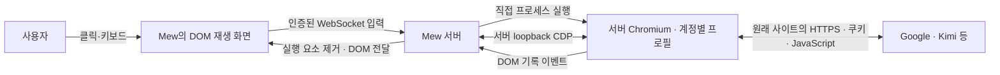

> The feature has been replaced by the [virtual login screen](../development/login-desktop.md) and [localhost app preview](../development/port-preview.md) ([decision 0023](../decisions/0023-login-desktop-and-port-preview.md)). The content below is evidence from the experiments at the time, not the current operating procedure.

# Confirmed conclusions

On 2026-09-11, the user confirmed **successful Google login in the actual Mew internal browser**. This
resulted from investigating the flow in which Google authentication was rejected during Kimi
Code login. It was resolved by **launching Chromium directly and then connecting Playwright through CDP**, without switching to screen streaming or removing DOM relay.

The criteria for choosing the launch method are in [ADR 0129](decisions/0129-mew-browser-native-launch-cdp.md), the DOM
browser's scope is in [ADR 0127](decisions/0127-mew-browser-server-dom-runtime.md), and browser-based authentication integration
is in [ADR 0128](decisions/0128-mew-browser-oauth-uses-internal-browser.md). This document explains the evidence behind the choice
and how it works. Installation, environment variables,
APIs, and code structure follow the [server browser
documentation](../../../docs/guides/browser.md); permission criteria follow [Security](../../../docs/operations/security.md#virtual-login-screens-and-localhost-apps).

## The experience the user wanted

Users needed to select, type into, and click web elements within Mew, while actual site execution and network access took place on the server
computer. Handing only login off to a browser on another device is not the default behavior; regular browsing and OAuth use the same internal browser.
No pixels or video are transmitted. To support this, the approach connecting DOM with screen semantics to user input was retained.

This requirement does not mean fully reproducing every desktop capability. Canvas/WebGL, media, OS authentication dialogs, and physical devices that are not represented in the DOM remain separate
limitations. What was confirmed here was not that all those limitations had been eliminated, but that **this Google login flow worked while retaining DOM relay**.

## What changed

Previously, Playwright's `launchPersistentContext` launched the Chromium process and owned the connection as well. When this launch path
was retained after switching to windowed mode, Google displayed “This browser or app may not be secure.”

Process launch and the browser control connection are now separate.

1. Mew directly starts the Chromium executable with a dedicated profile for each account.
2. It checks the loopback debugging endpoint reported by the child process it launched.
3. Playwright connects to that browser's existing context using `connectOverCDP`.
4. The site and DOM recorder run on the actual connected page.
5. The device screen in Mew replays DOM events and forwards input to the actual elements on the server.

**Playwright was not removed.** The change bypasses Playwright's default set of launch options while continuing to use it for page
manipulation, DOM collection, frames, and popups after connection. The issue
was also not resolved by overriding browser identifiers with scripts or disabling the sandbox.

The replay document displayed on the device does not execute the original site's JavaScript. This also
differs from an architecture that rewrites URLs to rerun authentication pages on the Mew origin. The
execution client seen by the site is server-side Chromium; the device handles display and input.

## What the comparison experiments showed

| Stage | Browser launch and connection state | Where login was performed | Observed result |
| --- | --- | --- | --- |
| Existing implementation | Chromium launched by Playwright + DOM relay | Internal Mew screen | Google login rejected |
| Switch to headed mode | Retained the existing launch path and enabled WSLg headed mode | Internal Mew screen | Same rejection message |
| Manual launch | Directly launched the Chromium executable from the same installation with a separate profile | Actual window opened through WSLg | User confirmed successful login |
| Stage 1 comparison | Direct launch + CDP connection, no DOM recorder, new profile | Actual window | User confirmed successful login |
| Stage 2 comparison | Direct launch + CDP connection + actual DOM recording code, new profile | Actual window | User confirmed successful login |
| Final integration | Direct launch + CDP connection + Mew's actual DOM replay and input path | Internal Mew screen | User confirmed successful login on 2026-09-11 |

In the comparison windows for stages 1 and 2, `navigator.webdriver` was observed to be `false`. No code was added to forcibly override it. DOM recording events in stage 2
were discarded, and neither screen replay on the device nor input relay was performed. Therefore, stage 2
alone was not used to declare success for the entire Mew flow; user confirmation was obtained separately after final integration.

Each comparison stage used a fresh test profile to avoid a prior login session appearing to indicate success. Conversely,
this means it cannot be described as a single-variable experiment under exactly the same conditions as the existing Mew profile.
Google's server-side decisions and account state were also not observable.

### Confirmed facts and unconfirmed causes

- Switching to headed mode alone did not resolve this block.
- Neither WSL nor the Chromium installation in use was inherently unable to perform Google login.
- The presence of a CDP connection alone did not block this login.
- The injection of DOM recording code alone did not block this login, either.
- The user confirmed success in the actual internal Mew screen after the launch path was replaced.

**Which individual flag caused the block was not verified.** There
is insufficient evidence to isolate the cause to one of the existing launch option set, connection
method, or profile state. No claim is made that changing `navigator.webdriver` alone resolves the issue, or that all Google accounts and all providers will allow it permanently.

These observations revise the categorical conclusions from the earlier investigation that “it is impossible because it is an embedded browser,”
“Google necessarily rejects it because of DOM relay,” and “pixel streaming is the only solution.”
Provider support policies, actual rejection messages, and success in a particular environment must be treated separately.

## Relay errors that had to be resolved before this success

Login rejection and screen relay failure were separate issues. The following implementation errors had to be fixed first.

| Issue | Confirmed mechanism | Handling to retain |
| --- | --- | --- |
| Kimi page appeared, then turned white | Processing a child iframe Document attachment event in rrweb's parent stream alongside separate frame replay replaced the parent document | Replay child frames separately and exclude duplicate Document attachment events in the parent |
| Dynamically displayed frames and styles missing | Changes were lost by treating incremental attributes arrays as ordinary attribute objects, or child views were attached before their parent nodes existed | Preserve incremental arrays and hidden styles; attach pending child views after the parent mutation |
| Infinite recursion error after the Google button | The recorder started immediately even in the temporary empty iframe rrweb created to obtain the original DOM prototypes, causing another iframe to be created | Defer recording until the next task so iframe creation and document.write can finish |
| Content and navigation disappeared from an empty OAuth popup | Mew navigated the about:blank Page the site had already opened again | Accept the existing Page as is to preserve the opener's document writing and subsequent navigation |
| Unable to open other addresses after a connection failure | Waiting for initial navigation blocked subsequent input, and injecting the recorder into Chromium's own error document could close the tab | Separate navigation changes and stops from the wait, exclude internal browser error documents from recording, and display the failed address and reason |

Do not confuse localhost connectivity issues with Google authentication blocking. localhost refers to the Mew server environment. If no actual server
is running on the target port, changing the browser launch method alone cannot establish a connection.

## Why login state and browser lifetime must both be preserved

Profiles are isolated per Mew account and shared by regular browsing and that account's browser-based OAuth. The lifetime of
a login task's tabs and popups differs from the lifetime of site cookies. Authentication windows are cleaned up when the task
ends, but site state remaining in the profile is not arbitrarily deleted, nor are cookies copied from the user's personal Chrome profile.
CLI credentials and token exchange remain owned by the corresponding official CLI.

Switching to direct launch made Mew responsible for terminating child processes as well. Disconnecting
CDP alone must not be assumed to terminate the browser or finish saving cookies. Mew requests a graceful browser shutdown,
waits for profile writes and process termination, and sends a termination signal only to processes it created if they are unresponsive. Initially, the termination signal was sent
too early and persistent-cookie revalidation failed; after adding a wait for graceful shutdown, reopening verification passed. Requests to use a new profile
are also accepted only after the existing process has finished terminating, avoiding profile lock conflicts.

## Connection security boundaries

CDP is a channel that can control the entire browser. It is not a public API protected by Mew user authentication.
Connections use only a dynamic loopback port, and the endpoint is not exposed to tunnels or device clients.
Only the endpoint reported by the launched process is accepted to prevent accidentally attaching
to another existing browser. Because local processes can access it, it is not considered an
isolation boundary between server shell users. The [access model](../../../docs/operations/access-model.md) is authoritative for production port boundaries.

Existing account ownership and role checks remain in place on the Mew UI side. The initial URL for browser-based OAuth is validated against CLI output and
registered hosts. Original scripts are not executed in DOM replay documents, and input, DOM transcripts, login codes, cookies, and tokens are
not saved as investigation materials or logs. In actual desktop window mode, the login screen is also visible on the server. Regular browsers on Linux/WSL currently use a [dedicated virtual display](../../../docs/guides/browser.md#브라우저-창) by default to separate them from server desktop focus. This change preserves direct launch, CDP, and DOM relay; it does not establish successful actual Google login on the virtual display as a historical result.

## The launch method retained on macOS

On macOS, regular tabs and browser-based OAuth use the same **direct launch → CDP connection → DOM relay** path. WSLg is only
an environment for displaying Linux windows, not a required component of this architecture.
Macs use the default window mode, and the operational baseline is to run Mew in the logged-in user's desktop session.
Do not assume the same window mode works over SSH without a GUI or in system services.

On 2026-09-11, automatic discovery was expanded to include per-user Applications folders and Chromium apps. Executable and profile
paths are passed without shell interpretation even when they contain spaces, and the common path handles process termination and profile persistence.
Passing an app to the OS's standard open command changes the ownership relationship between the child process launched
by Mew and the connection, so the executable inside the app is still launched directly. The [server browser
documentation](../../../docs/guides/browser.md) is authoritative for the Mac installation, path, and environment variable contracts.

Chromium's [macOS launch instructions](https://www.chromium.org/developers/how-tos/run-chromium-with-flags/#macos) also describe passing debugging flags to the executable inside the app. Since
Chrome 136 restricts remote debugging
of the default personal profile, Mew maintains
a dedicated profile for each Mew account on Macs as well, in accordance with [Chrome's separate data
directory requirement](https://developer.chrome.com/blog/remote-debugging-port).

Perform acceptance checks on Mac in the following order.

1. Run Mew in a logged-in Mac user session and open the Mac development server's localhost address in the internal browser.
2. Click the Google button in Kimi Code's browser-based authentication and separately verify that the popup appears, account authentication succeeds, control returns to Kimi, and the CLI completes.
3. Close all regular and authentication tabs for the same Mew account, reopen them, and verify that the persistent login state is retained.
4. If it fails, record the actual runtime OS, CPU architecture, browser version, executable, whether windowed mode was used, and the stage that failed. Do not record authentication values.

Automated verification of this enhancement was performed on **Linux/WSLg**. macOS path selection was checked with file fixtures,
and actual Chromium was launched through an app-style POSIX executable path containing spaces to verify CDP connection, clean shutdown, and reopening
cookies. This verification does not reproduce macOS binaries, the desktop, or
Keychain. **Execution on physical Macs, Google login, and separate checks on Apple Silicon and Intel remain outstanding.**

## Distinctions to preserve during revalidation

If behavior changes again, compare using the same executable on the same server before deleting the existing production profile or changing launch options all at once.
Distinguish manual launch, CDP connection, DOM recording, and input on Mew's replay screen in that order, and specify the success criteria for each stage.

- Record login page display, username entry, passing password and additional verification, returning to Kimi, and completion of CLI authentication as separate checkpoints.
- Distinguish comparisons using a new profile from comparisons reusing an existing profile. Do not count authentication skipped because of existing login cookies as a successful new login.
- WSLg display variables must be passed to the Mew process as well as the terminal. Distinguish whether code was modified from the actual execution environment after restart.
- Distinguish account authentication confirmed through user reports from automated regression checks on test sites. The user enters passwords and authentication codes for real accounts.
- Follow the [server browser documentation](../../../docs/guides/browser.md) for restarting Mew and configuring its environment, and the [deployment runbook](../../../docs/operations/deployment.md) for deployment roles.

Do not revert the current flow to the previous default Playwright launch method without a reason. However, this document does not prohibit diagnostic or comparative experiments with other launch methods.
Abandoning DOM relay itself or adding provider-specific external browser paths is a decision separate from the current user requirements.

## Evidence and verification scope

The core implementation is mew commit `a349672` (direct launch and CDP connection).
Earlier implementations can be traced in `8909cee` (server DOM browser and OAuth), `eb9d9c9` (navigation and blank popup recovery), and `35fd5e7` (authorization code copying). These
hashes serve as references for locating changes; the canonical sources for the execution contract are the [browser documentation](../../../docs/guides/browser.md) and current code.

At the time of the integrated implementation, all 547 tests passed, along with actual Chromium integration tests in window mode and type checks. Regression
tests cover input, server cookies, reconnection, child frames, popups/opener, history, dialogs, file transfers, profile persistence, account isolation, connection failure recovery, and more. They
also check startup failure handling when the executable is missing. These figures are results from the time of implementation and do not mean the tests were rerun while writing this document.

The final login confirmation on 2026-09-11 was a user's report of successful actual Google login inside Mew on Linux/WSLg. Do not extend
that result to all other providers, actual Google authentication in headless mode, OS device authentication, or long-term CLI token persistence.
