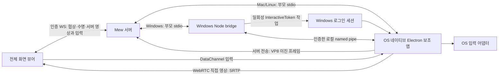

[Current contract](../development/remote-desktop.md)

Implementation and verification records from before ADR 0185 was applied on 2026-10-01. These do not apply to the current Windows resident GPU host and direct connection policy.

## Boundaries and lifecycle

When designing screen layouts, settings, and controls, follow [Common design guidelines: spacing and information density](../development/ui-contracts.md#design-guidelines-spacing-and-information-density).

`RemoteDesktop` is a full-screen dialog in a body portal. Do not add it to DockWorkspace, workspaceUi, or the panel restoration list. Closing the screen ends the session; reconnecting or changing the shared screen creates a new session. The internal browser's DOM transport contract remains unchanged.



`server/remote-desktop-host.ts` handles OS detection, fixed executable paths, and ICE settings; `server/remote-desktop.ts` handles APIs, permissions, and the single control connection. Install the same WS handler in both serve and Vite. There is no public helper app port or API for custom launch commands. WSL runs `electron.exe` installed on Windows and does not use WSLg as an alternative display.

Anonymous stdin in Windows Electron immediately reaches EOF in real environments, making direct stdio unusable. Following [ADR 0137](decisions/0137-mew-windows-desktop-pipe-bridge.md) and [0138](decisions/0138-mew-desktop-automatic-preparation.md), the connection runs from WSL Mew → Windows Node stdio → authenticated named pipe → Electron. The bridge uses `windows-bridge.mjs` from the source, and Electron uses `parent-channel.mjs` from the installation. Authentication is limited to a per-launch 256-bit token, 3 seconds/64 characters, and at most 4 candidate sockets. The entire initial connection has a 40-second limit; if the parent disconnects, pipe EOF and expiration of the 8-second lease end capture.

The `windows-session.ps1` broker opens a random bootstrap pipe, then registers and runs a temporary task with the current Windows user SID's InteractiveToken and minimum privileges. The task definition contains only a fixed script path and a public pipe name. It stores no passwords or tokens and has no boot or login triggers. The token is received through parent stdio and the bootstrap pipe, passed to the Electron child environment, and removed from that environment after authentication.

The bootstrap and video signaling pipes allow only the current user SID and deny the Network SID. The actual pipe ACLs are also updated because libuv's default DACL may be tied to the service logon SID. After receiving the first bootstrap byte, the impersonated user SID and the actual client process session ID (not 0) are checked. The wait for launch in the login session is 25 seconds, and the task is removed when the parent disappears, on failure, or on completion. The launcher in the login session retains a handle to the Electron process it starts directly. The bootstrap pipe stays open throughout the connection; if the broker or bridge disappears and EOF arrives, Electron is terminated through that handle if it has not exited after 2 seconds. Even if WSL terminates all service-side processes at once, the supervisor in the login session performs cleanup without killing another process due to PID reuse. Even if an abnormal OS shutdown leaves the task definition behind, it will not run automatically because it has no triggers or authentication information. Privileges are not extended to other users or pre-login screens.

Before launching on Windows, search for a supported version in this order: the installed dedicated Node, Program Files, then PATH. After Electron starts, if a separate query finds an explicit inbound firewall block rule for that executable, the server sends `network-hint`. If the direct connection fails, switch to server transport first, and show firewall guidance only if the browser cannot prepare server transport. Specify that the settings are in Windows on the computer running the Mew server. Only query the rules; their presence alone does not block execution. Firewall queries take at most 8 seconds, and delays or failures do not prevent the helper from starting. Diagnostics that arrive after the session ends are not sent. WSL checks the installed dedicated `runtime/node.exe` directly with `--version` and skips PowerShell discovery if the version is supported. If it is missing, cannot run, or has an unsupported version, fall back to the existing PowerShell discovery. Node discovery and `wslpath` conversion of the bridge source run in parallel. Bridge executable path discovery also uses a separate 30-second cache that reuses only in-progress requests and successful results; helper spec, WSL interop, or PATH changes and query failures invalidate it. Each connection's broker continues to validate the login session. Executable path discovery for the readiness API and actual spawn reuses a single in-progress request or successful result for 30 seconds. Rediscover when the platform, helper path, WSL interop, or PATH changes, and do not cache failures. Do not cache installed versions, file access, OS permissions, capture, or authentication. `ready` indicates configuration file readiness and does not guarantee OS login or network access success.

Using `await app.whenReady()` at the top level of the Electron ESM entry point causes module evaluation completion and app readiness to wait on each other. Start `createWindow()` asynchronously and let entry module evaluation finish immediately. If the parent exits during startup, do not create a window after the app becomes ready.

Only native `main.mjs` has OS capture, input, and clipboard permissions. The hidden renderer enables sandbox and contextIsolation, disables nodeIntegration, and reads only fixed local files. The preload exposes signaling, validated input, and a single capture request. Allow media and Chromium Local Network Access permissions only for the fixed local renderer ([Electron permission contract](https://www.electronjs.org/docs/latest/api/session)). Remove the session's temporary Chromium profile on normal exit. Windows file handles or forced termination may leave the temporary folder behind. Do not write captured video, keystrokes, SDP, or ICE credentials to files.

## Transport and latency

Background is in [Latency and bandwidth research](../research/remote-desktop-latency.md); implementation scope and verification results are in the [work document](remote-desktop-latency.md).

- Windows/WSL prioritizes the DXGI worker below, uses the GDI fallback if initialization fails, and uses Chromium capture if that also fails. macOS prioritizes the ScreenCaptureKit path below. On Linux and paths where native initialization fails, Electron desktopCapturer/Chromium owns capture. `sender.mjs` manages the capture lifetime, while `direct-sender.mjs` and `relay-sender.mjs` handle their respective transports. In the viewer, `desktop-connection.ts` manages readiness, lifetime, and switching policy, while `desktop-direct.ts` and `desktop-relay.ts` handle reception.
- Direct connections use VP8 WebRTC, up to 1920×1080, 60 fps, and 6 Mbps. Switch to server transport once if the connection fails or video decoding is not confirmed within 1.2 seconds of receiving the offer. At the deadline, check the actual `framesDecoded` once more to avoid missing a first frame that arrives before the statistics display updates. Do not start this 1.2-second timer while waiting for screen sharing approval. Also switch to server transport if an established direct connection drops.
- Server transport uses the same capture track → WebCodecs VP8 encoder → binary IPC → Mew WS → WebCodecs decoder → canvas. It supports up to 1920×1080 at 30 fps, starts at 2.5 Mbps, and adjusts within 0.35–4 Mbps based on increases in display ACK time over the baseline and bytes in flight. The server does not decode or re-encode. Hardware acceleration depends on Chromium, the OS, and the driver.
- Keep one encoder job, one capture buffer, one latest unencoded frame, and at most 4 frames in flight. Pause the next encoding operation if bytes in flight reach 1 MiB. Each packet is also limited to 1 MiB, so the byte limit, including the last frame admitted before the threshold, is less than 2 MiB. Native output and server WS have separate limits as well. For slow receivers, skip frames before encoding; do not arbitrarily discard already encoded delta frames.
- The browser draws only the latest decoded frame in rAF, then sends a cumulative ACK. Immediately close pending frames that will not be displayed and used VideoFrames. Resynchronize decoding errors with key frames at most twice. End the session if sender ACKs stop for 10 seconds or receiver display stops for 15 seconds, except for the explicit idle state below. Generate key frames at startup, on recovery requests, on configuration changes, and approximately every 10 seconds during active video; do not generate them periodically while the screen is static.
- The default ICE setting is `[]`, with no external STUN/TURN requests. Server transport uses the existing authenticated WS URL, requiring no additional accounts or public ports. If the existing proxy or tunnel is itself an external service, that route remains in use. External access uses HTTPS/WSS, and the TLS-terminating proxy and Mew server are included in the video trust boundary.
- WebCodecs requires a secure context and VP8 decoding support. Runtime feature checks show guidance for unsupported browsers; do not work around this with JPEG polling or separate codec downloads. With WebSocket/TCP, packet loss also makes subsequent video wait, so latency may be higher than with a direct UDP connection depending on the network.
- Zoom, view movement, 90-degree rotation, and joystick/hotkey positions are local transforms and do not trigger recapture or renegotiation.
- The UI's **Direct connection** and **Server connection** indicate the selected path. For the direct path, `왕복 … ms` is the candidate pair RTT, and Mbps is the increase in received bytes. These are neither actual end-to-end latency nor guaranteed values; latency and heat must be measured separately across operating systems, mobile devices, and networks.

### Windows capture, local cursor, and idle video

- `capture-windows.mjs` calls Windows DXGI/D3D11 through the existing Koffi integration. GPU copying and Map run in a separate Node worker in `capture-worker.mjs` to avoid blocking OS input injection in main. `native-capture.mjs` imposes a 3-second timeout on worker readiness and each request, with at most one request outstanding. The worker shares the process's login session and lifetime and initializes and releases COM on its own thread. Normal shutdown asks the worker to release resources and terminates it if this takes more than 1 second. Like Chromium screen capture, it maintains a Windows thread execution state that prevents display/system idle while connected and releases it on exit. It does not bypass manual sleep or locking.
- Match the selected physical monitor's bounds to the DXGI output. Currently supports x64/arm64 ABIs, unrotated BGRA screens, and a maximum pixel count of 4096×2160. If rotation, format, output, or pointer separation is unsupported, or an initial frame cannot be obtained, prepare a GDI screen with the cursor separated. Fall back to Chromium only if both native paths fail. Runtime failures such as capture access lost or pointer support failures release input and end the session with reconnection guidance.
- `capture-gdi.mjs` from [ADR 0146](decisions/0146-mew-desktop-cursor-capture-fallback.md) performs BitBlt+GdiFlush at up to 30 Hz in a worker attached to the login session's Default desktop. It compares pixels using native memcmp and copies and passes only changed screens into V8 buffers. It exits if permissions, the active desktop, or monitor bounds change. `cursor-windows.mjs` reads the shape and hotspot with GetCursorInfo/GetIconInfo/GetDIBits and releases the created bitmap handles. CPU read and comparison costs are higher than DXGI, and some GPU/protected content may be unreadable.
- Do not composite the cursor into the video. Skip raw screen copying for pointer-only updates where `LastPresentTime=0`. Pass actual screen changes through GPU staging → V8-owned BGRA buffer → worker transfer → Electron IPC. Because of Electron's V8 memory cage, do not expose mapped memory directly as an external ArrayBuffer. This is not zero-copy because it includes CPU readback and IPC copying.
- `native-stream.mjs` scales raw frames down to a canvas of at most 1080p and creates a manually updated track. Direct connections and server transport share this track. Do not queue undisplayed raw frames. Initial direct negotiation, switching to server transport, and recovery requests redraw the canvas so static screens are also delivered.
- `cursor-protocol.mjs` validates the shape, hotspot, visibility state, host coordinates, physical screen size, and applied input seq. Shapes are limited to 128×128, and the PNG's actual IHDR dimensions are also checked. PNGs are sent only when the shape changes, and position echoes matching the coordinates expected from input injection are omitted. Cursor movements from the host's physical mouse or apps are sent as separate corrections. Data uses the existing authenticated WS and is not saved as image files.
- Approximate monochrome/masked XOR pixels whose background inversion cannot be represented in CSS with a bright center and dark outline. Preserve normal alpha cursors. Cursors drawn directly on the screen by remote apps are not separated.
- `desktop-cursor.ts` caches and revokes the Blob URL for one shape. The mouse uses a native CSS cursor, and the joystick uses an image layer transformed in rAF. Local movement does not wait for React rendering or video ACKs. The shared projection in `desktop-view.ts` accounts for zoom, pan, letterboxing, and 90-degree rotation, and does not apply positions from late input seq values. Host corrections do not change the last mouse/joystick display mode. Recalculate the position when the first video's metadata arrives or the canvas resolution is established so the initial cursor does not remain hidden. The cursor visibility status in connection help shows the actual localCursor negotiation result.
- When native capture has been static for at least 500 ms, a worker response has arrived within the last 2 seconds, and no frames are awaiting encoding, being encoded, or in flight, the sender sends `relay-status {seq,idle,ackMs,bitrate}` every 1 second. The receiver accepts only idle responses from the last 3 seconds and only if it has actually drawn that seq. Do not determine video health from input heartbeats alone. Recovery requests resupply the latest screen even while it is static.
- `relay-adaptation.mjs` uses the minimum ACK from the most recent 6 intervals of 10 seconds as its baseline. If ACK time rises at least 80 ms above the baseline, bytes in flight exceed 256 KiB, or ACK time exceeds 1 second, reduce the bitrate by 25% at intervals of at least 2 seconds. When stable, increase it by 8% at intervals of at least 10 seconds. This removes the issue where a high baseline RTT alone crosses the 220 ms threshold and drives the bitrate to its lower limit. The maximum 4-frame window remains, so high RTT still imposes an FPS ceiling.
- The server's `표시 응답 … ms` measures the time from encoder output through transport, decoding, canvas drawing, and ACK return. It is neither pure network RTT nor click-to-photon latency. In `화면 정지`, control and liveness traffic remains even without video payloads. Idle frame omission also applies to the macOS ScreenCaptureKit path. Linux and paths where native initialization fails retain the existing capture.

### Binary protocol and trust boundaries

`relay-protocol.mjs` is the VP8 packet contract shared by the browser, server, and native components. The 24-byte header contains magic/version (`MDV1`), a uint32 sequence number, a float64 integer microsecond timestamp, uint16 width/height, a key flag, and reserved bytes. It uses network byte order. Validate length, version, sequence, dimensions, and a finite timestamp before decoding. Do not put Base64 in control JSON.

`host-wire.mjs` distinguishes the existing `MEW_DESKTOP <JSON>\n` from `MEW_DESKTOP_FRAME <길이>\n<이진 패킷>`. It does not depend on pipe chunk boundaries or UTF-8 splits. The Windows Node bridge forwards the stream unchanged after authentication, so it uses the same protocol as other operating systems.

The server's `desktop-relay.ts` allows switching only once. It accepts `relay-input` and `frame-ack` only for the selected session and permits only the existing input snapshot or restricted paste forms. It rejects ACKs beyond transmitted frames, duplicate switches, excessive input, and large packets. Closing, permission revocation, or termination of the source capture ends both paths.

## Verification

```bash
MEW_DATA_DIR=/tmp/mew-desktop-test-data node --test --test-concurrency=1 server/remote-desktop.test.ts server/remote-desktop-relay.test.ts server/remote-desktop-bridge.test.ts server/remote-desktop-install.test.ts server/remote-desktop-native.test.ts server/remote-desktop-latency.test.ts server/remote-desktop-ui.test.ts src/utils/desktop-input.test.ts src/utils/desktop-preparation.test.ts server/remote-desktop-windows.test.ts
npx tsc -b
npm run lint
```

- protocol/joystick: loss, out-of-order delivery, clicks overtaking movement, absolute position, timeout, tap/immediate movement/hold/cancel, wheel axis limits, local view, no movement while stationary during cursor/button dragging, small reversals, resetting the reference point on a new touch, and wheel/pan/zoom sustained speed, return to center, gradual speed increases with distance, halved maximum speed, fine control near the center, speed limits, frame interval independence, 50 ms integration limit, and cancellation.
- Server: Origin, roles, temporary passwords, OS/WSL paths, message validation, single-controller ownership, screen replacement, permission revocation, and child termination. Uses fake stdio processes.
- OS: Windows INPUT layout, Mac modifier/middle drag, X11 notch, and Wayland approval response races, input ordering, and termination. FFI/DBus use mocks.
- Windows bridge: checks session 0/login session launch arguments, firewall block guidance, and error forwarding over WS. Specifying a Windows `node.exe` path in `MEW_DESKTOP_TEST_WINDOWS_NODE` runs tests for actual temporary tasks, Electron launch, screen listing, authenticated pipes, parent termination, and forced termination when the Electron event loop stalls. Screen listing was confirmed in an actual Windows login session. Pixels and input are not recorded.
- Windows video integration checks additionally require `MEW_DESKTOP_TEST_WINDOWS_VIDEO=1`. Actual server transport, decoding, and parent termination for the Windows login screen were checked with a viewer unable to use direct candidates and an empty ICE configuration. The DXGI path does not require continuous frames on a static screen. A duplication with no initial frame waits for a 300 ms budget, is recreated once, and prepares the GDI fallback if pixels are still unavailable within another 300 ms budget. This is the empty-frame retry budget in `capture-start.mjs`; worker initialization, individual requests, and cleanup have separate time limits. If the screen is available immediately, it does not wait; API errors proceed to GDI without recreation. Frames arriving during closing are discarded and the worker is cleaned up. Verification results and applicability follow the [progress document](remote-desktop-latency.md). Also specifying `MEW_DESKTOP_TEST_WINDOWS_LOCAL_CURSOR=1` checks native local cursor activation, actual image decoding, visible pixels, DOM display, and continued connection after the first display. `MEW_DESKTOP_TEST_WINDOWS_GDI=1` simulates DXGI failure in a temporary copy, and `=timeout` simulates the absence of an initial frame to check the actual Windows GDI fallback. Cursor position checks move only the viewer DOM and do not send Windows input. No screen files or keystrokes are generated. The installation is not overwritten; a separate temporary helper folder and Windows junction reference the existing runtime and are removed after termination. On failure, only candidate types, protocols, and request/response counts are printed; IP addresses, ports, SDP, and credentials are not printed. Windows real-device tests run with `--test-concurrency=1`.
- Server transport protocol: checks binary content and UTF-8/pipe chunk boundaries, oversized frames, versions, dimensions, timestamps, ordering, forged/duplicate ACKs, frame/byte limits, invalid input, input before switching, and video forwarding, permission revocation, and parent termination over actual WS.
- Automatic preparation: checks skipped installation, starting once, rechecking after completion, preventing repeats after cancellation/failure, canceling polling on close, code changes, and dependency reuse fingerprints.
- Mac capture: uses mock FFI to check dimensions/Retina/negative origins, cursor preservation before the initial frame, idle pixel omission, cursor-only changes, buffer ownership after transfer, failures, and duplicate close. Compilation of arm64/x86_64 Mach-O objects was checked with Apple SDK 15.5 and Clang. This does not replace macOS linking, execution, permissions, or actual video measurements. On an actual Mac, prepare the installed runtime and Screen Recording permission, then use `MEW_DESKTOP_TEST_MACOS_CAPTURE=1 node --test server/remote-desktop-macos.test.ts` to check native capture, separate cursor PNG decoding, continuous responses, and termination in a temporary helper. No input is injected and no screen/cursor files are saved.
- Installation: role restrictions, fixed commands, duplicate starts, preservation of failure output, retries, state recovery, shell execution with quoted paths/paths containing spaces, WSL PowerShell arguments, interop failures, and custom installation paths. Uses temporary scripts and mock processes instead of actual npm installation. In the UI, replaces the terminal renderer and verifies the actual popup's layers, input, closing, reopening, failure, and completion.
- Chromium UI: uses the actual sender and VP8 encoding/decoding to check both the direct path and server transport after blocking candidates. In the actual WebCodecs path with simulated native capture input, confirms the local cursor, 0 additional video frames/0 bytes during a 16-second static period, continued connection, key frame recovery while static, and resumed updates. The screen is a synthetic canvas. Confirms touch taps, immediate drag, hold/cancel, 6 controls, handles, speed adjustment hold/return to center/release/blur, translucent backgrounds in both themes, 1/3× sensitivity, clicks and movement with 90-degree rotation, fullscreen switching, hotkey ordering/release, settings Esc, 320 px/landscape screen boundaries, paste, mobile/desktop layouts, reconnection, Esc, background termination, switching while connected with held keys released, capture reuse, frame limits and recovery when ACKs stop, and guidance for unsupported VP8. Skips if Chromium is unavailable.

**Remaining real-device verification is separate.** Mac binaries and OS permissions, actual X11/Wayland desktop injection, physical Safari/iOS devices, the user's external mobile network, Retina/mixed DPI and multiple monitors, and actual latency and bandwidth are not considered verified by automated tests alone. On each OS, login, permission approval, cursor/wheel/three-button dragging, Korean text paste, release after closing, and permission revocation must be checked. Support for lock screens, pre-login screens, and the Windows UAC secure desktop is out of scope.

## Initial connection optimization verification — 2026-09-23

Part of the [research](../research/remote-desktop-startup.md) was implemented. `remote-desktop-startup.test.ts` uses a virtual clock to check normal DXGI operation without waiting, switching to GDI after 600 ms with an empty screen, recovery through a second duplication, failure of both native paths, closing during startup, and cleanup of late frames. The reduction from 2 seconds to 0.6 seconds is the budget for this empty-frame wait, not a measurement of total real-device connection time. DXGI that provides its first screen later may fall back to GDI, so the fallback rate and CPU cost must be checked on real devices.

Bridge tests check that the dedicated Node path skips PowerShell and runs queries in parallel, existing discovery when the dedicated Node is missing/unsupported, cache expiration, environment changes, and retries after failure. Preparation tests check completion polling at 250 ms for short installations, the 1500 ms limit for long-running tasks, cancellation, and authentication errors. Supported Windows Node discovery failed in the current agent environment, so the actual full Windows connection time remains unmeasured. Direct-first behavior, switching to server transport after 1.2 seconds, the nonresident helper, login session, single-controller ownership, and parent lease are retained.

The verification command `MEW_DATA_DIR=/tmp/mew-test-data node --test server/remote-desktop*.test.ts src/utils/desktop-*.test.ts` passed 78 of 81 tests and skipped 3 Windows/Mac opt-in real-device tests. The passing tests include 4 synthetic screen scenarios using actual Chromium, WebRTC, and VP8. `npx tsc -b` and `npm run lint` passed, with 10 existing lint warnings outside the scope of the changes remaining. No build, restart, or installation was performed for the running server.