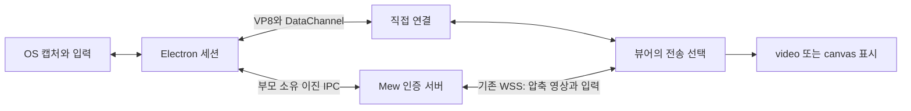

[ADR 0139](decisions/0139-mew-desktop-server-transport.md)

## Goals and scope

Deliver remote screen video and input through the current Mew connection path without external services, TURN accounts, or additional public ports. Retain the existing direct connection and switch automatically on failure. Verify licenses and notices for distribution. The user performs the actual server build and restart according to the README.

## Design

- The native session owns the capture lifetime; the viewer owns transport selection. Switching is one-way, direct → server, and retains the same screen sharing session.
- Direct and server transport use the same input snapshot. On switching, release held inputs and detach the previous channel.
- Use VP8 WebCodecs encoders/decoders. Check support at runtime. The server does not modify compressed frames.
- Keep the frame protocol and flow control in separate modules, and validate length, dimensions, order, version, and ACKs. Set limits and termination conditions for every queue.
- Native IPC distinguishes existing JSON control messages from length-delimited binary video packets. Do not create Base64 data or screen files.
- The UI retains the existing fullscreen and joystick controls. Display switching guidance and direct/server connection status. Match errors to the actual failure stage.

## Sequence and completion criteria

- [x] Investigate the current structure and constraints; write ADR
- [x] Shared protocol, flow control, and boundary checks
- [x] Native capture reuse, VP8 encoder, and binary IPC
- [x] Forwarding that preserves server authentication, lifetime, and backpressure
- [x] Viewer switching, VP8 decoder, and canvas integration with existing controls
- [x] Check direct path blocking, actual encoding/decoding, input, interruption, congestion, and permission revocation
- [x] Windows hardware video checks and browser checks in available environments
- [x] Update distribution licenses, usage, and service inventory; run type, lint, and documentation checks

State the verification status of Mac/X11/Wayland OS permissions and actual Safari/iOS devices according to the available environments. Do not extend successful test results into claims of measured latency or success on all networks.

## Results and incorporation

Of the 40 relevant suites, 39 passed; one Windows bridge test on actual hardware was skipped in the default run. Separately, capturing an actual Windows screen with empty ICE settings and the direct path blocked passed playback of 10 consecutive frames over server transport and child process termination after closing. The browser checks added later for switching while connected, key release, ACK pause/recovery, and unsupported decoders also passed. There were no type-check or lint errors; 10 existing lint warnings in other areas remain. Mobile and desktop composite screens were also checked.

The changes were applied to the source and documentation. The running Mew instance was not built or restarted. When the user opens remote desktop after the changes take effect, it automatically prepares the updated helper and uses server transport when the direct path is blocked. Verification on the actual user's external access network remains for that stage. Distribution conditions follow the [license document](../development/remote-desktop-distribution.md).
