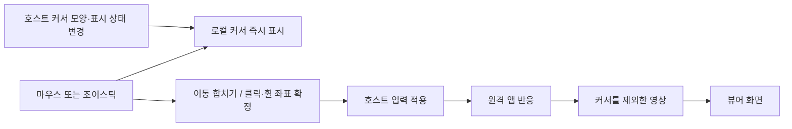

[Current implementation contract](../development/remote-desktop.md)

Status: **Baseline investigation before implementation.** The subsequent [implementation results from that time](../history/remote-desktop-latency.md) are historical records; follow the [current contract](../development/remote-desktop.md) for the latest status. The proposals and unmeasured labels below preserve the scope at the time of the investigation. The investigation baseline is mew `5c4ec7e`, helper Electron 44.3.0. The user reported a successful connection and cursor stuttering. The direct/server path, host and client OS, and RTT were not confirmed at the time, so no particular bottleneck is asserted as a measured cause.

## Conclusion

**The first improvement is to separate the cursor from the video and display it immediately on the client.** Make input transmission, cursor display, and video refresh intervals independent. Next, reduce unnecessary encoding and key frames on static screens, and separate congestion assessment for server transmission from baseline round-trip time. Decide on codec replacement afterward based on measurements.

Moving the server cursor only on clicks and wheel events is viable as a limited savings mode. For a general desktop default, we recommend **immediate local display + movement coalescing + applying coordinates just before important events** to preserve hover menus, tooltips, resize indicators, and dragging. A local cursor does not make click results or the remote app's visual response arrive sooner.

## 1. Costs identified in the current code

The [development document](../development/remote-desktop.md) is the canonical source for the current contract. Below are candidate bottlenecks and supporting evidence from the time of the investigation.

| Path | Facts confirmed in code | Impact / items to verify |
| --- | --- | --- |
| Capture | Legacy `getUserMedia` desktop capture in [sender.mjs](../../../native/remote-desktop/sender.mjs). `contentHint='detail'`; no cursor exclusion or separate metadata | A cursor included in the video waits through the entire capture→transmission→display path. Verify whether it is actually included through capture tests on each OS |
| Viewer | Video/canvas display in [remote-desktop.tsx](../../../src/components/remote-desktop.tsx). Does not receive remote cursor shape or coordinates separately | The browser's default pointer may be visible, but it is not a local cursor synchronized with the server cursor's shape and state. It may overlap the video cursor |
| Direct video | [direct-sender.mjs](../../../native/remote-desktop/direct-sender.mjs): VP8, up to 1080p60·6Mbps, `maintain-framerate` | May sacrifice resolution and text clarity at low bandwidth. Actual FPS and hardware use are unverified |
| Server video | [relay-sender.mjs](../../../native/remote-desktop/relay-sender.mjs): up to 1080p30, starts at 2.5Mbps, 0.35–4Mbps, key frame about every 2 seconds | At 30fps, the frame interval is 33.3ms. A cursor viewed in the video is also affected by that interval. Actual transmission volume for static scenes requires separate measurement |
| Input | [desktop-input.ts](../../../src/utils/desktop-input.ts), [desktop-connection.ts](../../../src/utils/desktop-connection.ts): movement coalescing up to 60Hz, immediate button/key transmission, heartbeat 250ms | The architecture already avoids unlimited transmission on every event. Simply reducing movement frequency without separating local display may make it look choppier |
| Flow control | [relay-protocol.mjs](../../../native/remote-desktop/relay-protocol.mjs): up to 4 frames pending display ACK, byte limit | Good for preventing runaway queues, but long ACK round trips limit FPS itself |
| Congestion detection | If ACK time exceeds 220ms, bitrate ×0.75; if below 90ms, ×1.1; adjustment interval greater than 2 seconds | Does not distinguish high baseline RTT, a slow decoder, and congestion. Even a stable 250ms path can have quality reduced to the lower limit |

### Examine the video path before input bytes

For example, if an input message averages 200 bytes, 60 messages/second means about 96kbps of payload, and 20 messages/second means 32kbps. The savings are about 64kbps, small compared with the current server video's initial target of 2.5Mbps. This is a **calculation based on assumptions** and excludes TLS·TCP·SCTP·WS headers and actual JSON sizes. The key gains are reducing the need to refresh video for small cursor movements and displaying the cursor at the screen's refresh rate. VP8 also uses interframe compression, so it does not send the entire raw screen on every cursor movement.

## 2. Recommended cursor and input design

### Proposed intervals and their meaning

The values below are starting points for experiments, not adopted defaults.

| Situation | Local display | Host transmission |
| --- | --- | --- |
| Normal mouse | Use the browser's native CSS cursor where possible | Coalesce the latest absolute coordinates at 20–30Hz. Ensure the final coordinates are delivered when movement stops |
| Mobile joystick | Update a separate layer's position at the screen refresh rate | Apply the same model starting with hosts that support absolute coordinates |
| Button down/up | Apply position immediately | Immediately deliver the event's coordinates and button state in one reliable snapshot |
| Wheel | Keep the local cursor | Update the event coordinates first, then deliver accumulated wheel input. Ensure the final wheel input is recovered even with brief coalescing |
| Dragging/drawing | Display immediately | Begin validation at 60Hz. Drawing that requires path preservation needs a separate sampling policy |
| Stationary | No position updates | Retain the current 250ms heartbeat and release contract |
| Savings mode that moves only on clicks | Display immediately | Limited to uses that do not require hover. Continuous movement is required while a button is held |

For a normal pointer, prefer a native cursor over updating React state on every event. For touch and joysticks, move a separate layer using refs and rAF. Cache the host-provided shape image, hotspot (actual click point), visible state, and shape ID, and send them **only when they change**. Handle standard arrow, I-beam, resize, and custom cursors. RFC 6143 also defines transmitting cursor shapes separately and displaying them on the client. [RFC 6143 §7.8.1](https://www.rfc-editor.org/rfc/rfc6143.html#section-7.8.1)

### Conditions for preserving correctness

- Retain the existing `seq/epoch`, accumulated movement and wheel input, and reliable button/key transitions. Do not wait for input ACKs for local display.
- **Recalculate the event's coordinates on up and wheel as well**, not just down. The current UI calls `directPoint()` only on down/move, so this needs to be addressed first.
- Execute button and wheel actions after applying position in the same host input processing sequence. Do not assume a separate move message will arrive first. Reuse the current position→button/wheel application order in [protocol.mjs](../../../native/remote-desktop/protocol.mjs).
- If the final movement/wheel packet is lost, the next reliable heartbeat can currently restore it. When reducing frequency, compare a reliable flush at the end of the action to avoid waiting 250ms. Retain cumulative counters to prevent duplicate application with clicks.
- Map coordinates by reversing the video's letterboxing, zoom, and pan transforms and fitting them to the monitor's actual bounds. Check mixed DPI, negative monitor origins, screen edges, and drag release outside the area.
- Actual mouse movement on the host, forced cursor movement by apps, and movement to another monitor require correction events. Include the applied input seq and screen generation so late responses do not rewind the latest local position. Shape changes may be delayed by remote processing latency.
- For relative joystick movement, do not assume local integration alone will match exactly because of OS acceleration and coordinate clamping. Wayland currently supports relative input only, so the existing display must be retained until capture/input stream alignment and host position metadata are available.
- Relative pointers and pointer lock in games are a separate mode. Do not apply the absolute pointer policy for hover unchanged. Hidden cursors or cursors drawn directly by apps may not be automatically separable from the video.
- Retain input release and watchdog behavior on blur, cancellation, switching, and shutdown. Validate shape data size, frequency, and cache limits, and transmit it only within existing authentication and single-controller authority.

### First technical challenge to solve: excluding the cursor from captured video

Simply adding a CSS cursor creates a double cursor, with the server cursor remaining in the video and trailing behind. Do not use globally hiding the host OS cursor or covering the capture with a rectangle as a solution. **The cursor must not be composited during capture.**

The Screen Capture specification includes `cursor: 'never'`, but there is no guarantee that it applies to mew's current legacy `chromeMediaSource` capture. First check Electron 44.3.0 support constraints, track settings, and actual pixel results. Do not treat the option's not being rejected as success. If switching to `getDisplayMedia`, also validate screen selection, permissions, and the existing lifetime contract. [W3C Screen Capture](https://www.w3.org/TR/screen-capture/#dom-cursorcaptureconstraint-never), [Electron desktopCapturer](https://www.electronjs.org/docs/latest/api/desktop-capturer)

| OS | Candidate native path | Remaining checks |
| --- | --- | --- |
| Windows/WSL | Windows Graphics Capture `IsCursorCaptureEnabled=false`; separate pointer shape/position in DXGI | DXGI may also have the cursor already drawn into the image, so do not assume separation on every GPU. Handle it within the login-session helper |
| macOS | ScreenCaptureKit `showsCursor=false` | Validate the cursor shape/hotspot collection path separately. Capture settings do not also transmit metadata |
| X11 | Combine XFixes cursor images/change events with cursor-free capture | Check how to connect this to current Chromium capture, and verify actual cursor images and coordinates |
| Wayland | Hidden/Metadata in portal `AvailableCursorModes` and PipeWire metadata | Check compositor support; capture/input stream integration is required. Requesting an unsupported mode may terminate the session |

Official references: [Windows cursor exclusion](https://learn.microsoft.com/en-us/uwp/api/windows.graphics.capture.graphicscapturesession.iscursorcaptureenabled), [DXGI pointer handling](https://learn.microsoft.com/en-us/windows/win32/direct3ddxgi/desktop-dup-api#updating-the-desktop-pointer), [Apple showsCursor](https://developer.apple.com/documentation/screencapturekit/scstreamconfiguration/showscursor?language=objc), [XCB XFixes](https://xcb.freedesktop.org/manual/xfixes_8h_source.html), [ScreenCast portal](https://flatpak.github.io/xdg-desktop-portal/docs/doc-org.freedesktop.portal.ScreenCast.html).

If Electron cannot exclude the cursor, a small CSS change cannot complete the work. OS capture adapters and their connection to video tracks/encoders must also be reviewed. Do not assume metadata is exposed directly to browser JS. Enable it through capabilities starting with OSes where support is confirmed, and retain the existing video cursor elsewhere.

## 3. Sequence for reducing both video bandwidth and latency

### A. Do not transmit when the screen is unchanged

1. First measure actual capture frequency, encoding frequency, and bytes/s in a static scene with the cursor excluded. Also check whether Chromium already reduces unchanged frames.
2. Where possible, use OS damage/dirty metadata to skip frames before encoding. Copying and hashing the entire RGBA image on the CPU every frame may cost more than it saves. Use VP8's existing interframe compression and do not add a custom tile codec in the initial stage.
3. When the screen is confirmed static, stop video transmission or reduce it to a very low frequency. Resume immediately on a screen-change signal. Simply lowering capture to 1fps may delay detection of changes immediately after input by up to 1 second. Remote animations and notifications without input must not be missed either.
4. Measure whether key frames generated about every 2 seconds need to repeat while static. Always send a key frame on initial connection, decoder reset, and explicit recovery, and preserve delta dependencies.
5. **The current receiver terminates if no frame is displayed for 15 seconds.** Optimizing by stopping transmission first requires designing liveness messages that distinguish video idle states from transmission failures. Input heartbeats alone do not prove the video encoder is working normally. Also require display confirmation and a failure timeout on resumption.

Allocate bandwidth freed while static to text quality, and use high FPS only during scrolling and dragging. A smoothly moving local cursor reduces the need to keep video FPS high at all times. Savings depend on the proportions of static screens, scrolling, and video.

### B. Server transmission: separate baseline RTT from queue delay

The current ACK time covers **transmission after encoder output→IPC/WS→decode→canvas drawing→ACK return**. It excludes capture and encoding time and does not confirm actual monitor scanout. It must not be labeled pure RTT or end-to-end latency.

- Measure baseline round-trip time with a separate small ping/echo and consider it alongside the minimum and trend of ACK times, queued bytes, and decode time. Respond to delay increases over the baseline path instead of classifying any value above a fixed `220ms` as congestion. A ping on the same WS is also affected by the queue, so it is not a perfect measurement of pure network latency.
- Apply smoothing and margins to bitrate increases and decreases, and account for the temporary traffic increase in the current code, which forces a key frame on every settings change.
- `4 / ACK초` is the ideal throughput ceiling for a 4-frame window. With an ACK time of 200ms, the maximum is about 20fps; at 300ms, about 13.3fps. Actual FPS may be lower due to capture, encoding, key frames, and byte limits.
- **Do not unconditionally reduce the window to 1.** At an ACK time of 100ms, the ceiling becomes about 10fps. Conversely, increasing it indiscriminately lets stale video accumulate. Distinguish necessary in-flight frames from a stalled queue, and use baseline round-trip time × target FPS as a guide while also setting time and byte limits. Review sender, server, and receiver together when changing the window contract.
- Retain the current policy of skipping frames before encoding and displaying only the latest screen after decoding. **Arbitrarily dropping an encoded delta and sending only the next delta breaks decoding dependencies.** Discarding stale transmissions requires explicit stream resynchronization.

WebSocket/TCP still makes subsequent data wait when loss occurs. Video is downstream and input is upstream, so sharing a socket does not mean input bytes queue behind downstream video bytes. However, reliable input transmission, downstream congestion of the decoded response screen, and shared event loop/IPC delays still exist. Consider a separate input-only WS only when that bottleneck is measured.

### C. Direct connection and encoding

- Keep the current WebRTC-first path in environments where direct UDP works. Preserve the deployment conditions in [ADR 0139](../history/decisions/0139-mew-desktop-server-transport.md): no external STUN/TURN by default and fallback to the existing server. Do not assume direct connectivity works for external connections.
- If CPU encoding is the bottleneck, first check actual VP8 encode time and hardware use. `hardwareAcceleration: 'prefer-hardware'` is a hint; a successful support check does not guarantee hardware use. [WebCodecs hardware acceleration contract](https://www.w3.org/TR/webcodecs/#hardware-acceleration)
- Check the actual delay in the receiving WebRTC jitter buffer, and compare supported `jitterBufferTarget` values only experimentally. Setting 0 does not guarantee 0ms playback, and reducing it too far may increase stuttering. [WebRTC receiver contract](https://www.w3.org/TR/webrtc/#dom-rtcrtpreceiver-jitterbuffertarget)
- Compare policies that preserve resolution for text work and preserve FPS for large screen changes. The current 1080p capture cap already downscales text from a 4K source. Increasing bitrate alone cannot restore the original detail.
- H.264, AV1, and HEVC are candidates for later evaluation that compares **host encode time + network bytes + client decode time** together. Even with better compression, CPU encoding or unsupported decoding may increase latency. A codec change conflicts with ADR 0139, which specifies VP8, so a new ADR and a review of browser support and deployment conditions are required first.

## 4. What to learn from StarDesk and what remains unconfirmed

Assume the comparison target is GearUP's **stardesk.net** product. Do not mix in material about other products with similar names. The official site describes direct P2P first, relay on failure, and up to 4K HDR/144fps. Its official technical overview emphasizes fewer copies, hardware encode/decode, small encoder buffers, congestion control, and frame pacing. [StarDesk official site](https://www.stardesk.net/), [Official latency explanation](https://www.stardesk.net/blog/stardesk-zero-latency-remote-desktop.html)

These materials alone do not establish the actual codec, cursor protocol, OS-specific zero-copy implementation, or latency under identical conditions. Do not adopt 144fps or the phrase “zero latency” as mew targets or verified performance. The useful principles are **independent input feedback, minimizing copies and queues, hardware use, and direct paths**. No evidence was found that StarDesk also moves the cursor only on clicks.

Use the same host, client, network, resolution, refresh rate, and work scenes in comparison experiments, and record whether each app uses direct or relay connectivity. Do not interpret differences between StarDesk's direct path and mew's server path as codec differences.

## 5. Validation plan and implementation sequence

### Measurement

| Dimension | Minimum comparison conditions |
| --- | --- |
| Path | Direct over LAN / server transport on the same network / actual external server transport |
| Network | Compare RTT of 20, 80, 150, and 250ms, bandwidth limits of 1, 3, and 10Mbps, and loss of 0 and 1% as independent variables |
| Scene | Pointer movement only on a static screen / small hover menu / text scrolling / window dragging and drawing / video |
| Devices | Windows/WSL first, followed by Mac, X11, and Wayland; desktop Chromium and actual Safari/iOS and Android devices |
| Coordinates | Monitor changes, mixed DPI, letterboxing, zoom/pan, edges, and intervention by the physical mouse at the remote end |

- Record local cursor latency separately from **latency from a click to a remote screen change**. Compare not only averages but also p50/p95, frame interval p95, and freeze counts and durations.
- After warm-up, measure the same synthetic scene for 60 seconds per run over 3 runs. Choose a scene without hover effects for pointer-only movement. Collect only counters and timing, without recording actual screen or input content.
- Direct path: `ΔbytesReceived`, `framesDecoded`, `framesDropped`, `ΔtotalDecodeTime / ΔframesDecoded`, `ΔjitterBufferDelay / ΔjitterBufferEmittedCount`, and candidate RTT. Collect encode time and `qualityLimitationReason` on the host. Treat unsupported fields as absent. [W3C WebRTC stats](https://www.w3.org/TR/webrtc-stats/)
- Server path: separately measure capture/encoding/delivery/decoding/drawing times, FPS, key frame bytes, frames and bytes in flight, ACK distribution, skips before encoding, idle/wake transition time, and input traffic volume.
- The UI's current Mbps value primarily measures video payload, so it differs from total network usage. Compare wire bytes sent and received by the client and relay server separately.
- Measure time using each process's monotonic clock. Do not directly subtract timestamps from different devices. Actual click-to-photon measurement requires a separate method, such as experimental equipment sharing a clock or high-speed recording of a synthetic screen; explicitly identify canvas draw completion as a proxy metric.

### Exit criteria by phase

1. **Baseline measurement and cursor exclusion feasibility:** Establish the paths and operating systems to use, and break down the bottlenecks. Verify cursor exclusion in actual Electron capture. If it is impossible, first establish the scope of OS capture changes.
2. **Local cursor and input policy:** Separate the cursor and synchronize its shape on verified operating systems, compare hover at 20–30Hz and drag at 60Hz, and establish down/up/wheel coordinates. Pointer movement must be independent of video FPS and RTT, with no double cursor, click errors, or stuck pressed states.
3. **Server ACK control improvements:** Verify that fixed RTT is not mistaken for congestion. Compare the balance among queue limits, freshness, and image quality at long RTTs; do not regard simply enlarging the window as a performance improvement.
4. **Static video traffic reduction:** Verify liveness changes first, then reduce static-screen transmission and key frames. The connection must remain active through 60 seconds without screen changes, and response p95 for the first change must not worsen.
5. **Decisions on subsequent codecs/native capture:** Adopt only candidates that improve both total bytes and response p95 at the same image quality. Do not promise simultaneous improvements in every scene.

Do not guarantee the size of the effect in advance. Success means that, under the same text readability and work conditions, video traffic during pointer-only movement approaches static-screen levels, local cursor response is independent of the network, and the accuracy and response p95 of clicks, wheel input, and dragging do not worsen.

This work is limited to writing the research document. Executable code, current ADR decisions, and server settings were not changed, and no builds, restarts, or actual remote input experiments were performed. If adopted, first record changes to implementation contracts in the development documentation, and changes to existing decisions such as OS capture ownership, shared protocol contracts, and codecs in central ADRs.
