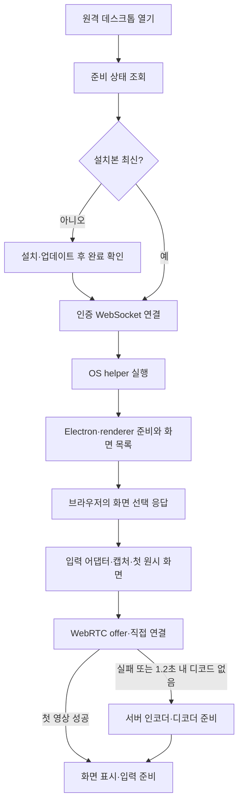

[Current implementation contract](../development/remote-desktop.md) · [Installation and usage](../../../docs/guides/remote-desktop.md)

Status: **Baseline investigation; some follow-up implementations completed.** On 2026-09-23, direct discovery of the dedicated Windows Node executable, bridge path caching, shorter DXGI empty-frame waits, and shorter initial installation polling were implemented. The figures and validation scope at the time are preserved in [2026-09-23 optimization validation](../history/remote-desktop-electron-transport.md#initial-connection-optimization-verification--2026-09-23). The 2026-10-01 transition to a resident GPU host and direct connections follows [ADR 0185](../history/decisions/0185-mew-desktop-resident-direct-host.md) and the [implementation record](../work/remote-desktop-resident-direct.md). The analysis and proposals not implemented below preserve the investigation as it stood at the time.

Investigated the 2026-09-22 working tree (based on `c7a6335`, including existing uncommitted changes). The existing [latency and bandwidth research](remote-desktop-latency.md) focuses on responsiveness after connection; this document covers the period from opening remote desktop to the first screen and input readiness. The time the user experienced, installation status, host OS, and access network have not yet been identified. Whether the running server matches the current source is also unverified.

## Conclusions and priorities

For environments where installation is complete, first investigate **Windows startup stages, capture initialization, and the cost of sequentially waiting for direct connections that will fail**. If initial installation is the cause, preparing the runtime in advance during installation or updates offers the largest improvement. To minimize time at connection, a standby helper that does not capture could also be started in advance, but this is a separate design that changes the existing policy of launching per connection.

| Order | Proposal | Stages that can be shortened | Difficulty and constraints |
| --- | --- | --- | --- |
| 1 | Instrument timing by stage through first display | Identify the actual bottleneck; does not reduce time on its own | Low. Collect only times and stages, without screen content, input, or tokens |
| 2 | Consolidate and reuse Windows path discovery; reduce broker PowerShell and dynamic compilation costs | Node discovery on every connection and broker/launcher startup | Path caching: low to medium; precompiled broker: high. Preserve login session validation and handling of parent termination |
| 3 | Switch to GDI sooner when DXGI cannot provide the first screen | Two initial screen waits of approximately 1 second each | Medium. Check the rate of unnecessarily abandoning functioning DXGI and the CPU cost of GDI |
| 4 | Select transport to suit environments that require server transport | Direct connection grace period of up to approximately 1.2 seconds after the offer, followed by server transport preparation | Medium to high. Server-first or concurrent attempts require an ADR change |
| 5 | Reduce round trips for status checks and screen selection; overlap capture and communication preparation | Network RTT and current serial initialization | Medium. Preserve user screen selection, permissions, and failure handling |
| 6 | Install in advance during Mew installation or updates; distribute validated OS-specific bundles | Initial download, dependency installation, and Mac compilation | Medium to high. Total installation cost remains, and distribution size increases |
| 7 | Start a helper without capture in advance in the login session and allow limited reuse | Repeated Windows broker and Electron startup | High. Changes memory usage and lifecycle, authentication, and update policies |

Actual seconds saved and improvement percentages cannot be guaranteed before the full connection process is instrumented. In particular, do not interpret a change to 1.2 seconds alone as resolving delays of tens of seconds.

## Current connection sequence

On Windows/WSL, F consists of Windows Node discovery → Node bridge → PowerShell broker → temporary InteractiveToken task registration and execution → PowerShell launcher in the login session → Electron. The broker also prepares a small C# P/Invoke type using `Add-Type` for each connection. Multiple process launches and task registration were confirmed, but their individual costs have not yet been measured. [Execution path](../../../server/remote-desktop-host.ts), [bridge](../../../native/remote-desktop/windows-bridge.mjs), [broker and launcher](../../../native/remote-desktop/windows-session.ps1)

## Delays confirmed in code and improvements already applied

| Stage | Confirmed facts | Interpretation |
| --- | --- | --- |
| Automatic installation | If the current marker is missing, poll for completion at 1.5-second intervals after installation | Recognizing completion may add 0 to approximately 1.5 seconds plus query costs. The 0.75-second average assumes uniformly distributed completion times |
| helper version | A hash of the entire file list shared across OSes determines installation status | Changes to Mac-only files can trigger updates on Windows as well. Consider separate installation fingerprints per OS, while invalidating all of them for shared protocol changes |
| Dependencies | Skip npm ci when the lockfile, OS, and architecture fingerprint matches | The claim that npm installation runs on every reconnection is incorrect. Running `install-runtime.mjs` is also not evidence that files were downloaded again every time |
| Paths | The host path reuses successful and in-progress requests for 30 seconds; the two wslpath calls run in parallel | An optimization already implemented. Windows Node bridge path discovery is separate and runs on every spawn |
| Firewall | Queries are asynchronous diagnostics after helper spawn | Do not add the timeout of up to 8 seconds to every initial connection |
| Screen list | `getSources` after renderer readiness, with thumbnail size 0 and no icons | Thumbnail removal is already applied. Using the `screen` list first for native capture requires validation of display ID, permission, and fallback contracts |
| Capture | If Windows DXGI cannot obtain the first pixels, try twice for approximately 1 second each, then use GDI | Approximately 2 seconds is repeated waiting on this failure path, not a fixed delay for every connection. Worker creation, request, and cleanup costs are separate |
| Mac capture | Native first-screen waiting has a budget of approximately 3 seconds, followed by Chromium fallback | A different path from Windows. Do not attribute them to the same cause without measurements on actual Mac hardware |
| Transport | Offer after capture. If no first decode occurs, switch to the server 1.2 seconds after receiving the offer | This timer does not run during the time before OS permission and capture. ICE candidates are already delivered using Trickle |
| Reconnection | Closing, switching to the background, or changing monitors ends the session and starts a new process | Even a brief return incurs helper startup costs again. Measure waiting for previous helper cleanup separately from a true first connection |
| Completion criteria | The direct path becomes connected when the two input DataChannels open; the server path becomes connected on the first canvas processing | Measuring only connected currently produces a mismatch with the time when the first screen is actually visible |

Evidence: [Preparation](../../../src/utils/desktop-preparation.ts), [installation fingerprint](../../../native/remote-desktop/helper-version.mjs), [capture startup](../../../native/remote-desktop/main.mjs), [transport selection](../../../src/utils/desktop-connection.ts), [direct reception](../../../src/utils/desktop-direct.ts), [server reception](../../../src/utils/desktop-relay.ts), [session termination](../../../server/remote-desktop.ts).

25·40·90·95 seconds are upper bounds on waiting in failure cases. They are not normal connection times or fixed waits that can be eliminated. Simply lowering timeouts can turn slow successes into fast failures.

## Specific scope of the proposals

### Improvements that preserve the current structure

- Share path checks for the host and bridge as a single preparation result. Cache only information that can be revalidated, such as executable paths and versions, and check the login session, permissions, and authentication on every connection. Eliminate duplicate execution between preparation and spawn.
- If measurements identify broker dynamic compilation and PowerShell startup costs as bottlenecks, compare a small precompiled launcher/broker. Preserve Task Scheduler InteractiveToken, pipe SID/session validation, passwordless execution, and the process-handle-based cleanup contract. Do not replace this with launching Electron directly from a regular WSL process. InteractiveToken uses an already logged-in user session. [Microsoft contract](https://learn.microsoft.com/en-us/windows/win32/taskschd/principal-logontype)
- Start by experimenting with a shorter limit on waiting for the first DXGI frame. On devices with repeated failures, retries can be reduced using hints containing the failure reason, screen configuration, and a short TTL. Preparing GDI first or concurrently, or promoting to DXGI during a session, is a larger change and requires updating the auxiliary path policy in ADR 0146. DXGI can return a timeout when there are no new screen or pointer changes. [AcquireNextFrame](https://learn.microsoft.com/en-us/windows/win32/api/dxgi1_2/nf-dxgi1_2-idxgioutputduplication-acquirenextframe)
- VP8 support checks and transport object preparation can run in advance while waiting for capture. ICE candidate pre-gathering is another option, but it helps only on networks where a connection can actually be established and does not reduce capture or broker delays. The current code already exchanges candidates immediately, so do not propose Trickle ICE as a new feature. [Trickle ICE](https://www.rfc-editor.org/info/rfc8838/), [WebRTC configuration](https://www.w3.org/TR/webrtc/)
- For the default monitor, including the preferred ID in the initial request, validating it against the helper's latest list, and selecting it automatically can eliminate one round trip of sending the list to the browser and receiving the selection. Monitor changes, missing IDs, and OS picker paths must be handled.
- Report installation completion through a completion event on the existing authenticated connection or through more frequent polling just before completion. Any proposal to combine the readiness GET and WS connection must also address failure recovery and separation of the installation lifecycle.

### Transport policy changes

The current default ICE list is empty, with no external STUN/TURN, and every connection starts with direct. Do not assume that an external network necessarily means failure, but environments that repeatedly select server transport have little reason to pay the same grace period every time.

The leading candidate is to briefly remember a recent successful server transport connection and open server transport first on the next connection. This requires checking browser VP8 support and providing a direct recovery path; because network changes cannot be detected perfectly, do not make the choice permanent. Server-first can eliminate the 1.2-second grace period on that path, but the overall connection still takes time for capture and transport preparation.

A more aggressive option is to briefly run server video and direct negotiation in parallel and select the first path ready to display, or start with server video and then switch to direct. This can speed up the first screen, but adds complexity around temporary dual encoding, bandwidth, keyframes, cursors, and transfer of input ownership. The two paths must not inject input simultaneously. Because this changes the direct-first, one-way transition in the current [ADR 0139](../history/decisions/0139-mew-desktop-server-transport.md), a new ADR is required before adoption.

### Advance installation and helper startup

If the initial download dominates, prepare the OS-specific helper in advance during Mew installation or updates, or provide distributions with validated runtimes, dependencies, and Mac native modules. This moves downloading and installation out of the wait for the first remote connection rather than eliminating them. Keep existing automatic preparation for recovery from missing files or version mismatches. Official Electron distribution also supports installing binaries in advance and caching downloads. [Electron installation](https://www.electronjs.org/docs/latest/tutorial/installation)

For installed environments, a candidate for a larger reduction is to **prepare a helper that does not capture in advance in the logged-in session**. Brief reuse can move repeated Electron and renderer startup and Windows task registration outside connection time. However, if a connection occurs immediately after initial login before preparation finishes, cold startup costs remain. Measure memory/RSS and idle CPU usage, and impose a limited TTL. Screen and microphone capture and input reception must be enabled only within an authenticated, explicit session and released immediately on close, permission revocation, or parent termination. Distinguish the lifetime of the standby process from the lifetime of capture.

This requires a follow-up ADR because it changes the one-shot, nonresident execution policy for each connection in [ADR 0138](../history/decisions/0138-mew-desktop-automatic-preparation.md). Replacing all of Electron with OS-specific native apps could further reduce Chromium startup costs, but the implementation burden for WebRTC, codecs, distribution, and OS-specific lifecycles is substantial, so compare this option only if the preceding measurements and improvements still fall short of the target. Official Electron performance guidance likewise prioritizes measuring actual bottlenecks and reducing unnecessary startup work. [Performance guidance](https://www.electronjs.org/docs/latest/tutorial/performance)

## Measurement and decision criteria for the next implementation

Separate connections into three types: first use requiring installation, the first connection after installation with the helper stopped, and reopening after closing. Further distinguish Windows/WSL, Mac, and Linux; LAN and external networks; direct and server; and DXGI, GDI, and Chromium. Include the time users spend granting permissions in the total perceived time, but report it separately from program processing time.

Collect events for open → status complete → installation start/end → WS open → Windows path check → broker → login launcher → Electron ready → renderer ready → sources → select → capture ready/first pixels → offer/answer → direct channels ready or relay ready → first decode → first display → input ready. Measure actual response to interaction in a separate synthetic scene.

For the first display of direct video, use `requestVideoFrameCallback` to confirm a frame delivered to the compositor; for server video, record the rAF canvas draw. Neither guarantees completion of optical display on the actual panel. Do not substitute DataChannel open, ICE connected, or framesDecoded for screen display. [Video frame callback proposal](https://wicg.github.io/video-rvfc/)

Measure intervals with a monotonic clock in each process, and use the same browser clock from browser click to display. Do not directly subtract `performance.now()` values or OS clocks from different processes. For initial exploration, run 5 times under the same conditions; for adoption decisions, compare p50, p95, maximum, and failure rate over at least 30 runs per condition. Since p95 is unstable with small samples, also check repeatability. Adjust if capture/input release after termination, normal direct connection success rate, GDI CPU and memory usage, or reconnection stability worsens.

This time, only limited queries were performed, without capture, input, or server changes. The readiness function in the current WSL agent process returned ready in all cases: approximately 0.60 seconds for the first call in a new process and 13~14ms for the two calls immediately afterward. This excludes HTTP, authentication, the browser, and the actual server process, and is not a cold measurement with OS caches cleared. Windows bridge path checking failed in this agent environment, so actual startup, capture, and first display could not be measured afterward. Since ready means installation files are prepared, it must be distinguished from successful execution. These results do not establish the bottleneck the user experienced.

Runtime code, configuration, and current ADRs were not changed. Only research documents and maps were added; no build, restart, installation, or actual remote session was performed.
