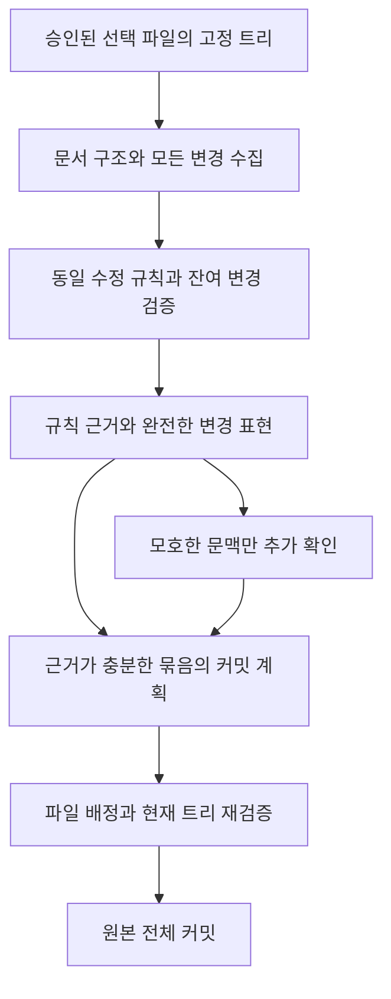

Prior measurements: [Review of AI commit token reduction](git-ai-commit-token-efficiency.md). Canonical source for current behavior: [AI commit execution contract](../development/agent-sessions.md#git-ai-commit-jobs).

**The research concludes that change representations tailored to document structure, consolidation of repetitive edits, and intent recorded at the time of change should be combined.** Replacing diffs with embeddings alone is incompatible with current ACP input, and sending excerpts first caused large-scale skipping in actual runs. Reduce the cost of repeatedly reading the same information rather than removing semantically distinct changes.

In a local experiment, a representation that reconstructs all changes across 43 actual documents reduced baseline tokens by **48.5%** compared with a Git diff with 3 lines of context. In a synthetic case with 100 repeated identical edits, the reduction was **88.8%**. By contrast, 100 unique additions showed almost no reduction. There is no evidence of a 90% reduction on the actual corpus without simply extracting excerpts.

This document presents research, reproducible offline experiments, and an implementation proposal. The experimental tools were not connected to the automatic commit execution path. Model grouping decisions, actual completion time, and embedding and LLMLingua performance on this server have not been measured. This proposal does not replace the default skill or production contract.

## Subsequent implementation status

With user approval on 2026-10-04, compression using shared characters, repeated lines, and a dictionary of identical changes across the full patch, along with change-purpose records verified against Git objects, was added to the execution path. A single packet requires 1 planning pass; if there are more, planning follows reading the evidence from all packets and verifying complete coverage. The experimental figures above measure the document-only representation used during the research; they do not indicate the compression ratio of this patch representation or live service speed. The original research and previous execution results are preserved unchanged. The current contract and limits follow [AI Commit Execution](../development/agent-sessions.md#git-ai-commit-jobs).

A separate offline check of the subsequent patch representation used 47 Markdown files that were uncommitted at the time (including this implementation document), `HEAD e3466026ebe8f0ab6e935eddeff5607c8a4a8978`, and selected tree `9327028db5f29885bb021a4a374affd31fb41cd8`. Preparing the full 3-line diff as 3 chunks in 2 packets took 261 ms in a single local measurement. With `o200k_base`, the original text quoted in JSON was 58,691 tokens, while the packet evidence including format instructions was 55,400 tokens, a 5.6% reduction. This comparison excluded the costs of the shared skill, selection list, purpose hints, evidence responses, and final plan. This is a different set from the earlier 43-document experiment and demonstrates the limits of compressing unique content with little repetition. Actual speed has not been measured. Execution for this set consists of parallel analysis of 2 evidence packets → 1 final planning pass, and does not skip files based on excerpts.

## What needs to be faster

Git already produces deltas that represent only the changes. The remaining issues are repeated long sentences before and after changes, identical edits across multiple documents, context unrelated to the changes, repeated instructions, and time spent on AI calls, reasoning, and output. The original commit content must be preserved as a Git tree, and the AI must receive evidence for determining the commit's purpose, logical grouping, and message.

The following are three separate goals. Failing to distinguish them can lead to reducing the files committed along with the input.

| Goal | What to check |
| --- | --- |
| Input completeness | Are all selected files, changed regions, and before/after differences represented? |
| Decision accuracy | Do the title and description match the actual changes, and are independent tasks grouped appropriately? |
| Execution safety | Are the selection scope, complete original content, HEAD, tree, stage, cancellation, and permissions respected? |

Writing a commit message does not replace a full code and documentation audit. A contract is needed that describes only changes supported by the provided evidence and does not claim that testing or review is complete. If intent affecting the title is unclear, more of the relevant context must be read, but proving implementation correctness for every changed file need not be a default prerequisite. This distinction is a proposal and has not been applied to the current skill.

## Why files were actually skipped

The completed fast-path task on 2026-10-04 recorded 13 of 145 selected files in 4 commits and left 132 files uncommitted. The overall skip rate was 91.0%; for documents, 43 of 45 remained, a rate of 95.6%. The task elapsed time was 181.0 seconds. Many reasons stated that only a partial diff had been received, preventing verification of all changes. The saved skip array alone contained 4,014 tokens under the baseline tokenizer. This is not the number of output tokens actually billed by the provider.

The current implementation has four problems in combination.

1. Selecting at most approximately 1,200 characters or fewer from each 8,000-character chunk discards a substantial amount of change evidence from the outset. When different small files share a chunk, even a small document becomes partial input because it is only part of the entire chunk.
2. Original chunks can be requested only 2 times, 6 at a time, so unread chunks are structurally inevitable as the volume of changes grows. There is no path for obtaining evidence in proportion to the total number of chunks.
3. The contract to skip when evidence is insufficient was combined with a limited recheck budget. This reduced only the number of calls without guaranteeing complete processing.
4. When documents and code are selected together, the total size determines the change-processing path. Changes that would fit in a single input when documents are considered separately can be lost in mixed input.

The completed task's `input.json` and original chunks had been cleaned up normally and were no longer available. Therefore, the full prompt, model settings, and exact contribution of each call at the time were not reconstructed. The compression experiments below measured the remaining document changes afterward using a **new fixed snapshot**; they do not directly compare completion times with this 145-file task.

**The subsequent design must not skip files solely because of size, excerpt markers, or the remaining call budget.** If insufficient evidence has been provided, the server supplies the remaining evidence in the next batch and distinguishes cases that cannot substantively be judged from cases where resource limits have been reached. This does not mean expanding automatic commit, push, or permission scope.

## Different meanings of compression

| Method | What the AI actually receives | Benefits | Limitations for commits |
| --- | --- | --- | --- |
| gzip·zstd | Compressed bytes or base64 | Reduced storage and transfer size | No change semantics for the model to read. External decompression restores the input tokens |
| Retrieval embeddings | Vectors are indexed instead of original text, and the original text from search results is passed along | Connecting and retrieving related candidates | Does not replace the procedure for sending evidence for every selected change |
| Learned memory·gist | Latent representations interpreted by a dedicated decoder | Research potential for substantial compression | Cannot be inserted directly into ordinary text ACP. Requires changes to the model, training, and serving |
| Extractive neural compression | Words and sentences retained by a small model | Compatible with ordinary text input | Removed negations, numbers, conditions, and relationships can change decisions |
| Document change representation compression | Before/after edits, shared segments, document structure, and references | Local processing and full change coverage can be designed together | The accuracy with which the model reads the new representation requires separate evaluation |
| Change intent records | Purpose, grouping, and verified scope recorded when authoring | Reduced cost of inferring intent again at commit time | Records alone cannot be trusted without checking original hashes and residual changes |

### What embeddings solve

Sentence-BERT is an approach that converts sentences into vectors for similarity comparisons. Typically, these vectors are used for retrieval and clustering rather than fed to a natural language generation model as replacement input for a diff. [Sentence-BERT paper](https://arxiv.org/abs/1908.10084), [Sentence Transformers documentation](https://www.sbert.net/docs/sentence_transformer/usage/semantic_textual_similarity.html)

Currently, `AgentSession` passes text content blocks to ACP through `runOnce(text)`. No path is connected to interpret embedding vectors as latent input. Writing a numeric array into a prompt does not convert that vector into the meaning of the original diff. If embeddings are added, the appropriate design is to use them to generate candidates for grouping changed regions by related tasks and send the actual change evidence separately.

Retrieval top-k selects a subset of documents. For commits that must assign every selected file, independent edits outside the top-k must also be handled without omission. Exact paths, APIs, links, and numeric relationships can first be connected through lexical retrieval and structural relationships. A structure combining embeddings with BM25 and sending the original search-result text is also described in [Anthropic Contextual Retrieval](https://www.anthropic.com/engineering/contextual-retrieval). The conclusion that applying this directly to exhaustive commit classification leaves a coverage problem is an inference from this research.

The tradeoffs for embeddings are as follows. Model download, loading, and CPU/GPU encoding times have not been measured on this server, so no conclusion is drawn that embeddings are always faster or slower.

```text
추가 인코딩·검색·군집 비용
  < 없어진 AI 호출 준비·입력 처리 시간 - 늘어난 재확인·출력 시간
```

If there are many unfamiliar expressions and an existing index or resident model is available, embeddings may help find similar edits. Identical edits and link or field changes can be found through hashes and exact matching, so there is little reason to embed them first. Similarity scores must not be treated as proof of identical meaning. The difficulty of similarity evaluation involving negation and antonyms is also addressed in the [SemAntoNeg study](https://aclanthology.org/2022.blackboxnlp-1.20/).

### What to take from learned compression papers

[LLMLingua-2](https://aclanthology.org/2024.findings-acl.57/) selects content to retain through token classification by a bidirectional encoder. The paper reports 2–5× compression and 1.6–2.9× end-to-end latency improvements on evaluation tasks. These are results from MeetingBank, LongBench, and other benchmarks, not results for Mew's mixed Korean/English Markdown diffs, commit classification, or this server's CPU performance. It is a suitable follow-up candidate for reducing the body text of new documents with repetitive explanations, but it must be evaluated while protecting conditions, numbers, links, commands, code, and tables. [Official implementation](https://github.com/microsoft/LLMLingua)

[Selective Context](https://aclanthology.org/2023.emnlp-main.391/) removes portions of context based on information content. [Selection-p](https://aclanthology.org/2024.findings-emnlp.646/) also learns whether to retain or remove tokens. High average task scores for these methods do not mean they preserve small contract differences in every document change. The idea that deletion may have a greater impact on diffs whose primary edits are local negations or exceptions is a hypothesis about their application.

[Gist tokens](https://arxiv.org/abs/2304.08467) compress prompts using a trained model and attention masks. The paper reported a 4.2% wall time improvement with up to 26× prompt compression. **The compression ratio and the improvement in completion time are not the same.** [ICAE](https://arxiv.org/abs/2307.06945) also uses learned memory slots and a model that interprets them. Neither method is a capability obtainable by prepending external embeddings to standard ACP text input.

An [EMNLP study evaluating information preservation](https://aclanthology.org/2025.findings-emnlp.949/) provides evidence that actual task performance, original-text evidence, and information preservation must be evaluated separately from compression ratio. Here, compressor reconstruction validation and model decision validation are designed as separate stages.

## Local experiments on actual documents

### Fixed input and measurement scope

The 43 changed documents and 181 hunks in the existing working tree were fixed using a separate Git index. The baseline HEAD is `74351efbf9cb73bb6230bdbc290167cfe36e3b68`, and the selected change tree is `3d5b7661b36d168b1512a19e4d224ea144e4bc1c`. Only the current and baseline blobs of the selected changed documents were read, without recursively loading the entire documentation folder or archives.

The environment was Node `22.22.2`, Ryzen 5 9600X, `diff 9.0.0`, `markdown-it 14.3.0`, and `yaml 2.9.1`. Baseline tokens use `o200k_base` from local `tiktoken`. They are not assumed to match the production model's tokenizer or billed usage. The table's inputs include each representation's file list, scope, and format instructions, and exclude the shared skill, runtime instructions, and model output.

Git diffs with 3 and 0 lines of surrounding context were compared. Global whitespace ignoring, truncated original text, and AI summaries were not used. Every representation used the same fixed document set.

### Results by representation

| Input representation | Baseline tokens | Reduction vs. 3-line Git | Reduction vs. 0-line Git | Evidence preserved |
| --- | ---: | ---: | ---: | --- |
| Git with 3 lines of context | 51,025 | Baseline | — | All changes and 3 surrounding lines |
| Git with 0 lines of context | 30,330 | 40.6% | Baseline | All changes; surrounding context separate |
| Before/after string JSON | 31,719 | 37.8% | -4.6% | All changes. Adding only JSON structure increases the size |
| Record shared strings once | 27,007 | 47.1% | 11.0% | Reconstructs the before/after strings of every hunk |
| Above representation plus a dictionary of identical edits | 26,302 | **48.5%** | **13.3%** | Reconstructs all changes; repeated content appears 1 time |
| Attach 32 surrounding characters to each edit | 37,634 | 26.2% | -24.1% | All changed strings. Duplicated context increases the size |
| Merge overlapping context; choose the smaller of the 32-character candidate and the full text | 23,925 | 53.1% | 21.1% | All edits; some unchanged context omitted |
| 80-character candidate for the adaptive selection above | 25,412 | 50.2% | 16.2% | All edits; context may still be insufficient |

**Reconstructing every hunk and obtaining the context needed to judge meaning are different things.** The shared-string and dictionary representations were applied to the baseline files to check whether the complete resulting documents matched the originals. The surrounding-context candidates also reconstruct the result from all character edits, but do not give the model some unchanged context. That context may contain the subject or scope of a condition, so 53.1% is not described as a compression ratio without semantic loss.

An example of shared strings follows. String entries are content shared by both sides, and pairs are `[이전, 이후]`. Explicit JSON types distinguish them instead of inferring delimiter patterns from the original text.

```json
{"shared":["접근을 ",["허용한다","허용하지 않는다"],".\n"]}
```

Only the model input changes in this way. The actual committed files contain the complete original content; the compressed representation is not written to the source.

### Findings on timing and structural classification

The same snapshot was measured 5 times in fresh Node processes. The median time for reading blobs and hunks was 381 ms, and the median preparation time for generating both the 3-line and 0-line baselines and all compression candidates was 917 ms. Preparation ranged from 894 to 1,009 ms. These values exclude Git snapshot creation, module loading, subsequent AST statistics, synthetic case generation, tokenization, ACP preparation, model calls, and actual commits. They are not the completion time or user-perceived latency of a path that generates only one production candidate.

A conservative comparison of `markdown-it` token structure and YAML values found differences in Markdown body structure or content in all 43 documents. No file could be classified as having identical content with only whitespace changes. Document titles, links, contracts, UI usage instructions, and other content changed together. The hypothesis that ignoring whitespace would eliminate most changes in this corpus was not supported. This parser is not a semantic validator that reproduces every Mew extension.

gzip was also compared. The 3-line diff shrank from 190,054 UTF-8 bytes to 56,989 bytes, taking approximately 5.5 ms to process. However, its base64 representation was **51,891 tokens**, larger than the original 51,025. It was not assumed that the model could understand changes from this value without invoking a decoder that reads compressed bytes. In this case, storage and transfer compression did not reduce AI input.

### The difference between repetition and new information

These are controlled cases with identical edits or different edits and additions across 100 documents. Within each row, comparisons use before/after string JSON for the same document set as the baseline. These results are not mixed with actual repository statistics.

| Synthetic change | Before/after JSON | Shared strings and dictionary | Reduction | Interpretation |
| --- | ---: | ---: | ---: | --- |
| 100 identical condition edits in the same long sentence | 42,550 | 4,751 | **88.8%** | Large reduction from providing the rule and evidence 1 time plus a list of applications |
| 100 local edits in different long sentences | 82,550 | 44,350 | 46.3% | Shared before/after sentence content reduces size even without duplication across files |
| 100 instances of identical new document content | 37,450 | 4,883 | **87.0%** | Identical added content provided once |
| 100 different additions of new content | 71,774 | 71,874 | -0.1% | Without duplication, the dictionary only adds overhead |

For local edits in different long sentences, the adaptive 32-character context candidate reduced the input to 8,767 tokens. However, this resulted from omitting information in unchanged portions of long sentences; semantic preservation and model decisions were not validated. The synthetic 89.4% reduction must not be cited as a result for the 43 actual documents.

The prototype selected candidates based on character length. In some synthetic additions, token counts increased even as character counts decreased. A production implementation must compare candidates using a tokenizer appropriate for the actual runtime or a verifiable conservative budget, and use the original representation when compression is unfavorable. It must also not assume that short numeric IDs and JSON always reduce tokens.

## Recommended change representation for documents

### Prioritize document structure over files and chunks

Split documents into frontmatter, heading hierarchies, paragraphs, list items, table rows and cells, code blocks, links, and HTML and comments. Associate each change with its before/after blobs, structural location, change representation, and complete original references. Preserve the before/after parent headings for moved paragraphs as well. The same sentence can change meaning when moved from a prohibition to a recommendation.

Changed regions need the following three states. Simply distinguishing complete from partial chunks does not show whether every change is represented.

| State | Meaning | Next action |
| --- | --- | --- |
| Complete change representation | All before/after strings in the hunk are represented | Use if sufficient for deciding the message |
| Structurally verified edit | Rule application at the specified fields, links, and locations, along with the residual diff, has been verified | Share rule evidence and assign every application target |
| Edit requiring context review | All edits are present, but scope or intent is unclear | Provide the relevant paragraphs, headings, and connected regions as additional context |

### Send identical edits as a rule and a list of applications

For example, if the same guidance text changes in 300 documents, provide one representative edit and a list of document and region IDs. Do not read only the representative edit and assume the rest are identical. Locally check that the before string, after string, and structural location match the rule at every application target, and that there are no separate residual changes. If residual changes exist, retain them as separate changes.

Find rule candidates using exact before/after strings, frontmatter keys and values, heading edits, link labels and targets, specified table cells, and completely identical insertion or deletion blocks. Do not treat similar prose as identical through hashing or group it solely by line number. Semantic clusters can be used for message candidates, but do not prove that rules are identical.

**The largest potential savings ahead come from evaluating repetition once, rather than cutting the entire input more aggressively.** For mechanical edits whose rules, targets, and exceptions are fully verified, a path that handles even standard message generation locally is also possible. Apply it only where it satisfies the message and splitting rules required by user skills, and do not use rules to settle semantic judgments about general prose. This 0-AI-call path is a proposal and has not been implemented.

### Send shared parts of long sentences only once

Use shared text and change pairs instead of sending each full before-and-after sentence. Do not omit deletions, insertions, negations, numbers, commands, or links. Reconstruction checks catch compressor bugs. Select this approach only when it saves space even after accounting for instructions for the new representation and structural overhead.

Git's `--word-diff=plain` can be ambiguous because it does not escape delimiters in the source, and default word comparison uses whitespace boundaries. Therefore, do not treat plain display strings as a lossless codec. [Official Git diff documentation](https://git-scm.com/docs/git-diff). The prototype used `diffChars` and explicitly typed JSON, falling back to full before-and-after strings when computation takes too long. [JsDiff contract](https://github.com/kpdecker/jsdiff)

### Preserve overlaps and relationships when reducing context

Unconditionally attaching a fixed amount of context to each character change repeats the same content in sentences with many small changes. Merge nearby changes into the same sentence or structural span. Expand to the paragraph if the remaining context is insufficient. For unique new paragraphs, deleted contracts, and code blocks, sending the full source may be shorter or clearer.

Markdown blank lines, indentation, and two trailing spaces affect list structure, code, and hard line breaks. The frontmatter fields `title`, `parent`, and `status` also affect Mew behavior. Do not make removing all whitespace or removing stop words from prose the default path. [CommonMark specification](https://spec.commonmark.org/0.31.2/), [GFM table and task list extensions](https://github.github.com/gfm/). Validation against the actual Mew extensions and renderer is required before classifying a change as mechanical formatting.

## A long-term approach to avoiding repeated analysis at commit time

When editing or agent work ends, leave a small change record containing the purpose, related files, why they form one task, before-and-after blob and block hashes, and verification actually performed. Features that apply the same wording to multiple documents can record rules, targets, and exceptions together. At commit time, check that the records match the current fixed snapshot and **analyze only the remaining changes absent from those records**.

This differs from a cache that trusts summaries as-is. If subsequent edits from other tasks, manual changes, rebases, or selection changes alter the hashes, invalidate the affected records. If multiple tasks modify one file, resolve file-level commit constraints first. Records do not replace commit approval for selected files or the current staging state. Keep them within account and repository boundaries, and avoid unnecessarily duplicating source text or secrets.

The project currently has no verified change-recording path for this purpose. We do not claim to have reconstructed the past intent of these changes without records. However, if repetitive documentation work becomes common, small intent records made during the work may reduce latency more than embeddings at commit time. Measuring this effect remains a follow-up task.

## Execution flow and latency budget



The first input includes rules and evidence for all changes, not just a file list. The goal is usually to finish planning in 1 call, while processing additional batches without omissions when many changes differ in meaning. Applying a fixed limit of 3 calls to every input size is not a solution. State time, input, and output budgets in advance, and distinguish inability to read more from uncertainty about the content.

Separate input budgets could be considered for documentation-only changes and changes mixing code and tests. `parent`, frontmatter `files`, documents for the same feature, actual change representations, and link relationships provide evidence for candidate groups. Do not strongly connect every file based on a directory or a single shared word. If related code and documentation are part of the same change, group them together in the final groups. If a file contains multiple concerns, group them or adjust the scope to satisfy file-level constraints. Do not introduce a policy that always commits documentation separately.

If splitting is needed, compare bounded concurrent analysis of independent batches. Parallel prompts within the same ACP session conflict with the current `busy` contract, so separate sessions and request limits are required. Parallelization may reduce wall-clock time but does not reduce the total tokens read. Measure startup and shutdown overhead together with rate limits. Reusing a session for follow-up checks on the same task may increase accumulated context costs in exchange for lower setup costs.

```text
전체 시간 = 로컬 수집·압축
          + 호출별 대기·ACP 준비·입력 처리·추론·응답 생성·정리
          + 스냅샷 재검증·Git hook·서명·커밋
```

Call completion times in the current logs cannot separate these components. Collect preparation start/end, first token, last token, call end, total/cache/output/reasoning usage, the amount of additional source requested, and result coverage. `AgentSession` has `turn_end.durationMs` and usage-related meta paths, but per-task cost breakdowns for automatic commits are not connected. Mark usage unavailable from the runtime as missing.

Reducing only the input while retaining lengthy analysis, repeated skip reasons, and repeated output of every path may not reduce completion time as much as expected. Consider concise messages focused on the purpose of the changes and allowing internal file IDs in model responses. The server must restore IDs to paths and perform validation equivalent to the existing complete-assignment check. The path that output the same skip reason for 132 items is a particular target for reduction.

Provider prefix caching is a supplementary way to reduce the processing cost of repeated instructions and identical input. It does not eliminate unique changes being read for the first time. Verify identical prefixes, cache-hit usage, and whether the ACP runtime supports cache control. [Claude's official caching contract](https://platform.claude.com/docs/en/build-with-claude/prompt-caching). Local structure and hash caches reduce recomputation before model calls; field and span hashes are needed to reduce invalidation of every chunk after an edit near the beginning.

## Evaluations required before adoption

Existing commit benchmarks mostly generate messages for a single commit whose contents are already determined. The large commit task in [Long Code Arena](https://arxiv.org/html/2406.11612v1) and [CommitBench](https://arxiv.org/abs/2403.05188) are useful references, but do not replace evaluation of Mew's uncommitted-change splitting, documentation, Korean, and complete processing. Do not judge correct grouping or omission-free commits solely by sentence similarity metrics such as BLEU and ROUGE.

Comparison groups are full source text, the current excerpt path, complete shared strings and dictionaries, structural rules and remaining changes, adaptive context, and neural compression with protected spans. Fix the same snapshot, model, reasoning effort, and skills, and compare initial runs separately from retries of the same changes.

| Evaluation dimension | Proposed metrics and acceptance criteria |
| --- | --- |
| Completeness | Selected file, hunk, and modified-span coverage of 100%; 0 skips solely due to size |
| Reconstruction | Exact source matches for all UTF-8 documents, before-and-after modes, insertions, deletions, and final newlines |
| Semantics | Whether changes to negations, exceptions, numbers, roles, link targets, table cells, commands, or checkbox states are omitted |
| Grouping | Separation of human-defined independent tasks, incorrect merging, and separation of code and documentation for the same feature |
| Messages | Factual errors, missing main purposes, and unsupported claims of testing or review |
| Speed | p50 and p95 total time, call count, and time to first token at equal processing coverage |
| Cost | Cumulative input, cache, output, and reasoning tokens, including retry and reconstruction costs |
| Operations | Staging preservation, contention, cancellation, partial success, permissions, and preservation of user skills |

Fixed cases include 100/1,000 identical edits, 100 unique prose items, one word in a long sentence, two tasks in one file, section moves, link and image target changes, table/code/HTML changes, final newlines, a condition reversal hidden in the middle, and different contracts with similar structure. Report the actual set of 43 documents separately from synthetic sets. Human ability to reconstruct compressed source alone does not establish that the model passes the accuracy evaluation.

The proposed adoption order is as follows.

1. **Instrumentation and separate skip reasons:** Make it observable when insufficient input silently ends as a completed commit.
2. **Complete change representations for documents:** Reduce repeated instructions and duplicate staged references, and use shared strings and identical-edit dictionaries. Validate the remaining diff and the complete result.
3. **Structural rules and candidate groups:** Start with verifiable repetitive edits and expand after passing the full model evaluation.
4. **Change intent records and span caches:** Apply them to new work, and handle changes without records using complete change representations.
5. **Embedding and neural compression experiments:** Compare them after checking whether large unique changes remaining in the paths above dominate latency.

The first experiment aims to reduce model calls while actually processing the currently remaining changes. Do not promise 90% token savings or completion in a few seconds upfront. Evidence must come from p50 and p95 measurements at equal coverage and judgment quality.

## Reproduction tools and verified scope

The [offline experiment tool](../../../server/git-doc-compression-benchmark.ts) accepts `{head,tree,files}`, reads fixed Markdown blobs and Git U0 hunks, and generates candidates. It checks source reconstruction and mode-list preservation, and optionally saves input in a private temporary folder. It performs no AI calls, staging, commits, or server changes. It uses the `diff` dependency in the current lockfile for research; whether to declare it as an explicit dependency must also be resolved when introducing it into the production path. It targets only UTF-8 regular files; binaries and symlinks require separate representations.

A new snapshot of the current changes can be created as follows. The same corpus can be reproduced only while the Git objects from the initial measurement remain; the same objects may be absent in a new clone or after Git GC. The commands below measure new changes at that point in time, so the results are not guaranteed to match the numbers in this document.

```bash
node --input-type=module <<'JS' > /tmp/mew-doc-snapshot.json
import { execFileSync } from 'node:child_process'
import { captureCommitChanges } from './server/git-ai-commit.ts'
const files = execFileSync('git', ['diff', '--name-only', 'HEAD', '-z', '--', 'docs'], { encoding: 'utf8' }).split('\0').filter(p => p.endsWith('.md'))
const snapshot = await captureCommitChanges(process.cwd(), files, false)
console.log(JSON.stringify({ head: snapshot.head, tree: snapshot.tree, files: snapshot.files }))
JS
node server/git-doc-compression-benchmark.ts --snapshot /tmp/mew-doc-snapshot.json --emit-directory /tmp/mew-doc-inputs
node --test server/git-doc-compression-benchmark.test.ts
```

This snapshot example selects only changes to tracked documents. To measure new untracked documents, add them to the explicit selection list.

Baseline tokens were measured with `tiktoken.get_encoding('o200k_base').encode(text, disallowed_special=())` over the entire string in the same temporary file. This is not a cost experiment that includes skills, model output, and system instructions. Running without `--emit-directory` does not save source input files. Do not add temporary source text to documents or Git.

Reconstruction tests cover negations, numbers, links, tables, fences, HTML comments, indentation, blank lines in lists, hard line breaks, Unicode, CRLF, insertions/deletions, final newlines, and 60 deterministic variations. Complete reconstruction of the actual 43 documents and 4 types of synthetic 100-document sets was also checked during the experiments. These checks verify the compressor's data preservation; evaluation of the production model's commit judgment quality remains a follow-up task.

The research tool passed 4 tests, TypeScript checks, and targeted lint checks.
