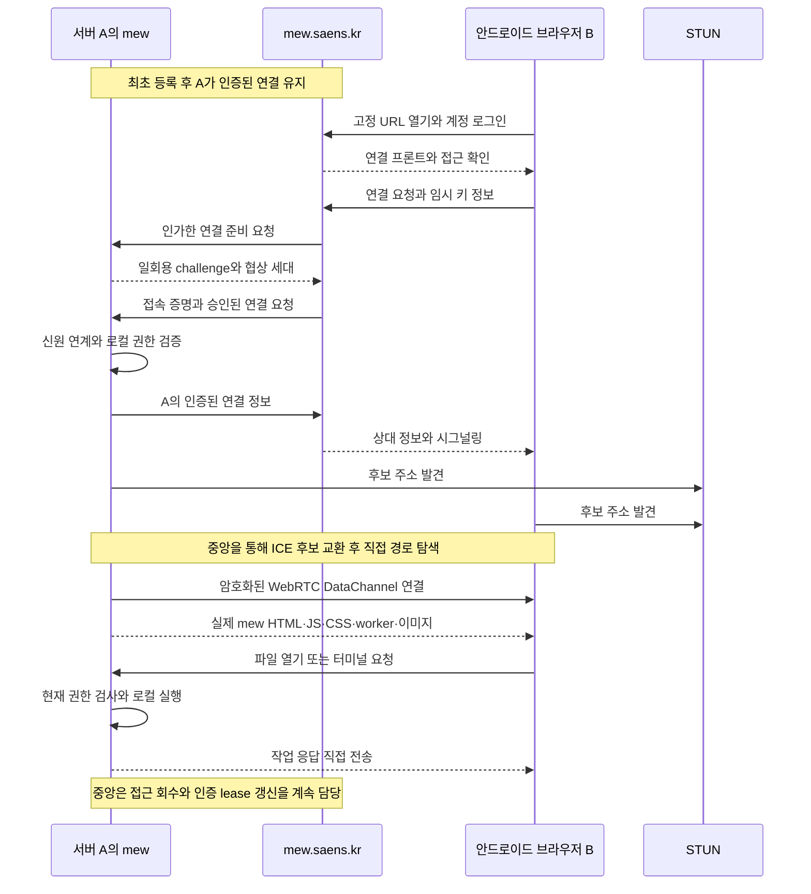

The text below preserves the initial design, implementation, and release conditions of the existing task whose review date was recorded as 2026-10-07. Its statements and checkboxes about domains, features not implemented, undeployed changes, and `done` reflect the plans and verification scope at that time.

The [P2P remote access contract](../development/remote-access.md) owns current behavior and verification scope, and [Central service deployment](../operations/remote-central.md) owns application procedures and production verification. Completion, tags, dates, and assignees are managed in [Build mew relay functionality](<../../tasks/Done/Build%20mew%20relay%20functionality.md>).

## Goals and current status

**Implementation of Cloudflare central services, OAuth, and P2P transport across the entire UI, plus local automated verification, is complete · not deployed.** Review date: 2026-10-07. Central login provider configuration and actual login, DNS, certificates, central production infrastructure, external-network measurements, and release validation remain. Keep `done` incomplete until the release is confirmed.

The central service is named **mewlink**, with its source in `mew/mewlink/`. It is separated from public mew installations through the parent `.gitignore` and exclusion from the npm workspace. The central service's own dependencies and tests are managed in its local folder, while connection protocols and signing tools use the public `shared/`. Workers + Static Assets deploy the connection frontend and backend together, using D1 and per-device Durable Objects. Actual mew HTML, JS, CSS, workers, and images are received from A over P2P. Supabase and a separate Pages project are not used. A separate Git repository has not yet been created. The public URL is retained, and only the internal app origin is separated.

[P2P remote access](../development/remote-access.md) owns the current code contract, and [Central service installation](../operations/remote-central.md) owns the central service application procedure. The requirements and release criteria below continue to be managed in this task.

Allow users to use their installed mew from another PC or mobile browser without configuring a separate domain, VPN, or tunnel. Register server computer A once, then B, C, and D log in through `https://mew.saens.kr/<user-id>/<device-name>` or the dashboard to connect. Registering the connecting browser or approving each connection on A is not required.

Here, **relay means account authentication, device lists, access approval, and signaling**. Actual app UI files, files, terminal, agent, collaboration, and video data are transferred directly between A and the browser. Existing Cloudflare Tunnel, Tailscale, user-configured HTTPS access, and local login are retained.

[ADR 0195](../history/decisions/0195-mew-account-based-p2p-remote-access.md) · [Follow-up ADR 0203](../history/decisions/0203-mewlink-workers-p2p-ui.md) · [Security baseline](../../../docs/operations/security.md) · [Server architecture](../development/architecture.md) · [Per-account permissions](../development/access-control.md) · [Native deployment](../../../docs/deployment/native.md)

## Implementation feasibility review

**Technically feasible. However, this feature requires more than adding a central login site.** The largest task is connecting the existing HTTP/WebSocket-based app to authenticated DataChannel transport. External-network connection success rates must be checked on actual devices after implementation.

| Currently verified architecture | Reuse or additional work |
| --- | --- |
| `server/serve.ts` serves the static UI, HTTP API, and multiple WebSockets on a single port | Serve the static UI centrally, but a separate transport layer is required for A's APIs and subscriptions |
| `src/api/client.ts` and other API modules call `fetch` directly | Gradually migrate to a shared request adapter; changing only `client.ts` is insufficient |
| Terminal, agent, presence, collaboration, DB, browser, and desktop use separate WebSockets | Subscription/session adapters that accept per-connection authentication contexts are required |
| Images, PDFs, media, and downloads use `/api/...` URLs directly | Separate resource delivery is required, including binary streams, Blob URLs, and Range handling |
| `server/reqAuth.ts` interprets local session cookies, and current account storage and permissions use email keys | Add immutable central identities and explicit local account mappings, and use the same permission decisions for HTTP and P2P |
| Remote desktop's `native/remote-desktop/native-host.mjs` uses `node-datachannel` | Native RTC and NAT preparation experience can be reused; the capture/input host will not be reused as-is for app transport |
| The local server binds to loopback, and existing native deployment assumes the root path | Add outbound WSS from A to the central service and a P2P module, avoiding public HTTP exposure and subpath deployment |

The first gate for external use is an **authenticated DataChannel between WSL server A and Android browser B on an external network**. Automated verification currently covers signed connections using actual Chromium and native RTC on the same host and an isolated HTTPS central service, reads, saves, and permissions through existing file APIs, and resource and WS transport. The external-network gate has not yet been passed. Because WSL UDP/NAT and Windows native helper placement affect connectivity and installation difficulty, verify this prototype's results before migrating transport for the entire app. A successful echo alone does not establish file permissions, app usability, or release readiness.

With direct connections only, connections may fail on restrictive NAT or UDP-blocking networks. Distinguish “can log in and attempt a connection without configuration” from “connects on every network.” Adding TURN or an HTTP relay for work data requires a follow-up decision that changes the existing ADR.

## User experience

### Installation and registration

1. After a Git clone inside WSL, install and perform initial setup with `cd mew && ./mew`. On macOS/Linux, integrate the same registration feature into the existing installation flow.
2. Choose an external access method: mew account access / Cloudflare Tunnel / Tailscale / None. Determine the guidance and automation scope for the latter options after checking existing support; do not assume this task automatically installs all of them.
3. Selecting mew account access displays registration guidance in the local owner UI. Change the temporary password first, then start registration in account management to receive a one-time URL. View the guidance again with `./mew remote-access account`. Do not enter OAuth tokens in the installation terminal.
4. Logging in at mew.saens.kr and entering a server name links A's registration request to the owning account. A displays the fixed address after verifying registration completion.
5. A automatically maintains its central connection using stored server credentials. The dashboard displays online/offline status and device names.

The final login requirement is **Google, Apple, GitHub, and email**. Google, Apple, GitHub, and an optional email OIDC adapter have been implemented in Workers, and only configured providers are displayed. Email magic links/passwords are handled by the OIDC provider configured by the operator. Actual provider configuration and login verification remain outstanding. Account merging across providers is not offered, and accounts are not automatically linked by matching email addresses.

### Connecting from another device

- Opening the fixed address connects to the target mew after login and permission checks.
- Logging in at `https://mew.saens.kr` displays the list of registered and permitted devices at `/dashboard`. Selecting a device starts the same connection flow.
- Display distinct states for offline, no permission, direct connection failure, and version mismatch. A must be powered on, running mew, and connected to the internet.

The detailed contracts for registration, connection, and member approval follow the sections below.

## Confirmed scope

- The public access address is `https://mew.saens.kr/<user-id>/<device-name>`. device-name is A's server name.
- A's local owner approves initial server registration while logging in to the account. Subsequent connections do not require approval on A or registration of B, C, or D.
- Only the owner and member accounts permitted by the owner can connect. Successful login and permissions to use files, terminals, and other features are checked separately.
- The central service does not transfer or store file, terminal, agent, or collaboration data, or remote desktop video and input.
- Only a small login, device selection, and connection frontend and authentication/signaling metadata are received from the central service. Actual mew UI code and resources are received from A over P2P. STUN also helps discover external addresses.
- The address bar retains `mew.saens.kr/{user}/{device}`. The internal `mew-ui.saens.kr` on the same Worker is an execution boundary separating P2P app code from the central authentication origin, not a separate mew UI deployment.
- The baseline design uses direct connections only. If a direct connection is blocked, display a failure. Introducing TURN requires a separate decision.
- A must be powered on, running mew, and connected to the internet. Remote desktop OS permissions and screen-sharing conditions follow the existing contract.

Existing local login and user-configured HTTPS access are retained. This document alone does not change the current [Security baseline](../../../docs/operations/security.md), [Native deployment](../../../docs/deployment/native.md), or [Per-account permissions](../development/access-control.md).

## Components and data boundaries

| Component | Responsibilities | Data handled |
| --- | --- | --- |
| mewlink connection frontend | Login, target selection, and P2P connection for the internal app frame | Small connection code and login state; actual UI and work are received directly from A |
| Central account and access approval service | OAuth/OIDC login, server ownership and member access management, connection proof issuance and revocation | Account identifiers, server registrations, memberships, session and policy information |
| Central signaling service | Check A's online status and exchange SDP/ICE between authorized A and B | Briefly retained connection metadata; no work payloads |
| A's connection module | Initial registration, central connection maintenance and reconnection, WebRTC and connection proof verification | A's private server credentials and per-connection authentication contexts |
| mew on A | File, terminal, agent, and collaboration operations; local permission checks | Actual work data, provider credentials, and OS resources |
| STUN | Discover external NAT addresses and ports | Connection address information; no file, terminal, or video relay |

The central service manages registration and authentication for multiple servers but does not host user workspaces or shells. Each A's OS permission boundary follows [Security](../../../docs/operations/security.md). The contract that the central service does not retain work data also applies to browser-side telemetry and error collection.

## User Flow

### Registering A for the first time

1. Log in as the local owner at A's `http://localhost:5000` or its actual installed port and start remote access registration. Local mew authorizes this management request.
2. A creates a server key and registration request, and the user completes OAuth/OIDC login on the mew.saens.kr login page. Bind the registration request to A's key, a one-time challenge, and the login transaction so it cannot be substituted with another server's registration request.
3. When the user chooses a server name, the central service links the registering account, immutable instance ID, and A's public key. A verifies the registration response for its own request and completes registration. Handle this in a single registration flow without creating separate approval for connecting devices.
4. A stores private server credentials in the mew data folder so only the OS user can read them. Account OAuth tokens are not used as credentials for the server's persistent connection.
5. A maintains an authenticated WSS connection to the central service. After a restart or temporary network interruption, it automatically reconnects using stored server credentials. Re-registration is required only if keys are lost during reinstallation or the registration is revoked.

After completion, the user receives a fixed address like the following.

```text
https://mew.saens.kr/saens/home
```

The server name is for display and navigation. The connection proof target and permission storage use an instance ID independent of name changes. Knowing the URL does not grant access.

### Connecting from B

1. When B opens the fixed address, it receives only the login, device selection, and connection frontend from the central service. It does not retrieve the actual mew UI or work APIs through a central HTTP proxy.
2. If not logged in, proceed with OAuth/OIDC login. Reuse an existing valid login session. The central service checks the account's permission to access A.
3. B creates a temporary key and WebRTC connection information for this connection only. The central service sends an authorized connection preparation request to A and receives a one-time challenge and negotiation generation generated by A. It then issues a short-lived connection proof bound to the specific user, A, challenge, and B's connection information. Temporary key generation is internal browser behavior and does not create device registration or an allowed-device list.
4. Central signaling delivers the connection proof to A. A verifies its challenge, the connection proof, external account mapping, and local allowlist, then sends its authenticated connection information. Both sides discover candidate addresses through STUN and seek a direct route through ICE.
5. A and B verify that the peer and connection match and open an encrypted DataChannel. A accepts work requests after establishing the authentication context and current permissions.
6. B receives A's installed mew UI over the authenticated connection and runs it in an internal iframe. HTML, CSS, JS, workers, and images are received over the same connection, while the address bar is retained.
7. B's file read/save, terminal, agent, and collaboration requests and responses flow directly between A ↔ B. Remote desktop also uses its existing separate WebRTC video/input path.

C and D connect using the same URL and account login. App access uses an independent connection per browser, while remote desktop's simultaneous control limits remain separate.



### Granting and revoking member access

The owner connected to A approves member access and local roles, features, and file scope. Central membership manages whether a member can connect, while local policies approved by A set the upper limit on actual work permissions. Adding a member centrally alone does not grant owner or manager permissions on A.

Member invitations, identity linking, and permission changes are applied as management operations approved by A. If A is offline, new access is not allowed until the local policy is applied. Accepting an invitation alone does not automatically take over a local account with the same email address. Once permitted, members only need to log in with their own accounts for subsequent access.

Revocation, account blocking, and server registration revocation block new connections and are also propagated to active connections. The existing limitation remains: previously downloaded materials and OS processes already executed cannot be retroactively revoked.

## Identity and connection proofs

Central accounts are identified by the provider and its immutable subject or user ID. Email addresses, display names, and user-id strings in URLs are not used as proof of permission. Links between A's local accounts and central accounts are managed through explicit mappings approved by the owner.

Link the initially registered central owner to the local owner, but do not waive the existing account's temporary password change requirement solely through OAuth linking. External logins are explicitly mapped to existing local accounts; registration does not create new local accounts or migrate account formats. Do not repurpose tokens from the [existing GitHub connection](../development/git-connections.md) for central mew login.

Connection proofs are validated against all of the following conditions. The current format is EdDSA JWT with protocol 1, verified using `jose`. Numeric limits and transport boundaries follow the [Implementation contract](../development/remote-access.md#protocol-and-resource-lifetimes).

- Pinned issuer, target instance ID, user ID, session ID, issuance time, short expiration, allowed algorithm, and key identifier.
- Binding of A's challenge, proof of possession of B's temporary key, the actual WebRTC connection's certificate fingerprint, and the connection transaction. It must not be reusable for another peer or negotiation generation of the same request.
- One-time proof ID and replay prevention. Also maintain a connection generation that invalidates existing negotiations and unused proofs when A restarts.
- Account mappings, allowlists, and current permissions stored on A. Do not use role strings sent by the central service directly as the local authorization context.

Do not include central session cookies, OAuth tokens, or server private keys in A ↔ B work messages or URLs. Keep connection secrets briefly in memory and do not leave them in logs or persistent browser storage. Also bind verification of A's public key and connection information to trusted registration and signaling paths. This does not eliminate trust in central authentication and deployment.

Connection proof expiration defines the validity period for new connections, not permission for unlimited use of active connections. Active connections have a limited authentication lease that requires renewal. Revalidate immediately when the central service pushes policy changes, and block work at lease expiration if pushes are not received or the central connection is lost. The maximum revocation delay must be numerically defined and tested before release.

## Connecting existing mew to the transport layer

WebRTC does not turn A's localhost HTTP server into a public internet address. The current app's HTTP APIs, WebSockets, and absolute-path resource requests require a remote transport layer.

- The browser's shared transport layer selects either the local HTTP/WSS path or the remote DataChannel path. Inventory all actual paths, including files, attachments, uploads, downloads, collaboration subscriptions, terminals, agents, and browser panels.
- On A, invoke existing work services and permission decisions using verified per-connection authentication contexts. Do not construct authentication contexts from browser-supplied auth, role, Host, or forwarded headers.
- Do not bypass existing authentication and Origin checks with a simple loopback HTTP proxy or create a general-purpose tunnel that connects local services through arbitrary URLs, ports, or file paths. Representative implementation entry points are `server/reqAuth.ts`, `server/access-policy.ts`, `server/authRoutes.ts`, and `server/serve.ts`.
- Define RPC request IDs, responses, cancellation, and errors, along with starting and stopping real-time subscriptions. Use channel separation, message and file size limits, concurrent operation limits, and backpressure to prevent large files or slow devices from exhausting memory.
- Reconnection creates a new authentication context using current permissions. Define duplicate execution prevention and result verification rather than unconditionally resending requests with side effects, such as saves or shell execution.
- When the same browser uses multiple A instances or accounts, isolate requests, caches, subscriptions, and UI state by user and instance ID. On logout or account changes, clean up previous connections and sensitive browser caches.
- Negotiate A's protocol and client versions and supported capabilities. Do not assume the latest central client can connect to an older A; indicate that an update is required when they are incompatible.

`/user-id/device-name` is the central client's path. Since the local mew's `/api` is not proxied unchanged under that path, the existing [root-path deployment assumption](../../../docs/deployment/native.md) remains in place. Document images, previews, and downloads must also use the DataChannel path; do not silently replace missing requests with a central data proxy.

For remote connections, the authenticated transport layer replaces remote desktop's existing HTTPS/WSS negotiation role. Send video directly through the existing separate peer, and preserve permissions, a verified caller origin equivalent to Origin, session IDs, single-controller control, input leases, and OS approval. Do not omit the safety conditions in the [remote desktop contract](../development/remote-desktop.md) and [external direct connection contract](../development/remote-desktop-connectivity.md).

## Connection Failures and Lifetimes

| Situation | Handling |
| --- | --- |
| A is powered off or its connection module is offline | Show the server as offline after login and authorization; do not execute on its behalf centrally |
| The user lacks access to A | Refuse to issue connection proofs or signaling; do not expose the server, members, or online status |
| STUN/ICE discovery fails or the direct path is blocked | Provide stage-specific errors and limited retries; do not automatically switch to a relay |
| Switching between Wi-Fi and cellular, or termination while in the mobile background | Check current permissions, then renegotiate ICE or create a new connection; query task status again |
| Central authentication or signaling outage | Block new connections; block existing connections once their authentication leases expire |
| Logout, membership revocation, or server registration revocation | Terminate related peers, subscriptions, and input, and block new requests |
| Browser and A version mismatch | Show a compatibility error; reject unsupported messages |

Direct connections may fail under restrictive NAT, UDP blocking, or corporate firewalls. Do not promise connectivity on every network. Adding STUN alone does not eliminate this limitation. Even when using A's temporary NAT setup, preserve the existing OS approval, short mapping lease, and cleanup contracts, and do not require manual router configuration in the default user flow.

Keep TURN only as a future option. If introduced, the documentation and product must reflect that encrypted work data passes through a relay server, along with usage terms, transfer volume, costs, and remote desktop policies. A follow-up ADR is required to change the relay prohibition in the current design and existing remote desktop.

## Central Service Security

The central service is a trust point that authorizes access to user servers and distributes browser code. Operate it as a critical security service even if it manages only authentication information and routes.

| Protected area | Design requirements |
| --- | --- |
| Login and account linking | Apply a vetted OAuth/OIDC implementation, Authorization Code and PKCE, and provider, callback, state, and nonce validation as appropriate for each flow; validate external tokens and renew and revoke sessions |
| Server ownership and membership | Require reauthentication for ownership transfers, identity linking, and privilege escalation; require A's explicit approval and final authorization; check access for each instance ID |
| Signaling | Relay only between authorized users, A instances, and sessions; bind the peer fingerprint, challenge, and negotiation generation; limit candidates, message size, frequency, and lifetime |
| Connection proof signing | Manage signing keys so they cannot be extracted from general web, signaling, or payment services; check identity, target, and policy at a separate issuance boundary; rotate keys and support emergency revocation |
| Browser sessions | Use host-only cookies with Secure, HttpOnly, and appropriate SameSite settings; validate Origin and CSRF for state-changing requests; prohibit passing tokens through URLs or local storage |
| User content | Assume paths do not provide security isolation within the same origin; prevent script execution in Markdown, HTML, and previews, apply sandbox and separate-origin isolation, and enforce a strict CSP |
| Client deployment | Minimize external scripts on authentication and work screens; pin dependencies, verify releases, separate deployment privileges, audit changes, and support rollback; prevent user content from deploying Service Workers or app code |
| Operations and infrastructure | Require security-key-based MFA and least privilege for operators; protect DNS, registrars, certificates, CI, and recovery accounts; separate administrative access from product user access |
| Abuse and resource exhaustion | Set rate, concurrent connection, and message limits per account, instance, and session; detect enumeration, login abuse, and connection abuse; if TURN is introduced, use short-lived, restricted credentials and transfer limits |
| Incident response | Procedures for stopping connection proof issuance, rotating keys, revoking sessions and registrations, rolling back clients, assessing impact, and notifying users |

Do not share cookies with other subdomains of saens.kr. Use `__Host-` cookies where possible, and do not trust requests from the same parent domain based on SameSite alone. For calls such as `postMessage` and WebSocket, verify the exact allowed origin and connection context. Define the administrative UI's origin and deployment privileges before implementation.

Separate account authentication, connection proof issuance, signaling, static code deployment, and payments at the privilege and credential levels. Payment verification does not replace authentication, signing, or local permissions. Even managed key services do not automatically defend against malicious signing requests that are already authorized, so policy checks at the issuance boundary and operational detection are required.

**What is not guaranteed:** If central issuance privileges are compromised, valid connection proofs can be abused, and if the deployment server delivers a malicious client, it can steal work content received by the browser. P2P encryption does not eliminate this trust. Separately assess during provider selection whether independent external identity verification can reduce dependence on issuance privileges. Do not substitute a requirement for users to register their devices.

## Central Storage and Costs

Limit persistent central storage to account identification, server registrations and public keys, member access policies, session revocation, necessary billing information, and security audit metadata. Keep connection SDP, ICE, and challenges in memory only as long as needed, and discard them on expiration or termination. Specify retention periods before implementation.

Do not transmit or store file contents, attachments, terminal input/output, agent conversations, video, local password hashes, or Git and AI provider tokens centrally. Logs and client error collection must also exclude this content and must not record addresses, SDP, ICE credentials, cookies, or connection proofs. Specify the scope of processing for connection metadata, such as IP addresses, online status, and connection times, in the privacy notice. P2P peers and STUN services can learn the address information needed for the connection.

With direct connections, work data does not count toward central transfer volume. Costs remain for central web code distribution, authentication requests, persistent connections, signaling, storage, monitoring, security operations, payments, and support. $1 per month is a previously considered pricing hypothesis, not a confirmed price. Assess business viability after measuring direct connection success rates, concurrent connections, connection retry volume, and support burden.

## Implementation Plan

Checked items indicate the scope completed in code and local automated verification. Keep each stage's pass criteria for actual devices and external services, along with unsupported items, separately documented. The central service has been migrated to Workers, Static Assets, D1, and Durable Objects, but has not actually been deployed. Changes to UI deployment scope and execution origins follow subsequent ADR 0203. D1 creation, migrations, signing keys, and deployment to both domains have been automated through user-run commands. Follow the [minimum steps for the user](../operations/remote-central.md#what-i-need-to-do).

This verification includes signed connections from an actual browser, actual file permissions and account roots, a 1 MiB stream, native images, Range, large WS messages, blocking central fallback after early 403 responses, cancellation, and connection termination, storage isolation by account/device, PC/mobile registration, and membership revocation. Failures remain in the full regression run, so it does not count as completed release verification.

### 0. Connection and identity contracts and external-network prototype

- [x] Inventory all request, subscription, and resource paths, including local/P2P support, permission checks, and implementation stages. Include not only HTTP, SSE, and WebSocket but also images, attachments, PDFs, Range downloads, browser proxies, and debuggers.
- [x] Define external identity ↔ local account mapping, registration approval, invitations, account linking/unlinking, temporary password retention, and the storage format for external-only accounts. Do not unconditionally migrate the entire existing account storage format at the outset.
- [x] Define protocol versions, message envelopes, allowed operations, subscription lifetimes, proof validation, leases, and error codes. Do not process work messages before authentication.
- [ ] First consider isolating the app's RTC helper and connecting it through Node IPC. Check OS-specific installation and redistribution requirements for the current native RTC dependency, and decide whether to run it inside WSL or on Windows based on external-network results. IPC must accept only an authenticated, fixed protocol, not arbitrary localhost URLs or ports.
- [x] Use test registration, signing, and signaling with an actual browser to verify A ↔ B direct connectivity, temporary key possession, fingerprint binding, 1 authorized file read, and connection termination. Complete actual provider login in stage 1, and do not leave test authentication in the release path.
- [ ] Measure success/failure, connection time, and the selected ICE path between a home network and LTE/5G, another home network, and a restricted network. Record whether failures originate in the runtime, installation, or direct connection policy.

**Pass criteria:** Confirm authenticated direct connections and file reads on actual external networks in representative supported environments, and identify environments where they fail. If the criteria are not met, hold off on expanding the transport migration and determine the causes and support scope. Do not count automatic TURN adoption as passing.

### 1. Central login, registration, and dashboard

- [ ] Separate responsibilities and operational privileges for the central web service, account/registration storage, connection proof issuance, and signaling. Finalize providers, hosting, key services, retention periods, and the privacy notice.
- [x] Implement Google, Apple, GitHub, and optional email OIDC for Workers, along with session issuance/revocation, state, nonce, PKCE for supported flows, and JWKS validation. Generate an Apple client secret JWT for each request using `.p8`.
- [x] Write configuration and operational documentation to provision and deploy the connection frontend, Worker, D1, DO, and custom domain with a single command. Actual deployment is the user's responsibility.
- [x] Retrieve UI HTML, JS, CSS, workers, and images from A over P2P while preserving the public address. Separate the central authentication origin from the internal app origin. Use automated verification to check refreshes, multiple tabs, and 0 central work requests.
- [ ] Verify and finalize actual OAuth/OIDC apps, callbacks, provider-specific login/revocation, email login operations, and explicit account linking.
- [ ] Implement A's key generation, one-time registration, immutable instance ID, duplicate server names and renaming, registration cancellation, and re-registration after key loss. Define user-id/device-name in the URL as navigation slugs.
- [x] Implement A's authenticated persistent WSS, heartbeat, retry backoff, online status determination, dashboard, and fixed-URL entry. Do not expose device existence or status to unauthorized accounts.
- [x] Integrate owner approval, registration URL guidance, completion checks, and remote access disconnection into the existing `./mew` installation flow. Perform approval, URL issuance, and completion checks in the local owner UI. The local UI also calls the same registration service.

**Pass criteria:** After initial registration, A returns online after a restart without re-registration. A new PC/Android browser can select owned devices simply by logging in, and registration, lookup, and connection requests from unauthorized users are rejected.

### 2. Shared transport layer and file operations MVP

- [x] Provide local HTTP/WSS and remote DataChannel implementations in the browser. Move call sites to explicit adapters instead of overriding global `fetch` and `WebSocket`.
- [x] Separate the server transport and share existing file/project Express routers and WS upgrades through in-memory sockets bound to authentication contexts. Preserve authentication, permissions, and per-account project contexts in `server/reqAuth.ts`, `server/access-policy.ts`, and `server/account-workspace.ts`. Do not forge cookies for P2P or create a general-purpose loopback proxy.
- [x] Define request IDs, cancellation, timeouts, errors, and control/realtime and file streams over reliable app channels. Apply limits on chunk size, total size, concurrent requests, and send queues, along with backpressure. Do not implement chunked transfer by buffering entire files in memory.
- [ ] Connect project/tree queries, document opening and saving, images/attachments, uploads, and downloads. Preserve save conflict checks and existing upload limits.
- [x] On reconnection, distinguish restoring reads and subscriptions from checking write results. When save or shell execution responses are lost, provide an unconfirmed-result status and explicit recovery instead of automatic re-execution.
- [x] Isolate caches/IndexedDB and project/UI state by user and instance ID, and terminate requests/subscriptions for each connection. Clean up regenerable caches while preserving unsaved drafts, PDF annotations, and tabs/settings. Do not conflate central sessions with A's work state.

**Pass criteria:** Ensure identical file permissions and save conflict behavior over local/P2P connections. Edit and save documents containing images and upload/download files on Android. Cancellation during transfer, permission revocation, and A restarts must not cause saves under the wrong account or duplicate writes.

The result of this stage is a **file operations MVP**. Do not label it a release that also completes terminal, agent, browser, and desktop functionality. Disable unsupported features based on capability negotiation results and prevent their requests from leaking to central APIs.

### 3. Real-time features and remaining APIs

- [x] Connect terminal, agent, presence, Yjs collaboration, DB, and SSE sessions/subscriptions to transport adapters. Apply checks equivalent to the existing WS authentication, connection revalidation, and account workspace checks.
- [ ] On reconnection, terminals and agents query existing session state without automatically repeating execution requests. Collaboration preserves per-document permissions and subscription removal.
- [x] Connect app APIs such as Git, tasks, settings, search, and debuggers from the stage 0 path inventory to explicit request adapters. Do not send provider tokens or local password hashes to the central login layer.
- [ ] Run large file transfers alongside terminal/collaboration use to check latency, queue/memory limits, and the impact of slow receivers. Separate channels alone do not guarantee bandwidth isolation.

**Pass criteria:** Allowed realtime features work remotely, and read-only, member, manager, and owner permissions apply identically to local use. Existing work data must stop being delivered on logout, permission revocation, or subscription termination.

### 4. Browser, media, remote desktop, and member management

- [ ] Connect browser DOM streams, resource proxies, Android iframes, and PDF/media Range requests individually. Since ordinary `iframe src` and `img src` cannot call DataChannel RPC directly, define and verify delivery/isolation methods for each resource type. Native resources use the requesting tab's Service Worker connection. Leave Android iframes and general proxies unsupported and hide them in the remote UI.
- [ ] Do not execute user HTML or scripts directly on the central origin. Apply sandboxing and separate origins where needed, and explicitly mark incompatible previews as unsupported.
- [ ] Deliver remote desktop negotiation messages through the authenticated app transport. Keep the existing separate peer for video/input and preserve the persistent host, OS approval, single-controller control, authentication/input leases, and NAT cleanup. Distinguish desktop failures from app connection failures.
- [x] Allow the owner to map existing local accounts using central account IDs and approve or revoke access through existing role/path policies. Do not provide invitation email delivery. Distinguish central membership from the status of policy application on A, and do not finalize new permissions for an offline A.

**Pass criteria:** Resources and video for features supported in the release do not pass through the central service. Verify app/desktop connections, malicious content isolation, and member policy synchronization/revocation on actual supported OSes/devices. Preserve existing requirements for testing on each actual device.

### 5. Security, compatibility, operations, and release

- [ ] Complete the release criteria below and automatable regression checks for proofs, permissions, revocation, and resource limits. Conduct an external security review, key rotation, emergency issuance shutdown, backup recovery, and client rollback.
- [ ] Define supported version ranges, capability negotiation, and update guidance for the central client and A. Test simultaneous tabs across multiple A instances/accounts, mobile power saving, and network switching.
- [ ] Measure connection success rates, connection times, concurrent connection limits, and central costs on actual networks, and finalize supported environments and usage terms. Handle pricing/billing as separate work after connection verification.
- [x] Update the feature, development, usage, and installation/operations reference documents to match the actual implementation. When configuring domains and external services, also update the central service inventory, and separately record implementation completion, user application, and production deployment.

**Pass criteria:** Release only within the supported scope that meets the release verification criteria below. Do not conflate same-PC or isolated NAT tests with actual external-network or production-service verification.

## Confirmed Implementation and Remaining Decisions and Schedule

| Item | Proposal or decision criteria |
| --- | --- |
| Central login/infrastructure providers | Workers + Static Assets, D1, per-device Durable Objects, and direct OAuth. Unified deployment command prepared; actual deployment, OAuth apps, email operations, and retention policies are not configured |
| Actual UI delivery | Transfer A's installed `dist/` over P2P. Deploy only the connection frontend centrally. Separate the internal origin and preserve the public `/{user}/{device}` address |
| External-only local accounts | Immutable central ID for provider/issuer/subject ↔ existing local email key approved by the owner. No automatic account creation or automatic email-based account takeover |
| RTC runtime | Optional dependency node-datachannel 0.33.4 and an isolated IPC helper for the app implemented. Verification of actual OS installation, external networks, and deployment requirements remains |
| Connection proofs and leases | Currently, proofs/challenges last 60 seconds; leases last 60 seconds, renew every 20 seconds, and are checked every 1 second; work terminates immediately on signaling loss. Verification under actual load, clock skew, and external-network revocation remains |
| Permission revocation | Block immediately when the push arrives; otherwise apply the lease upper bound; stop send queues, subscriptions, and desktop input together |
| Resource limits and retention periods | Finalize chunk, queue, total file, and concurrent connection limits and security metadata retention periods based on prototype results and existing limits; retain SDP/ICE temporarily within the connection lifetime |
| Expanded login providers | Google, Apple, GitHub, and optional email OIDC implemented in Workers. Actual app configuration, login, and account linking remain incomplete |
| MVP and final release | File MVP in stage 2, expanded supported features and final release in stages 3–5; specify unsupported features at each stage |

Keep the current task's `2026-10-10`–`2026-10-13` schedule. **There is no basis for concluding that all features, 4 login methods, security review, and production release can be completed within this period.** The connection, transport, and management UI code is ready, but the external-network gate remains. Estimate application and release schedules based on verification results for actual providers, external networks, and supported features. Do not change the status to `done` before the timeframe and scope are finalized.

## Release verification criteria

- Connect from a new Android or PC browser using only a URL and login. Device registration, a VPN, domain purchases, and manual router configuration are not required.
- Distinguish owners, allowed members, and unauthorized accounts, and prevent access to another person's server by changing the URL, instance ID, or email address.
- Reject proofs with forged signatures, expired or reused proofs, and proofs for a different peer or negotiation generation, and prevent invalid signaling from opening a work channel.
- Revocation of membership, feature permissions, and file permissions, as well as logout, applies to open connections, and use cannot continue beyond the defined lease limit when the central service is disconnected.
- Distinguish successful and failed connections between server A and actual devices on external mobile networks, other home networks, and restricted networks. Do not record tests on the same PC as successful external access.
- Verify that work content, files, and video do not pass through central traffic, logs, or error collection. Also verify the state with TURN unconfigured and the ICE path actually selected.
- Memory limits, duplicate write and execution prevention, and subscription cleanup work with large files, slow browsers, connection surges, network changes, and restarts of A.
- Switching between servers or accounts on the same origin, and malicious Markdown, HTML, or attachments, cannot access session or work data or execute app code.
- Existing local authentication, temporary password requirements, feature and file permissions, and remote desktop OS approval, single-controller access, and leases are preserved.
- Verify procedures for client version mismatches, lost or revoked registration keys, issuing key rotation, emergency suspension of issuance, and rollback.

## Technical references

- [WebRTC connections and signaling](https://webrtc.org/getting-started/peer-connections): Connection information exchange and the roles of ICE, STUN, and TURN.
- [WebRTC DataChannel RFC 8831](https://www.rfc-editor.org/rfc/rfc8831.html): Arbitrary data transmission and DTLS-based channels.
- [WebRTC security RFC 8827](https://www.rfc-editor.org/rfc/rfc8827.html): Peer authentication and trust boundaries for web code and signaling.
- [OAuth security RFC 9700](https://www.rfc-editor.org/rfc/rfc9700.html): Security criteria for login flows, redirects, token reuse, and permission restrictions.
- [OWASP authorization design](https://cheatsheetseries.owasp.org/cheatsheets/Authorization_Cheat_Sheet.html): Deny by default, least privilege, and authorization checks on every request.
- [OWASP CSP guidance](https://cheatsheetseries.owasp.org/cheatsheets/Content_Security_Policy_Cheat_Sheet.html): Policies that complement web content isolation and script execution restrictions.

The references above support the technical properties. The service architecture and release requirements in this document are a design for mew and do not represent implementation results or measurements.
