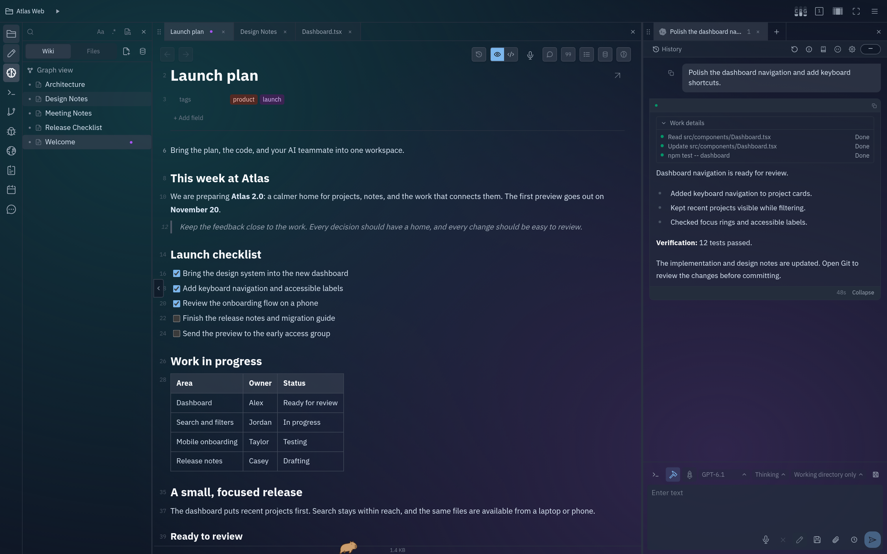
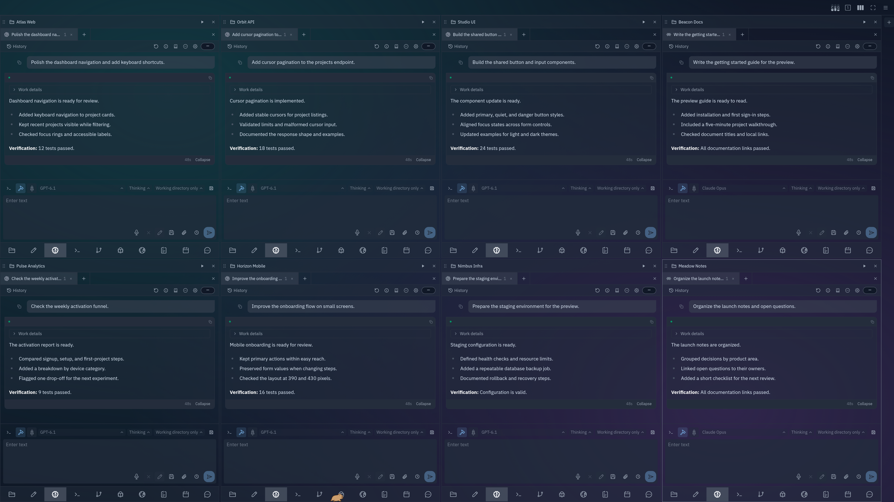
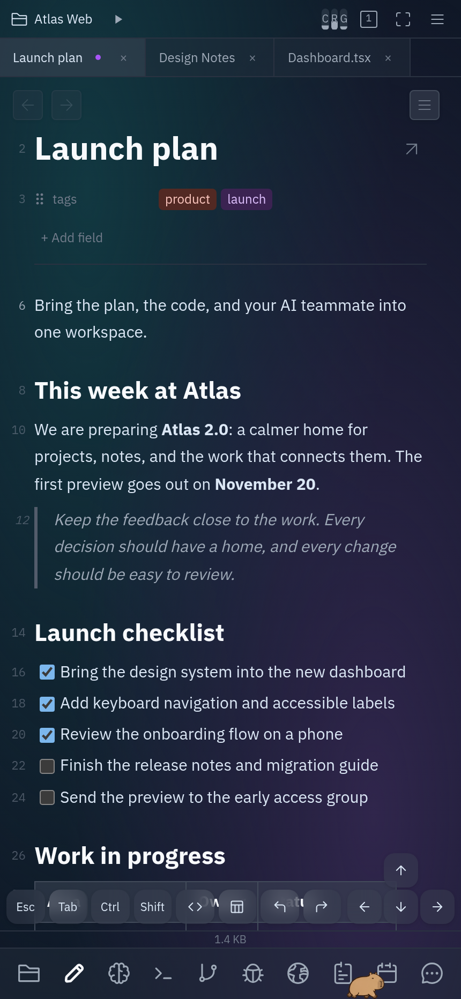
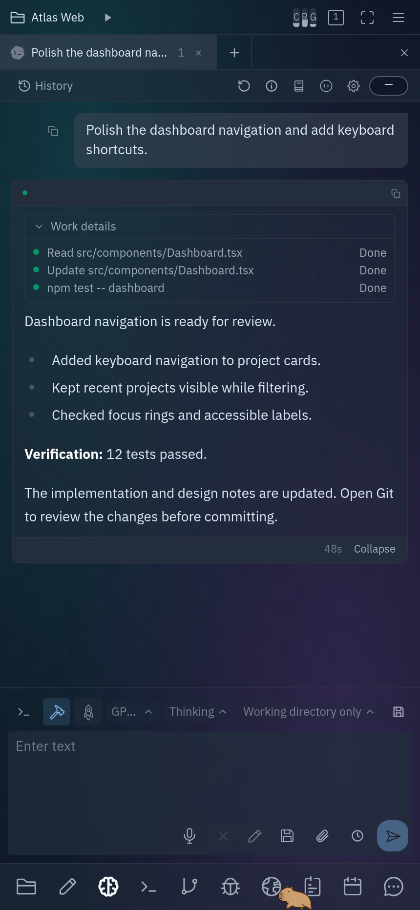

# mew : my easy workspace

**A browser workspace for your documents, code, and AI agents.**

Open a folder on your computer or server and work with it in your browser. Write Markdown, edit code, run AI agents, and review their changes in Git — with your files in the same place. Connect from your desktop or phone.

[Get started](#get-started) · [Screenshot tour](docs/guides/overview.md) · [User guides](docs/guides/MOC.md) · [Documentation](docs/README.md)



*Your project files, a working document, and an agent conversation in one workspace. All screenshots use English example data. [Take the full screenshot tour](docs/guides/overview.md).*

## What you can do

### Write documents next to your code

Edit Markdown as a rendered document or switch to its source. Use checklists, tables, links, and document properties; open code files in the same editor. Split the workspace to keep your notes beside the implementation. Content saves automatically to files in your folder.

[Document editing](docs/guides/editor.md) · [Projects and file search](docs/guides/projects.md)

### Run terminals and AI agents

Open a project terminal or an AI conversation from the dock. Configure your runtime, attach files, use skills and MCP tools, and return to saved conversations. Arrange panels around the work you are doing.

[Terminals and agents](docs/guides/terminal-agents.md) · [Runtime setup](docs/configuration/agent-runtimes.md)

Mew includes documentation skills for Korean, English, Japanese, and Simplified Chinese, plus a shared commit skill. Open **Skills management → Mew** in the agent panel to inspect them. [Skills and MCP](docs/configuration/agent-harness.md).

### Keep eight projects in view

Switch **Layout → Multi-project mode** to arrange independent project panels on one screen. Each project keeps its own files, tools, working directory, and conversations. Give every project an agent panel, or mix agents with documents and Git.



*Atlas Web, Orbit API, Studio UI, Beacon Docs, Pulse Analytics, Horizon Mobile, Nimbus Infra, and Meadow Notes, each with a separate agent conversation.*

[Multi-project controls](docs/guides/projects.md#desktop-workspace-modes)

### Review the work in Git

See changed files and commit history without leaving the workspace. Open a diff, check what an agent changed, and choose the files to commit. Autosave and Git commits are separate, so you decide when to record a change.

[Git workflow](docs/guides/projects.md#git-operations-panel)

### Work together, or connect from your phone

Edit documents together, leave comments, chat, and share documents with guests. Account roles and file permissions control access. On a phone, switch between the editor and tools with the bottom dock.

<p>
  
  
</p>

*Read the plan, then switch to the agent conversation from the same phone. Browser captures at a mobile viewport; see [capture details](docs/guides/overview.md#capture-details).*

[Collaboration and sharing](docs/guides/collaboration.md) · [Mobile controls](docs/guides/editor.md#mobile-and-fullscreen)

Also available: [PDF annotation](docs/guides/editor.md#reading-and-annotating-pdfs), [remote browser](docs/guides/browser.md), [Postgres tables](docs/guides/database.md), and [command buttons and schedules](docs/guides/commands.md). The prebuilt installer prepares local Postgres automatically; source installations can configure their own connection.

## Get started

Mew runs on **Linux or macOS**, including **WSL 2 on Windows**. Choose one installation route:

| Route | Run it from | Command |
| --- | --- | --- |
| 1. npm | A computer with Node.js 24 and npm; CMD or PowerShell on Windows | `npx mew-ide` |
| 2. curl | An existing WSL 2 Ubuntu terminal, Linux, or macOS | The one-line command below |
| 3. Source | A terminal with the [platform prerequisites](docs/guides/getting-started-en.md#install-from-source) | Clone the repository, then `./mew setup` |

**The npm package, curl installer release assets, and clean-platform acceptance are pending. Use source installation until publication.** [Release status](.mew/docs/operations/cli-release.md).

The curl route installs a private Node runtime and Mew without requiring npm or Git first:

```bash
curl -fsSL https://raw.githubusercontent.com/s-saens/mew/main/install.sh | bash
```

Both prebuilt routes prepare Postgres, use default settings, run Mew in the background, and register login startup. On Windows, npm prepares a dedicated WSL environment; curl runs inside the WSL distribution you already opened. The browser opens administrator creation, usually at `http://localhost:5000`. Browser prerequisites may require OS authorization. [Prebuilt installation details](docs/guides/getting-started-en.md#run-with-one-command-after-the-first-release).

For source installation, follow your [Windows / WSL 2](docs/guides/getting-started-en.md#windows-wsl-2), [macOS](docs/guides/getting-started-en.md#macos), or [Linux](docs/guides/getting-started-en.md#linux) prerequisites, then run:

```bash
git clone https://github.com/s-saens/mew.git
cd mew
./mew setup
```

Source setup installs dependencies, asks for configuration, then builds and starts Mew. Create the administrator account through the private setup link, or sign in with an existing account. Open **Add project** in the header's project selector to choose a working folder. [First-use walkthrough](docs/guides/first-steps.md).

> **Windows installer:** A separate single-file x64 wizard is implemented in source. Its first signed EXE and clean-Windows acceptance are pending. [Release status](.mew/docs/operations/cli-release.md#windows-installation-wizard).

## Open it from another device

[Mewlink](https://link.mew.run) helps another browser connect to your running mew instance. It handles device registration and connection setup; workspace data travels directly between the host and the connecting browser. You do not need your own domain or router port forwarding.

After creating the first administrator, Mew opens one popup with **Mewlink**, **Tailscale**, and **Cloudflare Tunnel**. Open **Menu → Mewlink** to return to the same choices later. Local installation requires no remote-service account; follow the selected provider's sign-in and setup steps when you want remote access.

1. On the host, sign in as owner and open **Menu → Mewlink → Register device**.
2. Follow the registration link, sign in to Mewlink, and choose your username and device name.
3. Open the displayed device address on another device, such as `https://link.mew.run/you/laptop`. Sign in with the host's **local mew email and password**. Opening this address does not require a Mewlink account.

Sign in at `https://link.mew.run/you` to see your registered devices. This dashboard is visible only to its account owner.

Keep the host awake, online, and running mew. Networks that block direct connections can prevent access. Mewlink registration and local mew sign-in are separate; connecting devices do not need registration.

[Remote access, account access, and alternatives](docs/guides/getting-started-en.md#remote-access) · [Connection validation scope](.mew/docs/development/remote-access.md#verification-and-remaining-gates)

## Documentation

| Topic | Start here |
| --- | --- |
| Open a folder, edit a document, and review changes | [First steps](docs/guides/first-steps.md) |
| Find a feature's everyday controls | [User guides](docs/guides/MOC.md) |
| Accounts, appearance, search, agents, skills, and MCP | [Configuration](docs/configuration/MOC.md) |
| Server installation, HTTPS, updates, and recovery | [Deployment](docs/deployment/_deployment.md) · [Operations](docs/operations/MOC.md) |
| Architecture, implementation contracts, and verification | [Development](.mew/docs/development/MOC.md) |
| Features, work records, research, and history | [Project knowledge](.mew/docs/AGENT.md) |

Project documentation is maintained in English. Earlier locale-specific guide paths are retained for existing links.

## Security

- Passwords use salted hashes. Login attempts are rate limited, and password changes invalidate existing password sessions.
- The server enforces file and feature permissions and rechecks active connections when access changes.
- Origin checks protect state-changing requests and browser WebSocket connections. Raw file views use sandboxing or separate origins.
- Workspace file APIs block access to server account data. Stored GitHub tokens are encrypted and removed when an account is deleted.

Terminal and agent access uses the server user's OS permissions. Read [Security](docs/operations/security.md) before sharing an instance.

## Development

Read the [development setup](docs/development/getting-started.md) before changing code. Agent work also follows the [repository execution rules](.mew/docs/development/getting-started.md).

Mew is an independent project. This repository owns its [agent instructions](AGENTS.md), [documentation rules](.mew/docs/README.md), and [decision records](.mew/docs/decisions/README.md).

```bash
npm ci
npm run dev     # Private development UI, port 4999
npx tsc -b      # Type checks
npm test
npm run lint
npm run check:docs
```

The server serves `dist/` directly, so a build changes the UI assets a running instance serves. The agent composer's [Build and Deploy selections](docs/guides/project-setup.md#build-verification) are explicit instructions for the submitted message and override older saved build/deploy requirements or prohibitions. Build on uses `npm run build` in this repository, with failure repair and rechecking; Build off skips that build. Deploy on authorizes the task's documented deployment after verification. Requests without selections retain the required-build default and do not authorize automatic deployment. Neither selection authorizes the launcher or server start, stop, or restart; those operations require a separate explicit request. Follow the [execution rules](.mew/docs/development/getting-started.md#execution-and-verification).

For documentation work, follow the [writing rules](.mew/docs/README.md); agents start at [.mew/docs/AGENT.md](.mew/docs/AGENT.md).

## License

[Mew Source Available License 1.0](LICENSE). Personal and internal business use, including paid work and private modifications, is permitted. Selling Mew or modified versions, or offering them as paid hosting or SaaS, requires a separate commercial license. Renaming or bundling Mew does not remove these restrictions. You retain the rights to your own documents, code, and other output.

The project owner retains commercial rights to code they own or are authorized to license. Third-party licenses and rights already granted for earlier MIT releases remain in effect. Mew is source-available with commercial restrictions. See the [license decision](.mew/docs/decisions/0053-source-available-license.md) for the scope and [contribution requirements](docs/development/contributing.md) before submitting changes.
