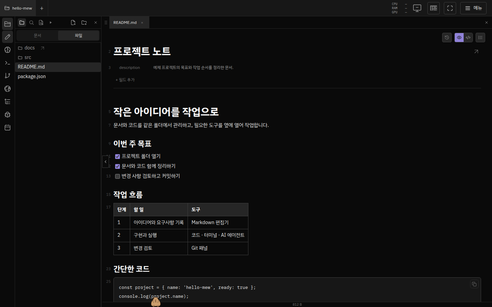

# Open your first project and document

Start with installation complete and logged in to mew. By the end of this guide, you will have created `notes.md` in your working folder and reviewed your changes. If you have not installed it yet, follow the [installation guide](getting-started-en.md).

## 1. Add your first project

With My projects empty, Mew shows only the top bar and the project panel. Click the **+** button below **Add a project** to open the setup popup. Choose **New project**, enter a name such as `hello-mew`, and click **Create project**. The Git icon inside the name field starts enabled; leave it on to track changes, or turn it off for a regular folder. Mew creates and opens the project without asking for a storage path.

The popup also offers these choices:

- **Git clone** accepts a public GitHub or GitLab HTTPS repository URL without an account connection. Connect GitHub here to select a repository your account can access, including authorized private and organization repositories. This is available before you open a project.
- **Import project** shows **From this workspace** and **Browse path** in the popup. The first lists registered projects; selecting one adds it to My projects and opens it. The second opens the server folder browser to link a folder without moving or copying its files.

The secondary **Create with agent** action is available when you want help defining and building a new project. It uses the normal agent conversation controls: select a configured runtime if needed, answer the agent's first questions, and let it document and implement the project. This option requires agent access. [Runtime setup](../configuration/agent-runtimes.md).

Creating, cloning, or linking registers the project with the **workspace** and adds it to your **My projects** shortcuts. Importing a workspace project adds your shortcut and opens it. The Dock and header project controls appear once you have a personal project. Other signed-in users can import the same project, subject to file permissions.

To return to a project, click its name in the header and choose it from My projects. Use **+ → Import project → From this workspace** to find projects added by other users. The back arrow returns one step within the popup. X, clicking outside, Esc, or browser Back closes it and returns focus to **+**; a nested folder browser closes first. A running project operation keeps the popup open. Removing a shortcut leaves the folder and workspace registration intact; removing the last one returns to the centered project panel. Nested Git/Mew projects appear beneath their actual parent. [Project management](projects.md#프로젝트-탭).

## 2. Distinguish files from Documents

Select a file from the project folder in **Files** on the left. **Documents** shows the Documents folder linked to that project. Both open in the same editor; switching views alone does not copy files.

If you have no Markdown files, click **New File** in the **Files** view. Enter a name including its extension, such as `notes.md`, and press Enter to create the file. If a folder is selected, the file is created inside it; if a file is selected, it is created in the same folder as that file. With no selection, it is created in the project root. To link an existing document folder, follow [Documents setup](project-setup.md).

## 3. Edit Markdown



Try writing a heading and checklist as follows.

```markdown
# 프로젝트 노트

## 할 일

- [ ] 요구사항 정리
- [ ] 첫 변경 검토
```

Edit the rendered content in **Hotview** and use the **Plain** button to view the Markdown source. Once saving is complete, open another file, then return to `notes.md` to confirm the content remains. Content is saved automatically; `Ctrl+S` commits the current file to Git. Before recording change history or reverting a file, review [save and restore behavior](editor.md#autosave-commits-and-file-history).

## 4. Open the tools you need

On a PC, click **Agents**, **Terminal**, **Git**, or other tools in the left dock. You can close tools or rearrange them, and dragging a document tab to the edge of an editor pane splits the screen. If the icon you want is missing, check the visibility settings in **Settings → Dock** and your account's feature permissions.

For AI agents, first complete [runtime installation and authentication](../configuration/agent-runtimes.md). Terminals and agents run with the permissions of the server's OS account. [Using the terminal](terminal-agents.md) · [Security and roles](../operations/security.md).

On a phone, use the bottom dock to switch the foreground panel. On narrow screens, select a document in the file list to move to the editor.

## 5. Review changes

If the project is a Git repository, click `notes.md` in the **Git** panel to review the diff. To record the changes in history, select the file's checkbox, click the commit icon, enter a title, and commit. Connect GitHub to your Mew account when making your first commit. Folders that are not Git repositories can also be used for document editing. [Git work panel](projects.md#git-operations-panel).

## Next steps

| What to do next | Guide |
| --- | --- |
| Connect from a phone or another computer | [External access with Mewlink](getting-started-ko.md#connect-remotely) |
| Link folders and configure default agent instructions | [Project setup](project-setup.md) |
| Work on documents with others | [Collaboration, comments, and sharing](collaboration.md) |
| Change search, theme, and account settings | [Settings home](../configuration/MOC.md) |
| Find instructions for a specific feature | [User guide home](MOC.md) |
