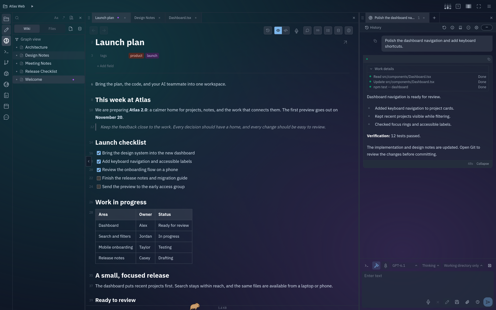
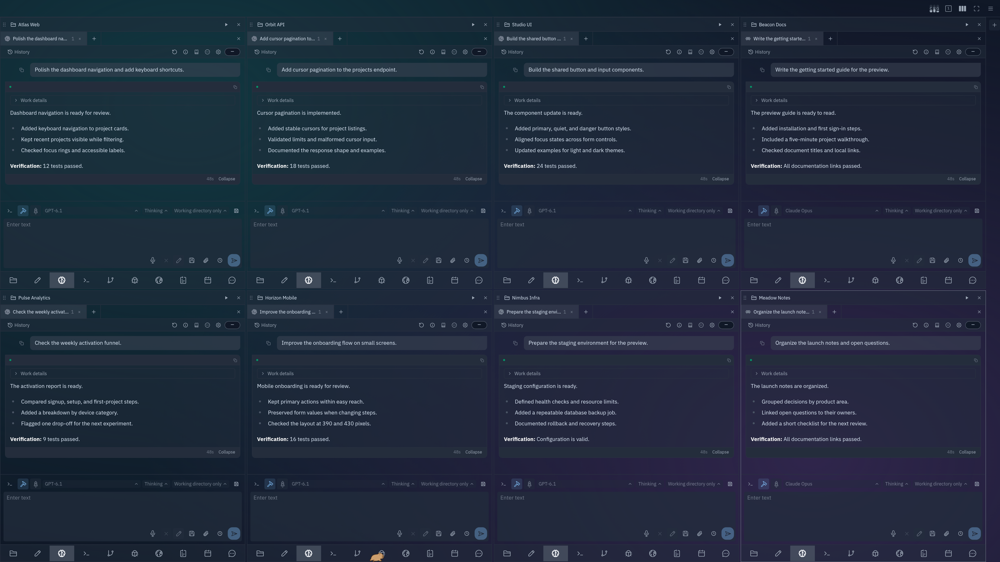
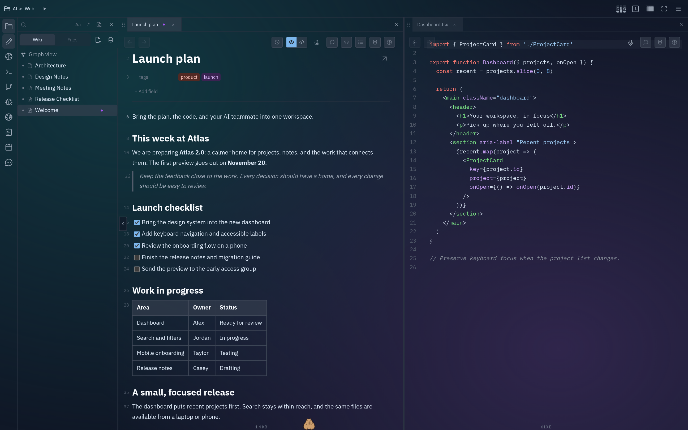
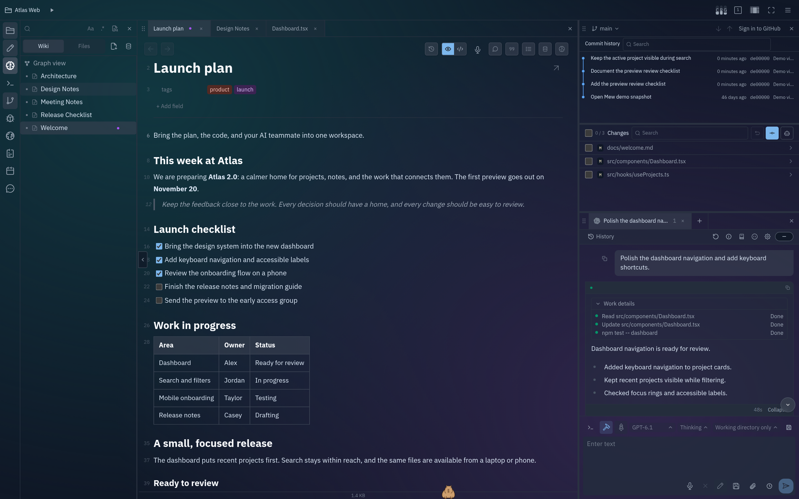
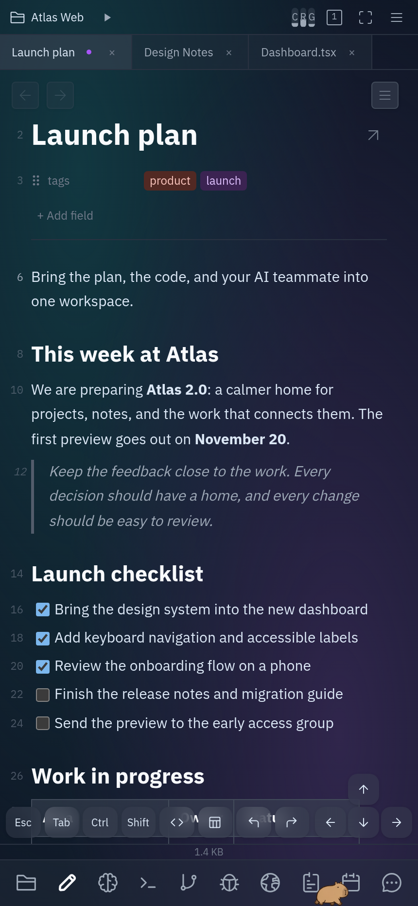
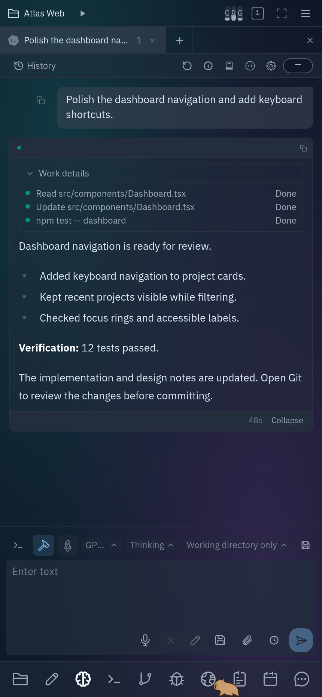

# Mew screenshot tour

Mew brings your files, documents, code, AI agents, and Git into a browser workspace. Start with one project, spread several projects across a desktop, or continue from your phone. These screens follow fictional projects with English example content.

[Install Mew](getting-started-en.md) · [Open your first project](first-steps.md) · [User guides](MOC.md)

## Start with one project

The default desktop layout keeps project navigation, the editor, and tools within reach. Select a file on the left, work in the center, and open an agent or another tool from the Dock. Here, Atlas Web's project notes and agent conversation share the screen.

Markdown opens in **Hotview**, where you edit headings, checklists, tables, and code blocks as they render. Switch to **Plain** to edit the source. Files save automatically; recording a Git commit remains a separate action. [Document editing](editor.md) · [Projects and files](projects.md).

## Follow eight projects at once

Use **Layout → Multi-project mode** when several projects need attention. This board shows eight projects, each with its own agent conversation: a web app, API, design system, documentation site, analytics service, mobile app, infrastructure, and personal notes.

Each project panel has its own Dock and tools. Add panels with **Add project panel**, move them with the six-dot handle, and resize their boundaries. Return to single-project mode when you want more room for one task. [Desktop workspace modes](projects.md#desktop-workspace-modes) · [Agent conversations](terminal-agents.md).

## Keep documents beside code

Drag a document tab to an editor pane's edge to split the view. Keep a requirement, checklist, or explanation beside the code it describes, then resize the panes to suit the task. Documents and source files use the same project folder. [Editor panes and split view](editor.md#editor-panes-document-tabs--split-view).

## Review changes before committing

Open **Git** from the Dock to inspect changed files and commit history. Select a changed file to open its diff, check an agent's work, and choose the files to include in a commit. The history shown here is fictional example data. [Git review and selective commits](projects.md#git-operations-panel).

## Continue from your phone

  
  

Read and edit the same files from a narrow screen. One panel fills the available space, and the bottom Dock switches between the editor, files, agents, and other tools.

Switch to **Agents** to review a conversation and send a follow-up from your phone. To connect to your host from another device, use **Menu → Mewlink → Register device** and open the resulting device address. The host must stay awake, online, and running Mew. [Remote access](getting-started-en.md#remote-access) · [Mobile controls](editor.md#mobile-and-fullscreen).

## Make the workspace yours

Choose a runtime in **Agents** to start a conversation after installing and authenticating it. Open **Skills management → Mew** to inspect the included documentation and commit skills. [Runtime setup](../configuration/agent-runtimes.md) · [Skills and MCP](../configuration/agent-harness.md) · [Agent instructions](project-setup.md).

These screens use **Midnight**, the default theme, and the built-in capybara **Mewpet**. Change fonts, theme, and Dock controls in settings. Click Mewpet for notifications, resource information, and its assistant controls. [Appearance](../configuration/appearance.md) · [Mewpet](../../.mew/docs/features/appearance-accounts-operations/mewpet-assistant-conversations-and-controls.md).

## Explore other workflows

| Task | Guide |
| --- | --- |
| Coedit documents, comment, chat, and share with guests | [Collaboration and sharing](collaboration.md) |
| Read and annotate a PDF | [PDF annotation](editor.md#reading-and-annotating-pdfs) |
| Use the host browser and login screens | [Browser](browser.md) |
| Add database tables to documents | [Postgres tables](database.md), which require a separate database connection |
| Run project commands and recurring tasks | [Commands and schedules](commands.md) |

## Get started

1. [Install Mew for your operating system](getting-started-en.md) and create the administrator account on a fresh installation.
2. [Open your first project and document](first-steps.md).
3. Find everyday controls in the [user guides](MOC.md) and implementation details in [project knowledge](../../.mew/docs/AGENT.md).

## Capture details

Captured on **2026-11-17** with Playwright Chromium in isolated browser contexts. The current shared Mew application UI was rendered offline with in-memory example projects, files, Git history, agent responses, and session data. All visible example content is in English. The conversations illustrate the interface; no live model requests or operating-system commands were run for them. No private accounts, files, conversations, or secrets are included.

| Screens | Browser viewport | Device scale factor |
| --- | --- | --- |
| Default desktop, split editor, Git | 1728 × 1080 | 1.5 |
| Eight-project board | 2560 × 1440 | 1.5 |
| Mobile document and agent | 430 × 932 | 2 |

Mobile captures use browser emulation, not a physical phone. These images document example layouts; they do not establish provider execution, remote connectivity, or physical-device compatibility. Layouts can vary with screen size, settings, and version.
