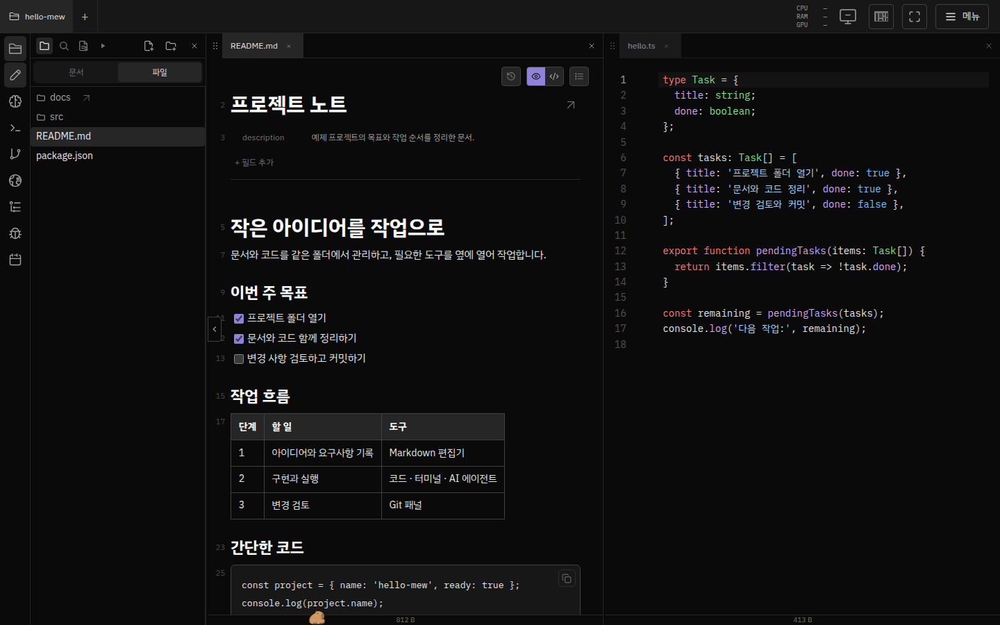
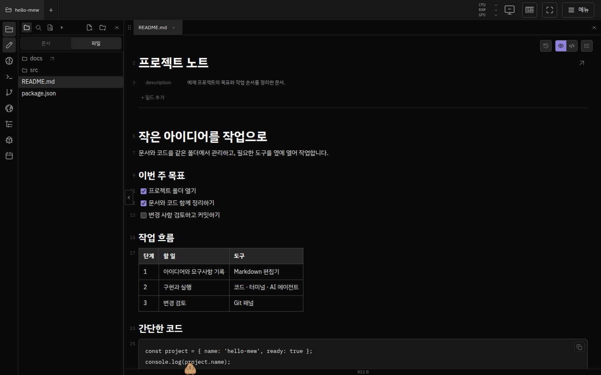

# Introduction to mew and a tour of the interface

**Turn a folder on your computer into a workspace in your browser.**

mew opens documents, code, terminals, AI agents, and Git on one screen. Keep files in a folder on your computer or server and work through your browser. It runs on Linux and macOS, and uses WSL 2 on Windows.

[Install](getting-started-ko.md) · [Open your first project](first-steps.md) · [Find usage instructions](MOC.md)

## Work on code while reading documents

Select project files on the left and open documents and code side by side. Drag a tab to the edge of an editor pane to split the screen. Open and arrange panels such as terminals, agents, and Git from the dock as needed.

Use this to write requirements in a document while checking the implementation beside it, or to review code and explanations together. [Split screens and tabs](editor.md#editor-panes-document-tabs--split-view) · [Terminals and agents](terminal-agents.md).

## Edit Markdown directly

**Hotview** lets you edit headings, checklists, tables, and code blocks as they render. YAML properties appear at the top of the document. You can also switch to source to edit Markdown syntax directly.

The document body is automatically saved to the file. Git commits are a separate action. Use document links and the Documents list to find and navigate to related files. [Editing, saving, PDF, and media guide](editor.md).

## Review Git changes

Open **Git** in the dock to view changed files and commit history for the current project. Open a changed file to see its diff in the editor, and select files to commit.

You can also use it to check which files changed after an AI agent finishes its work. [Git panel and selective commits](projects.md#git-operations-panel).

## Continue viewing on your phone

On a phone, one panel fills the screen, and the bottom dock switches between documents, files, agents, and other panels. Since you access the same project files, you can check work from your computer on your phone.

To connect from outside, complete **Menu → Mewlink → Remote access → Register device** in your local mew, then open the device address. The host must be on and mew must be running. [External access](getting-started-ko.md#connect-remotely) · [Mobile controls](editor.md#mobile-and-fullscreen).

## Configure agents and appearance

Select a runtime under **Agents** in the dock to start a conversation. The runtime must be installed and authenticated. You can view the default documentation and commit skills under **Manage Skills → Mew**. The default language for new documents follows the agent's response language setting. [Prepare runtimes](../configuration/agent-runtimes.md) · [Default skills](../configuration/agent-harness.md) · [Response language and instructions](project-setup.md).

The default theme in a new browser is Midnight. Change the theme, fonts, and dock in settings. Click the **Mewpet** at the bottom of the screen to check notifications and resource information, or connect an agent to open an assistant conversation. The screens in this document use the dark theme and built-in capybara Mewpet. [Appearance settings](../configuration/appearance.md) · [Mewpet assistant](<../../.mew/docs/features/appearance-accounts-operations/mewpet-assistant-conversations-and-controls.md>).

## Other things you can do

| What you want to do | Guide |
| --- | --- |
| Switch between folders and projects and find files | [Projects, files, and search](projects.md) |
| Connect AI runtimes and use conversations and terminals | [Terminals and agents](terminal-agents.md) · [Runtime settings](../configuration/agent-runtimes.md) |
| Coedit documents, comment, chat, and share with guests | [Collaboration and sharing](collaboration.md) |
| Use the login screen, localhost apps, or Android | [Login, localhost apps, and Android](browser.md) |
| Connect directly to your computer's screen | [Remote desktop](remote-desktop.md) — Requires component installation and OS permissions |
| Add database tables to documents | [Postgres tables](database.md) — Requires a separate database connection |
| Set up recurring commands and scheduled tasks | [Command buttons and scheduling](commands.md) |

## Get started

1. [Install for your operating system](getting-started-ko.md) and change the temporary password.
2. Follow the [First use guide](first-steps.md) to open folders and documents.
3. Find the features you need in the [Usage guide home](MOC.md) and implementation and operations materials in [Project knowledge](../../.mew/docs/MOC.md).

The screenshots were captured with Playwright from the running mew UI on 2026-10-15. They use the dark preset, which was the default at the time, and the built-in capybara Mewpet, with public example folders, documents, and Git history supplied through mock API responses in the browser. No real accounts, personal files, or conversations were included. Desktop images use a 1440 × 900 browser viewport, and mobile images use a 390 × 844 browser viewport; they were not captured on physical devices. The Git history in the images is an example for explaining features, not actual repository history. Layout may vary by screen size and version.
